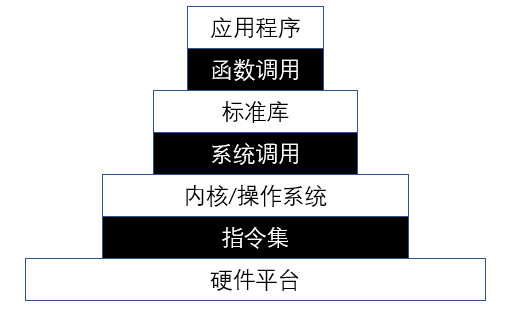
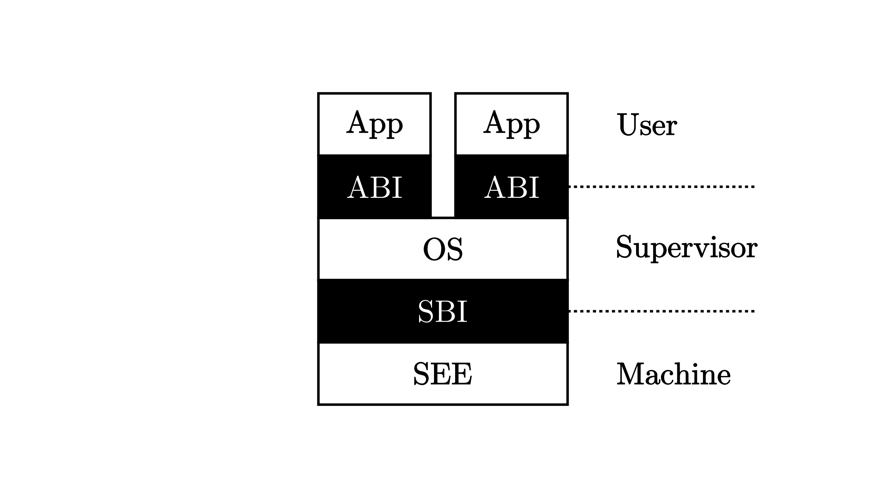
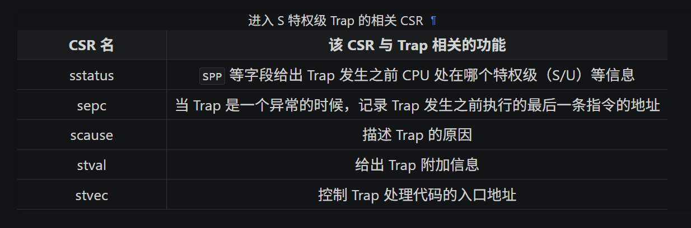
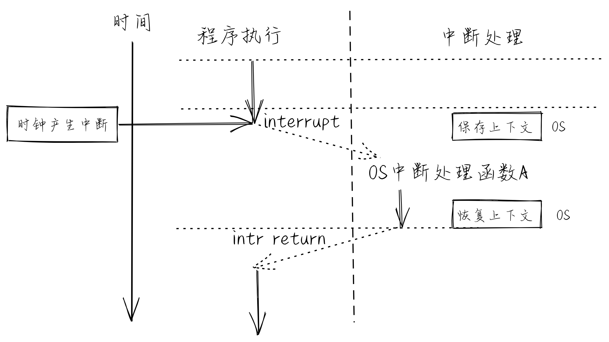
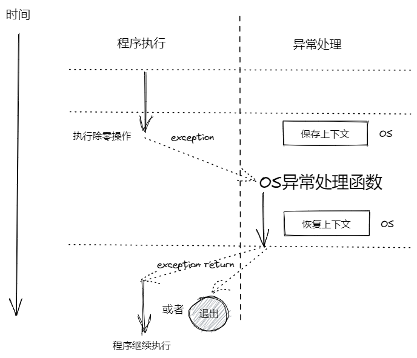
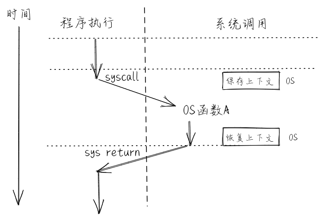

# 操作系统演进进程与体系框架
## 第一章实现LibOS：给应用提供各种服务（比如输出字符串）的库，方便了单一应用程序的开发与运行。
在现代通用操作系统（如 Linux）上运行应用程序，需要多层次的执行环境栈支持：


应用程序通过调用这些接口从而调用库等方法与函数，进而通过少量源代码实现功能。而其中这些所需的库就是这些源代码指令的**执行环境**

### 平台与目标三元组
编译器在编译、链接得到可执行文件时需要知道，程序要在哪个 平台 (Platform) 上运行，
而**目标三元组(Target Triplet)**则表述了所需的目标平台的*CPU 指令集*、*操作系统类型*和*标准运行时库*
我们查看我们的rust的hello world程序的目标三元组：

```
b1rd@BirD:~/programStudy/OS-rcore/rCore-Camp-Code-2026/os$ rustc --version --verbose
rustc 1.80.0-nightly (c987ad527 2024-05-01)
binary: rustc
commit-hash: c987ad527540e8f1565f57c31204bde33f63df76
commit-date: 2024-05-01
host: x86_64-unknown-linux-gnu
release: 1.80.0-nightly
LLVM version: 18.1.4
```

host代表我们的默认目标平台是 x86_64-unknown-linux-gnu， CPU 架构是 x86_64，CPU 厂商是 unknown，操作系统是 linux，运行时库是 gnu libc。

那么我们将程序放在**riscv64gc-unknown-none-elf**的目标平台上去运行，结果就会报错，提示我们没有std库。原因在于，我们的目标平台的操作系统是 ==none==,也就是裸机。而在这里是没有封装的std库供我们使用。
但rust还有一个**core**库可以供我们使用。这是一个不需要任何操作系统支持的库。而这个core库包含了相当多的rust核心机制。
那么我们需要做的，就是通过core而不是std来实现打印功能。
### 移除标准库依赖（将代码脱离原来的目标平台依赖）
#### 配置cargo默认属性
os目录下的.cargo目录实际上是在对cargo**编译器**进行环境变量的配置。在其下的config.toml我们输入以下指令：
```
# os/.cargo/config
[build]
target = "riscv64gc-unknown-none-elf"
```
使 cargo 工具在 os 目录下默认会使用 riscv64gc-unknown-none-elf 作为目标平台。 这种编译器运行的平台（x86_64）与可执行文件运行的目标平台不同的情况，称为 交叉编译 (Cross Compile)

#### 移除println!宏
==[详情代码见ch1的main.rs中的注释]==
#![no_std] ————告诉编译器不使用std库

#### 制作错误处理模块panic_handler
由于禁用std，相关的错误打印功能也被禁用。我们必须使用core来制作一个新的错误处理模块
新建一个子模块 lang_items.rs，在里面编写 panic 处理函数，通过标记 #[panic_handler] 告知编译器采用我们的实现。==[详情在ch1的src/lang_items.rs]==

#### 移除main函数
在std库执行main函数时，会需要进行初始化。这是通过start语义项进行的，但这在std库中。禁用了std库，也就没有了start语义，于是出现了报错。
在 main.rs的开头加入设置 #![no_main] 告诉编译器我们没有一般意义上的 main 函数， 并将原来的 main 函数删除。这样编译器也就不需要考虑初始化工作了。

--------
于是经过这系列操作，我们成功将代码从std依赖库中脱离出来能够编译成功
但是我们的代码只是符合能通过编译（不存在目标平台不存在的字段）的针对裸机的能在riscv目标平台的代码，但是编译出来的汇编指令是缺失的，因为我们缺少了编译器规定的入口函数 _start，编译器无法正常产出汇编。换句话说，编译器没有入口（在rust的std库中main承担了这个入口，这也是为什么我们的main函数需要调用start语义）

### 构建用户态执行环境
这里的任务是让编译器能够正常将代码转成目标平台的汇编指令，从而能够在目标平台能正常将我们的编译出来的文件能正确转换成汇编指令。
也就是让我们的应用程序能在用户态层面正常运行，兼容目标平台
>QEMU有两种运行模式：
>
>User mode 模式，即用户态模拟，如 qemu-riscv64 程序， 能够模拟不同处理器的用户态指令的执行，并可以直接解析ELF可执行文件， 加载运行那些为不同处理器编译的用户级Linux应用程序。
>
>System mode 模式，即系统态（内核态）模式，如 qemu-system-riscv64 程序， 能够模拟一个完整的基于不同CPU的硬件系统，包括处理器、内存及其他外部设备，支持运行完整的操作系统。

#### 用户态最小化执行环境
**执行环境初始化**
在main.rs增加_start入口函数定义，从而让编译器能够正常初始化这个文件并编译产出汇编。
为了让编译器能够正常运转，我们将start入口函数执行exit系统调用退出程序。来最简单的达成这个目的：
```rust
#[no_mangle]
extern "C" fn _start() { //将这个_start入口函数通过extern模块使其能被汇编调用。
    sys_exit(9);
}
```
于是这样我们完成了一个能够正常编译并产出汇编指令的程序。它的作用就是进入，然后退出，返回一个退出码：9

#### 有输入输出的用户态执行环境
Rust 的 core 库内建了以一系列帮助实现显示字符的基本 Trait 和数据结构，函数等，我们可以对其中的关键部分进行扩展，就可以实现定制的 println! 功能。

==============

封装一下对 SYSCALL_WRITE 系统调用。
```rust
const SYSCALL_WRITE: usize = 64;

pub fn sys_write(fd: usize, buffer: &[u8]) -> isize {
  syscall(SYSCALL_WRITE, [fd, buffer.as_ptr() as usize, buffer.len()])
}
```
然后为core中的某些关于显示字符的Trait完成需要的数据结构和实现，并依此创建println宏，完成终端输出。
[具体可看ch1的console.rs的注释]

### 将用户态执行环境的代码转移到内核态
但以上的程序，我们依旧是在应用层做操作（只有rust操作与应用程序）。没有涉及到更底层的内核层面。那么我们现在就是需要将代码搬到能在内核态（以裸机为执行环境）进行运行并操作内核。
#### 裸机启动过程
用qemu启动裸机的指令：
```
qemu-system-riscv64 \
            -machine virt \
            -nographic \
            -bios $(BOOTLOADER) \
            -device loader,file=$(KERNEL_BIN),addr=$(KERNEL_ENTRY_PA)
```
* -bios $(BOOTLOADER) 意味着硬件加载了一个 BootLoader 程序，即 RustSBI（我的是OpenSBI）

* -device loader,file=\$(KERNEL_BIN),addr=\$(KERNEL_ENTRY_PA) 表示硬件内存中的特定位置 \$(KERNEL_ENTRY_PA) 放置了操作系统的二进制代码 $(KERNEL_BIN) 。 \$(KERNEL_ENTRY_PA) 的值是 0x80200000 。

执行包含上述启动参数的 qemu-system-riscv64 软件，就意味给这台虚拟的 RISC-V64 计算机加电了。 此时，CPU 的其它通用寄存器清零，而 PC 会指向 0x1000 的位置，这里有固化在硬件中的一小段引导代码， 它会很快跳转到 0x80000000 的 RustSBI 处。 RustSBI完成硬件初始化后，会跳转到 \$(KERNEL_BIN) 所在内存位置 0x80200000 处， 执行操作系统的第一条指令。
>RustSBI 是什么？
>
>SBI 是 RISC-V 的一种底层规范，RustSBI 是它的一种实现。 操作系统内核与 RustSBI 的关系有点像应用与操作系统内核的关系，后者向前者提供一定的服务。只是SBI提供的服务很少， 比如关机，显示字符串等。

#### 实现关机功能
通过ecall调用SBI提供的关机功能以实现关机
[具体可见os/src/sbi.rs中]
```rust
// bootloader/rustsbi-qemu.bin 直接添加的SBI规范实现的二进制代码，给操作系统提供基本支持服务

// os/src/sbi.rs
fn sbi_call(which: usize, arg0: usize, arg1: usize, arg2: usize) -> usize {
 let mut ret;
  unsafe {
      core::arch::asm!(
          "ecall",
...

const SBI_SHUTDOWN: usize = 8;

pub fn shutdown() -> ! {
    sbi_call(SBI_SHUTDOWN, 0, 0, 0);
    panic!("It should shutdown!");
}

// os/src/main.rs
#[no_mangle]
extern "C" fn _start() {
    shutdown();
}
```
这里的代码说明，我们编译器在编译main代码时，从_start进入后直接调用sbi.rs模块中的shutdown函数以调用sbi接口关闭qemu系统。
但实际上，我们并没有关机，而是qemu占满进程，卡在qemu界面，未执行程序，也并未关机。因为我们执行开机qemu后，裸机cpu并未被引导到规定的内核程序的内存地址头0x80200000上访问，于是无法执行os目录中的指令并运行应用程序，更无法关闭通过程序调用sbi关机。

因此我们需要设置好程序的内存布局与栈空间
#### 设置内存布局
通过 链接脚本 (Linker Script) 调整链接器的行为，使得最终生成的可执行文件的内存布局符合我们的预期。
修改 Cargo 的配置文件来使用我们自己的链接脚本 [os/src/linker.ld]：
[详情可见.cargo/config.toml]
```
[target.riscv64gc-unknown-none-elf]
rustflags = [
    "-Clink-arg=-Tsrc/linker.ld", "-Cforce-frame-pointers=yes"
]
```

#### 正确布局栈空间内存
我们用一段汇编代码来初始化栈空间
[具体可从os/entry.asm中查看详情和具体指令]

然后我们在 main.rs 中嵌入这些汇编代码并声明应用入口 rust_main ：
[具体见ch1的main.rs中的注释]

#### 清空bss段落
我们在bss段落分配了一块栈内存，在程序成功退出后，我们需要清空它，然后再退出系统（shutdown()）
[具体可见ch1中的main.rs中的clear_bss()函数字段]

#### 添加裸机打印相关函数
在上一节中我们为用户态程序实现的 println 宏，略作修改即可用于本节的内核态操作系统。 详见 os/src/console.rs。

利用 println 宏，我们重写异常处理函数 panic，使其在 panic 时能打印错误发生的位置。 相关代码位于 os/src/lang_items.rs 中。

我们还使用第三方库 log 为你实现了日志模块，相关代码位于 os/src/logging.rs 中。


=====================================
-------

## 第二章实现批处理功能
批处理是指把一批作业（英文： Job ，古老的术语，可理解为现在的应用程序）以脱机方式（offline mode）输入到磁带上，并使这批作业能一个接一个地连续处理，流程如下：
* 将磁带上的一个作业装入内存；
* 操作系统把运行控制权交给该作业；
* 当该作业处理完成后，控制权被交还给操作系统；
* 重复 1-3 的步骤处理下一个作业直到所有作业处理完毕。

> 脱机方式：过去指无计算机参与完成的操作，比如打纸带，打印机打印等。现在指没有网络连接状态下的操作
> 联机方式：过去指计算机参与完成的操作，比如在计算机上编辑文档，编译程序等。现在指有网络连接状态下的操作

批处理操作系统分为**单道批处理系统**和**多道批处理系统**。
单道批处理操作系统：只能管理内存中的一个（道）作业，无法充分利用大型计算机系统中的所有资源，致使系统整体性能较差。
多道批处理操作系统：能管理内存中的多个（道）作业，可比较充分地利用计算机系统中的所有资源，提升系统整体性能。这里的“多道”是指多个程序，即允许同时把多个程序放入内存，并允许它们交替在 CPU 中运行（并发），它们共享系统中的各种硬、软件资源。当一个程序因 I/O 请求而暂停运行时， CPU 便立即转去运行另一个程序。
>批处理系统的出现，进一步要求程序间的隔离，否则会出现内存访问混乱造成一个作业出错而影响另一个作业。
>同时，批处理系统带来了另一个问题，人机交互性差，比如由于多道作业摆进队列中，用户无法及时知道作业的运行状态，甚至无法知道作业是否运行成功。

### 引论
批处理系统 (Batch System) 出现于计算资源匮乏的年代，其核心思想是： 将多个程序打包到一起输入计算机；当一个程序运行结束后，计算机会 自动 执行下一个程序。

应用程序难免会出错，如果一个程序的错误导致整个操作系统都无法运行，那就太糟糕了。 **保护** 操作系统不受出错程序破坏的机制被称为 **特权级 (Privilege)** 机制， 它实现了用户态和内核态的隔离。

引入了用户程序。为了将内核与应用解耦，我们将二者分成了两个仓库，分别是存放内核程序的 rCore-Tutorial-Code-20xxx （下称代码仓库，最后几位 x 表示学期）与存放用户程序的 rCore-Tutorial-Test-20xxx （下称测例仓库）（也就是我们本地的user目录）

### 特权级机制
为了保证os不受到出错程序应用的影响，我们需要应用到cpu架构中特权级机制来做硬件上的隔离保护支持。

#### 特权级的软硬件协同设计
在上一章，我们所实现了一个简单的libOS，也就是将OS功能通过各种库的方式来实现。但这样出现了一个值得注意的问题：==由于二者通过编译器形成一个单一执行程序来执行，导致即使是应用程序本身的问题，也会让操作系统受到连累，从而可能导致整个计算机系统都不可用==
于是，我们能否考虑，将os和应用程序解耦？也就是说**让相对安全可靠的操作系统运行在一个硬件保护的安全执行环境中**，不受到应用程序的破坏；而让**应用程序**运行**在**另外一个**无法破坏操作系统的受限执行环境中**。以此来达到隔离程序和os，当程序出错时os不会出现问题。
>为确保操作系统的安全，对应用程序而言，需要限制的主要有两个方面：
>
>* 应用程序不能访问任意的地址空间（这个在第四章会进一步讲解，本章不会涉及）
>* 应用程序不能执行某些可能破坏计算机系统的指令（本章的重点）

这样的实现依靠了我们将
接着，对于应用程序如果需要做更为底层的操作，那么就与os通信或者交互的方式（call），来特别获取许可。通过这样的方式，应用程序就被放在了与os隔离开的环境下运行，并且受到限制，而且必须依靠os（高特权级）作为执行环境的一部分才能够正常运行。
要实现这样的模式，就需要进行软硬件协同：

---
**硬件上**，处理器设置出两个不同的执行环境：用户态和内核态。前者对应的是应用程序所处的执行环境，后者则是对应内核程序的执行环境。
且**明确指出可能破坏计算机系统的内核态特权级指令子集**，规定内核态特权级指令子集中的指令**只能在内核态特权级的执行环境中执行**。处理器在执行指令前会进行特权级安全检查，如果在用户态执行环境中执行这些内核态特权级指令，会产生异常。
>为了让应用程序获得操作系统的函数服务，采用传统的函数调用方式（即通常的 call 和 ret 指令或指令组合）将会直接绕过硬件的特权级保护检查。为了解决这个问题， RISC-V 提供了新的机器指令：执行环境调用指令（Execution Environment Call，简称 ecall ）和一类执行环境返回（Execution Environment Return，简称 eret ）指令。其中：
>
>* ecall 具有用户态到内核态的执行环境切换能力的函数调用指令；
>* sret ：具有内核态到用户态的执行环境切换能力的函数返回指令。
---
**软件上**，还需要操作系统的配合才能最终完成对操作系统自身的保护。首先，操作系统需要提供相应的功能代码，**能在执行 sret 前准备和恢复用户态执行应用程序的上下文**。其次，在应用程序调用 **ecall 指令后，能够检查应用程序的系统调用参数，确保参数不会破坏操作系统。**

#### RISC-V特权级架构
| 级别 | 编码 | 名称 |
| :---: | :---: |:---:|
|0|00|用户/应用模式（U）|
|1|01|监管模式（S）|
|2|10|虚拟监督模式（H）|
|3|11|机器模式（M）|

我们从特权级的角度出发，来审视我们之前提出的执行环境层级架构：

其中白色块代表一层执行环境，而黑色块代表的是执行环境间的通信接口
其中，应用程序运行在U态，OS运行在S态，底层的SBI接口及更底层的硬件操作（*比如引导处理器的寄存器进行初始化然后载入操作系统的起始内存*）放在M态。从而将硬件和软件解耦，为自己的上层部分提供一个稳定安全的执行环境，互相隔离。
>值得注意的是，RISC-V的架构要能够正常运行，必须要实现的是M态，其他的态都可以根据CPU要完成的需求而按需实现其他特权级。

执行环境的另一种功能是对上层软件的执行进行监控管理。
>监控管理可以理解为，当上层软件执行的时候出现了一些异常或特殊情况，导致需要用到执行环境中提供的功能，因此需要暂停上层软件的执行，转而运行执行环境的代码。由于上层软件和执行环境被设计为运行在不同的特权级，这个过程也往往（而 不一定 ）伴随着 CPU 的 特权级切换 。当执行环境的代码运行结束后，我们需要回到上层软件暂停的位置继续执行。
>这种出现了执行环境的改变的控制流和常规控制流并不相同，被称为异常控制流。在RISCV中被称为**异常**，在RISCV中异常**属于Trap类型**。

### 应用程序设计
user目录树
```
user
|_src
    |_bin/*.rs      //各个应用程序
    |_*.rs          //用户库（包括入口函数、初始化函数、I/O函数和系统调用接口等）
    |_linker.ld     //应用程序的内存布局说明
```
#### 项目结构：
user/src/bin 里面有多个文件，其中三个是：

* hello_world：在屏幕上打印一行 Hello, world!
* bad_address：访问一个非法的物理地址，测试批处理系统是否会被该错误影响
* power：不断在计算操作和打印字符串操作之间切换

批处理系统会按照文件名顺序加载并运行它们

=====================================
[应用程序的具体实现和程序设计可以先后顺序看user目录下]
[ch2b_hello_world.rs]
[lib.rs(里面定义了_start函数入口)]

#### 内存布局
我们使用链接脚本 user/src/linker.ld 规定用户程序的内存布局：

将程序的起始物理地址调整为 0x80400000 ，三个应用程序都会被加载到这个物理地址上运行；

将 _start 所在的 .text.entry 放在整个程序的开头 0x80400000； 批处理系统在加载应用后，跳转到 0x80400000，就进入了==用户库==的 _start 函数；

提供了最终生成可执行文件的 .bss 段的起始和终止地址，方便 clear_bss 函数使用。

其余的部分和第一章基本相同。

#### 系统调用
在子模块 syscall 中我们来通过 ecall 调用批处理系统提供的接口， 由于应用程序运行在用户态（即 U 模式）， **ecall** 指令会**触发**名为 **Environment call from U-mode 的异常**， **并 Trap 进入 S 模式**执行批处理系统针对这个异常特别提供的服务程序。 这个接口被称为 ABI 或者系统调用。 **现在**我们不关心 S 态的批处理系统如何提供应用程序所需的功能，只考虑如何使用它。
实际调用时，我们要按照 RISC-V 调用规范，在合适的寄存器中放置参数， 然后执行 ecall 指令触发 Trap。当 Trap 结束，回到 U 模式后， 用户程序会从 ecall 的下一条指令继续执行，同时在合适的寄存器中读取返回值。
约定寄存器 a0~a6 保存系统调用的参数， a0 保存系统调用的返回值， 寄存器 a7 用来传递 syscall ID。 这超出了 Rust 语言的表达能力，我们需要内嵌汇编来完成参数/返回值绑定和 ecall 指令的插入
>*RISC-V 寄存器编号从 0~31 ，表示为 x0~x31 。 其中： - x10~x17 : 对应 a0~a7 - x1 ：对应 ra*

[具体见ch2的user目录下的syscall.rs]

>了解rust提供的asm!()宏内嵌汇编
>==todo!()==


然后我们将把syscall模块中定义好的系统调用接口继续在lib.rs库包中进一步包装。
[具体见ch2的lib.rs]

#### 编译生成应用程序二进制码
要介绍一下应用程序的构建，在 user 目录下 make build：

1. 对于 src/bin 下的每个应用程序， 在 target/riscv64gc-unknown-none-elf/release 目录下生成一个同名的 ELF 可执行文件；
2. 使用 objcopy 二进制工具删除所有 ELF header 和符号，得到 .bin 后缀的纯二进制镜像文件。 它们将被链接进内核，并**由内核在合适的时机加载到内存**。

### 实现批处理操作系统
我们要把应用程序的二进制镜像文件作为数据段链接到内核里， 内核需要知道应用程序的数量和它们的位置
因此我们引入了一段汇编代码，在 make run 构建操作系统时自动生成的

[具体见os/src/link_app.S]

通过这段汇编，我们实现了在内存里分配一块内存来存待办程序的起始内存地址，并且提供_num_app符号来找到这块地址
这个文件是在 cargo build 时，由脚本 os/build.rs 控制生成的

### 在内核程序中找到并加载应用程序
[详情可见ch2的os/batch.rs中关于App manager部分]
清空内存前，我们插入了一条奇怪的汇编指令 **fence.i ，它是用来清理 i-cache 的**。 
我们知道， **缓存又分成 数据缓存 (d-cache) 和 指令缓存 (i-cache) 两部分**，分别在 CPU 访存和取指的时候使用。 通常情况下， CPU 会认为程序的代码段不会发生变化，因此 i-cache 是一种只读缓存。 
但在这里，我们会修改会被 CPU 取指的内存区域，使得 i-cache 中含有与内存不一致的内容， 必须使用 fence.i 指令手动清空 i-cache ，让里面所有的内容全部失效， 才能够保证程序执行正确性。
> 注意：在我们用的qemu虚拟机中即使不清理i-cache也可能不报错，但是在物理裸机中则必定要报错

### 实现特权级切换
#### 特权级切换起因
批处理操作系统为了建立好应用程序的执行环境，需要在执行应用程序前进行一些初始化工作， 并监控应用程序的执行，具体体现在：

* 启动应用程序时，需要初始化应用程序的用户态上下文，并能切换到用户态执行应用程序；
* 应用程序发起系统调用后，需要切换到批处理操作系统中进行处理；
* 应用程序执行出错时，批处理操作系统要杀死该应用并加载运行下一个应用；
* 应用程序执行结束时，批处理操作系统要加载运行下一个应用。

这些处理都涉及到特权级切换，因此都需要硬件和操作系统协同提供的特权级切换机制。

#### 切换特权级相关的寄存器
仅考虑当 CPU 在 U 特权级运行用户程序的时候触发 Trap， 并切换到 S 特权级的批处理操作系统进行处理。

特权级切换的具体过程一部分由硬件直接完成，另一部分则需要由操作系统来实现。

#### 切换时硬件控制机制
CPU 执行完一条指令并准备从用户特权级 陷入（ Trap ）到 S 特权级的时候，硬件会自动完成如下这些事情：
* sstatus 的 SPP 字段会被修改为 CPU 当前的特权级（U/S）。
* sepc 会被修改为 Trap 处理完成后默认会执行的下一条指令的地址。
* scause/stval 分别会被修改成这次 Trap 的原因以及相关的附加信息。
* CPU 会跳转到 stvec 所设置的 Trap 处理入口地址，并将当前特权级设置为 S ，然后从Trap 处理入口地址处开始执行。

#### 用户栈和内核栈
在 Trap 触发的一瞬间， CPU 会切换到 S 特权级并跳转到 stvec 所指示的位置。 但是在正式进入 S 特权级的 Trap 处理之前，我们必须保存原控制流的寄存器状态，这一般通过栈来完成。 但我们需要用专门为操作系统准备的内核栈，而不是应用程序运行时用到的用户栈。
[具体见ch2的os/src/batch.rs]

#### Trap管理
**然后我们还要定义在trap时需要保存的上下文**：
[具体见ch2的os/src/trap/context.rs]
我们发现trapContext结构体字段里有通用寄存器和spec，status两种寄存器：
* 对于通用寄存器而言，两条控制流（应用程序控制流和内核控制流）运行在不同的特权级，所属的软件也可能由不同的编程语言编写，虽然在 Trap 控制流中只是会执行 Trap 处理 相关的代码，但依然可能直接或间接调用很多模块，因此很难甚至不可能找出哪些寄存器无需保存。既然如此我们就只能全部保存了。但这里也有一些例外， 如 x0 被硬编码为 0 ，它自然不会有变化；还有 tp(x4) 寄存器，除非我们手动出于一些特殊用途使用它，否则一般也不会被用到。虽然它们无需保存， 但我们仍然在 TrapContext 中为它们预留空间，主要是为了后续的实现方便。
* 对于 CSR 而言，我们知道进入 Trap 的时候，硬件会立即覆盖掉 scause/stval/sstatus/sepc 的全部或是其中一部分。scause/stval 的情况是：它总是在 Trap 处理的第一时间就被使用或者是在其他地方保存下来了，因此它没有被修改并造成不良影响的风险。 而对于 sstatus/sepc 而言，它们会在 Trap 处理的全程有意义（在 Trap 控制流最后 sret 的时候还用到了它们），而且确实会出现 Trap 嵌套的情况使得它们的值被覆盖掉。所以我们需要将它们也一起保存下来，并在 sret 之前恢复原样。

=================================
**Trap上下文的保存和恢复**
实现Trap上下文的保存和汇编代码
[详情见ch2的trap模块目录下的mod.rs查看具体声明和实现]

Trap 处理的总体流程如下：首先通过 __alltraps 将 Trap 上下文保存在内核栈上，然后跳转到使用 Rust 编写的 trap_handler 函数 完成 Trap 分发及处理。当 trap_handler 返回之后，使用 __restore 从保存在内核栈上的 Trap 上下文恢复寄存器。最后通过一条 sret 指令回到应用程序执行。
[在trap目录下的trap.S汇编代码中实现Trap上下文的保存和恢复]

>CSR 相关原子指令
>
>RISC-V 中读写 CSR 的指令是一类能不会被打断地完成多个读写操作的指令。这种不会被打断地完成多个操作的指令被称为 原子指令 (Atomic Instruction)。这里的 **原子 的含义是“不可分割的最小个体”，也就是说指令的多个操作要么都不完成，要么全部完成，而不会处于某种中间状态。**

==================================
**Trap的分发处理**
Trap 在使用 Rust 实现的 trap_handler 函数中完成分发
[具体在ch2的os/src/trap/mod.rs查看声明和实现]
而trap_handler函数只负责处理trap类型，而面对用户程序调用了系统调用接口syscall，那么就进一步调用os（内核态程序）目录下的syscall模块中的syscall函数，将需要的trap上下文传入进syscall函数，并让syscall进一步根据给的trap上下文（存在x17寄存器中的系统调用id）找具体的处理函数去处理对应的系统调用类型请求。
[syscall模块在os/src/syscall/mod.rs]
[syswrite系统调用实现在syscall/fs.rs子模块中]

#### 执行应用程序
当批处理操作系统初始化完成，或者是某个应用程序运行结束或出错的时候，我们要调用 run_next_app 函数切换到下一个应用程序。此时 CPU 运行在 S 特权级，而它希望能够切换到 U 特权级。在 RISC-V 架构中，唯一一种能够使得 CPU 特权级下降的方法就是通过 Trap 返回系列指令，比如 sret 
在运行应用程序之前要完成如下这些工作：

* 跳转到应用程序入口点 0x80400000；
* 将使用的栈切换到用户栈；
* 在 __alltraps 时我们要求 sscratch 指向内核栈，这个也需要在此时完成；
* 从 S 特权级切换到 U 特权级。

复用 __restore 的代码来更容易的实现上述工作。我们只需要在内核栈上压入一个为启动应用程序而特殊构造的 Trap 上下文，再通过 __restore 函数，就能 让这些寄存器到达启动应用程序所需要的上下文状态。
[具体初始化看ch2的os/src/trap/context.rs]
[而主要的run_next_app函数查看os/src/trap/context.rs]
>run next app函数简要流程概述：
>先向栈顶压入一个初始化的user上下文
>然后调用restore用这个结构体上下文来初始化user上下文，从而保证应用程序从0到1或者从上一个失效或结束的程序切割，供下一个程序使用上下文。

=====================================
----
## 第三章实现分时操作系统和多道批处理
分时:多个用户和多个程序以很小的时间间隔来共享使用同一台计算机上的 CPU 和其他硬件资源。
CTSS（Compatible Time-Sharing System， 兼容时间共享系统）操作系统 ，它拥有分时系统必须有的特征：支持多个用户分享使用同一台计算机，即宏观上的同一时间段内能完成多个人机交互工作。

本章目标是实现分时多任务系统，它能**并发**地执行多个用户程序，并调度这些程序。
为此需要实现：
* 一次性加载所有用户程序，减少任务切换开销；
* 支持任务切换机制，保存切换前后程序上下文；
* 支持程序主动放弃处理器，实现 yield 系统调用；
* 以时间片轮转算法调度用户程序，实现资源的时分复用。


### 多道程序放置和加载
**放置**
这步负责布局，安排好各个程序的内存布局。
在ch2中由于我们将所有的程序都只加载到一个起始地址（0x80400000），所以只能处理一个程序，其他程序在批处理通道等待。
要一次加载运行多个程序，就要求每个用户程序被内核加载到内存中的起始地址都不同。 为此，我们编写脚本 [user/build.py] 为每个应用定制各自的起始地址让其不再都放在同一个0x80400000起始地址加载。
这个脚本类似于我们之前用的链接器脚本，在这里是自动化链接将不同的.text代码段挂载到不同的对应的起始地址上。
>build.py 不是“另一个链接器脚本”，而是“给链接器传参”，让同一份链接器脚本在不同应用上产生不同的起始地址。
>这个py脚本代替人去向链接器输入对应指令自动化分配起始地址。

**加载**
这步负责执行，根据规划好的各个应用程序的内存起始地址，将二进制程序搬到对应的物理地址并执行。
第二章中负责应用加载和执行的**子模块 batch 被拆分为 loader（loaaApp函数） 和 task（run next app和初始化appmanager获取的批处理程序）** ， 前者负责启动时加载应用程序，后者负责切换和调度。
对于laoder部分，我们只需要对loadApp函数稍作修改，
[具体看ch3的os/batch.rs]

### 任务切换
即应用在运行中主动或被动地交出 CPU 的使用权，内核可以选择另一个程序继续执行。 内核需要保证用户程序两次运行期间，任务上下文（如寄存器、栈等）保持一致。
任务切换和之前的trap切换不同，
* 我们不需要涉及到特权级的切换，部分由编译器完成。
* 与trap切换相同，任务切换不需要依靠应用的配合而全程由内核完成操作。

>具体来说：任务切换实际上是一个应用trap到S态，其trap控制流由内核调用一个_switch函数来切换到另一个应用，__switch 返回之后，Trap 控制流将继续从调用该函数的位置继续向下执行。 而在调用 __switch 之后到返回前的这段时间里， 原 Trap 控制流 A 会先被暂停并被切换出去， CPU 转而运行另一个应用的 Trap 控制流 B 。 __switch 返回之后，原 Trap 控制流 A 才会从某一条 Trap 控制流 C 切换回来继续执行。

因此我们**在__switch函数中保存原任务的上下文**。
[具体看ch3的os/src/task/switch.S]
[TaskContext结构体具体字段声明看：os/src/task/context.rs]

### 管理多道程序
而内核为了管理任务，需要维护任务信息，相关内容包括：
* 任务运行状态：未初始化、准备执行、正在执行、已退出
* 任务控制块：维护任务状态和任务上下文
* 任务相关系统调用：程序主动暂停 sys_yield 和主动退出 sys_exit


=====================================
---
## 第四章实现Address Space OS
解决多个应用所在内存隔离的问题，从而确保应用之间不会相互破坏各自的内存空间，并进一步发展出地址空间、虚拟内存等操作系统核心概念。

## 第五章实现Process OS
解决多个应用灵活创建与执行的问题，发展出进程、调度等操作系统核心概念。

## 第六章实现Filesystem OS
解决数据持久保存的应用需求，并进一步提出文件的概念，并且把文件与地址空间作为进程的资源来进行管理，综合了操作系统三大核心概念。

## 第七章实现IPC OS
解决进程间的数据交换与信息通知的应用需求，并把部分IPC功能建立在文件的抽象之下，简化了应用开发的复杂性。

## 第八章实现Thread OS
线程作为处理器的调度单位，并成为进程资源管理的一部分内容。线程间通过共享进程的地址空间建立了线程间共享数据和进行数据交换的基础。

=====================

## 第九章实现Device OS
支持与新增的键盘、鼠标、GPU 等多种 Virtio 外设的交互，可以形成初级的人机交互 GUI 能力，而且支持在内核中响应中断来降低 I/O 响应的总体延迟。这在某种程度上体现了当前广泛使用的有图形界面的桌面/移动终端操作系统的基本特征。

------------------
# 操作系统的基本概念和知识体系
## 操作系统组成
操作系统的主要组成包括：
* 操作系统内核：操作系统的核心部分，负责控制计算机的硬件资源并为用户和应用程序提供服务。
* 系统工具和软件库：为操作系统提供基本功能的软件，包括工具软件和系统软件库等。
* 用户接口：是操作系统的外壳，是用户与操作系统交互的方式。用户接口包括图形用户界面（GUI）和命令行界面（CLI）等。

操作系统内核主要组成：
* 进程/线程管理：内核负责管理系统中的进程或线程，创建、销毁、调度和切换进程或线程。
* 内存管理：内核负责管理系统的内存，分配和回收内存空间，并保证进程之间的内存隔离。
* 文件系统：内核提供文件系统接口，负责管理存储设备上的文件和目录，并允许应用访问文件系统。
* 网络通信：内核提供网络通信接口，负责管理网络连接并允许应用进行网络通信。
* 设备驱动：内核提供设备驱动接口，负责管理硬件设备并允许应用和内核其他部分访问设备。
* 同步互斥：内核负责协调多个进程或线程之间对共享资源的访问。同步功能主要用于解决进程或线程之间的协作问题，互斥功能主要用于解决进程或线程之间的竞争问题。
* 系统调用接口（ABI）：内核提供给应用程序访问系统服务的入口，应用程序通过系统调用接口调用操作系统提供的服务，如文件系统、网络通信、进程管理等。

## 系统调用接口
### API和ABI
操作系统是一个为应用程序提供服务的系统软件。应用程序通过系统调用接口访问操作系统提供的服务，而用户通过应用软件简洁调用操作系统提供的服务。应用程序需要访问操作系统获得操作系统的服务，这就需要通过操作系统的接口才能完成。操作系统与运行在用户态软件之间的接口形式就是应用程序二进制接口 (ABI, Application Binary Interface)。
>底层硬件 ----> 操作系统内核 ----~通过API和ABI~----> 应用程序 ----> 用户接口
API：可以理解成应用程序上层的接口，通过API，程序能够调用操作系统提供的服务，并在编译后转为更底层的ABI接口，最终由操作系统内核提供服务。
>类比：API的表现形式在源码层面，调用的函数，库等，而ABI的表现形式是在二进制层面的。

==所以系统调用接口，实质上就是一系列与系统内核操作相关的接口。ABI，API不直接等同于系统调用接口；系统调用接口是直接与内核交互的接口，从属于API和ABI，是二者的某种组合==

## 操作系统抽象

### 执行环境
>负责给在其上执行的软件提供相应的功能与资源，并可在计算机系统中形成多层次的执行环境。

比如对于直接运行在裸机上的操作系统，其执行环境是计算机的硬件；
操作系统取代了函数库来访问硬件，函数库通过访问操作系统的系统调用服务来进一步给应用程序提供丰富的功能和资源，于是应用程序的执行环境就变成了 函数库 -> 操作系统内核 -> 计算机硬件 。我们发现，**随着计算机系统的发展，执行环境也相应变得复杂和多层次**

**执行环境切换**:CPU在执行过程中，可以在不同层次的执行环境之间切换。执行环境切换主要是通过特定的 API 或 ABI 来完成的，这样不同执行环境的软件就能实现数据交换与互操作，而且还保证了彼此之间有清晰的隔离。

### 控制流
**普通控制流**：将多个角度统合为一个角度下，普通控制流就是在同一个执行环境下的控制流。在其中按照规定的顺序平滑地执行指令。(CCF，Common Control Flow，简称 控制流) 
**异常控制流**：在特殊情况下，前后指令的执行环境发生了突变，即控制流脱离了其原本所在的执行环境，并产生 执行环境的切换。 我们把这种“突变”的控制流称为 异常控制流 (ECF, Exceptional Control Flow) 
==本质上ECF是在强调控制流“突变”这一现象，而不是指代某个具体的控制流。也就是说出现突变的控制流==

>简而言之，操作系统必须能够处理异常控制流，才能保证系统的稳定性和安全性。并简化应用程序的开发和运行。

### 控制流上下文（执行环境状态）
当cpu执行某条指令时，指令可以访问的物理资源内容（通用寄存器，可访问的内存等）随着指令的执行而逐渐发生了变化，以保证接下来的指令的正常运行。
所以我们把控制流的某条指令执行完时的物理资源条件（也是保证下一条指令能够运行的物理资源）称为控制流上下文。也被称为控制流所在的执行环境状态。
>控制流的上下文是特指会影响控制流==正确执行==的有限的物理/虚拟资源内容。这里需要理解程序中控制流的上下文对程序**正确**执行的影响。如果在程序正常运行的时候，控制流的上下文变化，但并不是由于程序本身的控制流的指令执行引起的，导致了运行偏差，那么被称为**程序执行错误**。==操作系统有责任来保护应用程序中控制流的上下文，以让应用程序得以正确执行。==
>
>==物理资源==：即计算机硬件资源，如CPU的寄存器、可访问的物理内存等。
>==虚拟资源==：即操作系统提供的资源，如文件，网络端口号，网络地址，信号等。

由此我们易知：控制流上下文是保证指令正常运行的前提。但如果是异常控制流，那么执行环境的突变就会带来上下文的突变，因此在更改上下文之前需要==对原上下文进行保存==，以确保突变处理后能够保持原有正常控制流的继续进行。

### 三种异常控制流现象

在操作系统中，需要处理三类异常控制流：外设中断 (Device Interrupt) 、陷入 (Trap) 和异常 (Exception，也称Fault Interrupt)。
#### 中断
外设 **中断** (Interrupt) 由外部设备引起的外部 I/O 事件如时钟中断、控制台中断等。外设中断是**异步**产生的，与处理器的执行无关。产生中断后，操作系统需要进行中断处理来响应中断请求，这会破坏被打断前应用程序的控制流上下文，所以操作系统要保存与恢复被打断前应用程序的控制流上下文。


#### 异常
异常（Exception）在处理器执行指令期间检测到不正常的或非法的内部事件（如 x86 平台上的除零错、地址访问越界）。产生异常后，操作系统需要进行异常处理，这会破坏被打断前应用程序的控制流上下文，所以操作系统要保存与恢复被打断前应用程序的控制流上下文。
>如果是应用程序产生的不可恢复的异常，操作系统有权直接终止该应用程序的执行。


#### 陷入
陷入（Trap） 是程序在执行过程中由于要通过系统调用**请求操作系统服务**而有意引发的事件。产生陷入后，操作系统需要执行系统调用服务来响应系统调用请求，这会破坏陷入前应用程序的控制流上下文，所以操作系统要保存与恢复陷入前应用程序的控制流上下文。
>在 RISC-V 的特权级规范文档中，异常指的是由于 CPU 当前指令执行而产生的异常控制流，中断指的是与 CPU 当前指令执行无关的异常控制流，中断和异常统称为陷入。当中断或异常触发时，我们首先进行统一的陷入处理流程，随即根据 mcause/scause 等寄存器的内容判定目前触发的是中断还是异常，再对应进行处理。在操作系统意义上的陷入，在 RISC-V 的语境下属于异常的一部分。另外，在 x86 架构下的“软件中断”（也即指令 int 0x80 ）可以理解为操作系统意义上的陷入，但在 RISC-V 语境下软件中断表示一种特殊的处理核间中断。



### 进程
可以把进程理解成一个任务，操作系统调度这个进程，就是在调度这个任务进行，并调配这个进程所需的**上下文**
一个**进程**是一个具有一定独立功能的程序在一个数据集合上的一次动态执行**过程**。操作系统中的进程管理需要采用某种调度策略将处理器资源分配给程序并在适当的时候回收，并且要尽可能充分利用处理器的硬件资源。

### 地址空间
地址空间 (Address Space) 是对**物理内存的虚拟化和抽象**，也称虚存 (Virtual Memory)。它就是操作系统通过处理器中的内存管理单元 (MMU, Memory Management Unit) 硬件的支持而给应用程序和用户提供一个大的（可能超过计算机中的物理内存容量）、连续的（连续的地址空间编址）、私有的（其他应用程序无法破坏）的存储空间。这需要操作系统将内存和外存（即持久存储，硬盘是一种典型的外存）结合起来管理，为用户提供一个容量比实际内存大得多的虚拟存储器，并且需要操作系统为应用程序分配内存空间，使用户**存放在内存中的程序和数据彼此隔离、互不侵扰**。操作系统中的虚存管理与处理器的 MMU 密切相关,在启动虚存机制后，软件通过 CPU 访问的每个虚拟地址都需要通过 CPU 中的 MMU 转换为一个物理地址来进行访问。

### 文件
文件 (File) 主要用于对持久存储的抽象，并进一步扩展到为外设的抽象。
文件管理的任务是有效地支持文件的存储、 检索和修改等操作。
文件的基本功能或者说特性：读写操作，长期存储
对于外设文件而言，在程序层面对外设文件读写操作，进而通过OS转进硬件的驱动，再通过驱动对这些操作转换为硬件的操作。在这个流程中，外设文件更像某种统一的接口。但是共享了文件操作的特征，从而利于OS操作各种形态各异的外设。

## 操作系统特征
虚拟化 (Virtualization)、并发性 (Concurrency)、异步性、共享性和持久性 (Persistency)

## 虚拟化
### 内存虚拟化
在编写程序时，将内存虚拟化为一块空间巨大，地址固定的虚拟内存供应用程序使用。保证了程序员在使用时不需要考虑其中存储的起始位置与物理存储类型。
>内存虚拟化 其实是一种 “空间虚拟化” ， 可进一步细分为 内存地址虚拟化 和 内存大小虚拟化 。这里的每个符号在运行时是要对应到具体的内存地址的。这些内存地址的具体数值是什么？程序员不用关心。为什么？因为编译器会自动帮我们把这些符号翻译成地址，形成可执行程序。程序使用的内存是否占得太大了？在一般情况下，程序员也不用关心。

地址虚拟化具体实现逻辑：
1. 编译器将程序设置了一个初始内存地址。而一切的程序中的变量，函数，指令等都是根据这个初始地址进行偏移获取，而在这个阶段，编译器和链接器等是并不知道具体所在的物理内存
2. 而这项任务就被转移到操作系统身上。在OS中，就必须要通过各种方式，在动态变化的物理内存中找到一块存储来提供给这个程序，映射成编译器所假设的初始地址，并对它维护，以保证程序的正常运行。同时，也保证了程序员能够调用，分配编译器所假设的虚拟地址。

空间虚拟化：
如果应用程序需要一定空间的内存，但由于在某些情况下，物理内存的空闲空间可能不多了，这时操作系统通过把物理内存中**最近没使用的空间**（不是空闲的，只是最近用得少）**换出（就是“挪地”）到硬盘上**暂时缓存起来，这样空闲空间就大了，就可以满足应用程序的运行时内存需求了，从而实现了 内存大小虚拟化 。

### cpu虚拟化
不同的应用程序可以在内存中**并发运行**，相同的应用程序也可有多个拷贝在内存中并发运行。而==每个程序都“认为”自己完全独占了 CPU 在运行==，这是 “CPU虚拟化”，也是一种 “时间虚拟化” 。操作系统给了运行的应用程序一个幻象，即操作系统把时间分成小段，每个应用程序占用其中一小段时间片运行，用完这一时间片后，操作系统会切换到另外一个应用程序，让它运行。由于时间片很短，操作系统的切换开销也很小，应用程序或使用应用程序的用户基本上是看不出的，反而感觉到多个程序各自在独立“并行”执行，从而实现了 CPU虚拟化 。

## 并发性
操作系统为了能够让 CPU 充分地忙起来，并充分利用各种资源，就需要有多种不同的应用程序在执行。这些==多种应用程序是分时执行的==，并由**操作系统**来**完成**各个应用在运行时的**任务切换**。并发性虽然能有效改善系统资源的利用率，但也带来了对共享资源的争夺问题，即同步互斥问题。还会带来执行时间的不确定性问题，即并发程序在执行中是走走停停，断续推进的，使得应用程序的完成时间是不确定的。并发性对操作系统的设计也带来了很多==挑战，一不小心就会出现程序执行结果不确定，程序死锁等很难调试和重现的问题。==

## 异步性
由于操作系统的调度和中断等，会不时地暂停或打断当前正在运行的程序，使得程序的整个运行过程走走停停。在应用程序运行的表现上，特别体现在它的执行完成时间是不可预测的。

## 共享性
多个应用并发运行时，**宏观上**体现出它们可**同时访问**同一个资源，即这个资源可被共享。
但其实在**微观上**，操作系统在硬件等的支持下要确保应用程序**互斥访问**这个共享的资源。
>在多核处理器下，多个 CPU 核可能同时访问同一内存单元，在这种多核场景下的共享性不仅仅由 OS 来保证，还需硬件级的 Cache 一致性保证。

## 持久性
操作系统提供了文件系统来**从可持久保存的存储介质**（磁盘， SSD 等，以后以硬盘来代表）中**取数据和代码到内存**中，并可以**把内存中的数据写回到硬盘**上。硬盘在这里是外设，具有持久性，以文件系统的形式呈现给应用程序。

>文件系统也可看成是操作系统对存储外设（如硬盘、SSD 等）的虚拟化。 这种持久性的特征进一步带来了共享属性，即在文件系统中的文件可以被多个运行的程序所访问，从而给应用程序之间实现数据共享提供了方便。即使掉电，存储外设上的数据还不会丢失，可以在下一次机器加电后提供给运行的程序使用。**持久性对操作系统的执行效率提出了挑战，如何让数据在高速的内存和慢速的硬盘间高效流动是需要操作系统考虑的问题。**


---------
# RISC-V架构前置知识