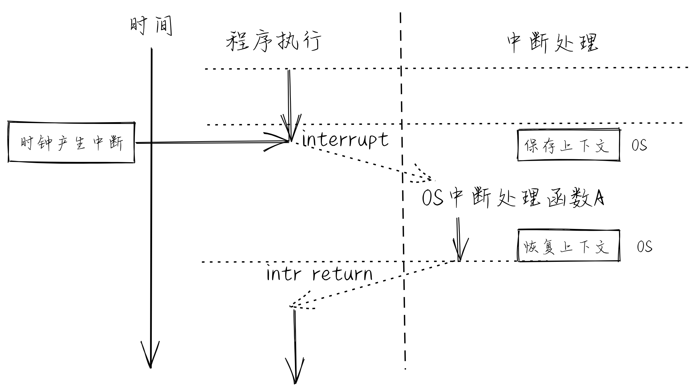
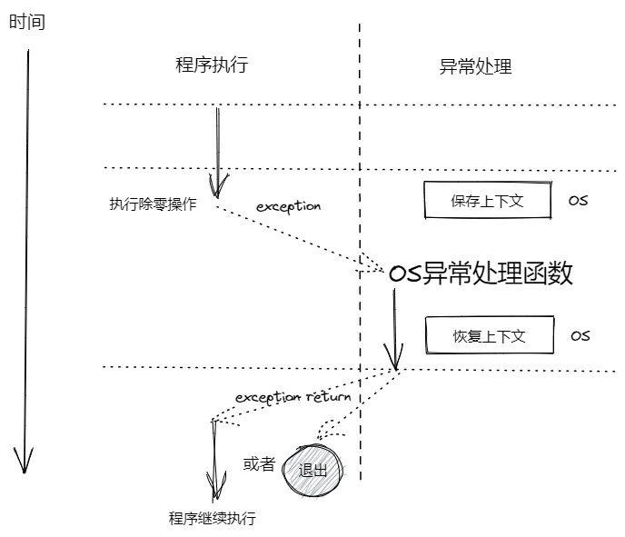
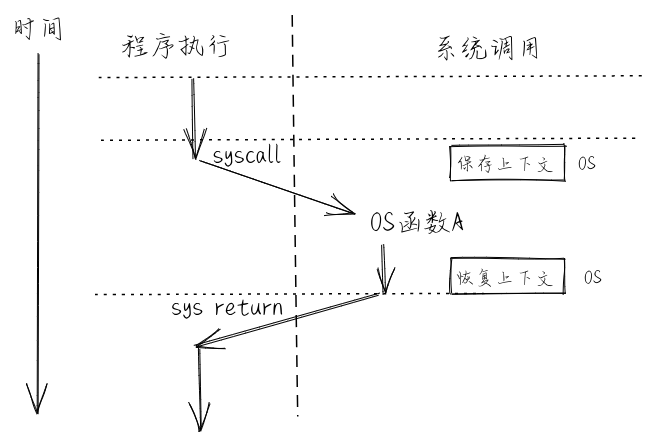

# 操作系统演进进程与体系框架
## 第一章实现LibOS：给应用提供各种服务（比如输出字符串）的库，方便了单一应用程序的开发与运行。
操作系统的主要组成包括：
* 操作系统内核：操作系统的核心部分，负责控制计算机的硬件资源并为用户和应用程序提供服务。
* 系统工具和软件库：为操作系统提供基本功能的软件，包括工具软件和系统软件库等。
* 用户接口：是操作系统的外壳，是用户与操作系统交互的方式。用户接口包括图形用户界面（GUI）和命令行界面（CLI）等。

操作系统内核主要组成：
* 进程/线程管理：内核负责管理系统中的进程或线程，创建、销毁、调度和切换进程或线程。
* 内存管理：内核负责管理系统的内存，分配和回收内存空间，并保证进程之间的内存隔离。
* 文件系统：内核提供文件系统接口，负责管理存储设备上的文件和目录，并允许应用访问文件系统。
* 网络通信：内核提供网络通信接口，负责管理网络连接并允许应用进行网络通信。
* 设备驱动：内核提供设备驱动接口，负责管理硬件设备并允许应用和内核其他部分访问设备。
* 同步互斥：内核负责协调多个进程或线程之间对共享资源的访问。同步功能主要用于解决进程或线程之间的协作问题，互斥功能主要用于解决进程或线程之间的竞争问题。
* 系统调用接口（ABI）：内核提供给应用程序访问系统服务的入口，应用程序通过系统调用接口调用操作系统提供的服务，如文件系统、网络通信、进程管理等。

=====================================
## 第二章实现批处理功能
批处理是指把一批作业（英文： Job ，古老的术语，可理解为现在的应用程序）以脱机方式（offline mode）输入到磁带上，并使这批作业能一个接一个地连续处理，流程如下：
* 将磁带上的一个作业装入内存；
* 操作系统把运行控制权交给该作业；
* 当该作业处理完成后，控制权被交还给操作系统；
* 重复 1-3 的步骤处理下一个作业直到所有作业处理完毕。

> 脱机方式：过去指无计算机参与完成的操作，比如打纸带，打印机打印等。现在指没有网络连接状态下的操作
> 联机方式：过去指计算机参与完成的操作，比如在计算机上编辑文档，编译程序等。现在指有网络连接状态下的操作

批处理操作系统分为**单道批处理系统**和**多道批处理系统**。
单道批处理操作系统：只能管理内存中的一个（道）作业，无法充分利用大型计算机系统中的所有资源，致使系统整体性能较差。
多道批处理操作系统：能管理内存中的多个（道）作业，可比较充分地利用计算机系统中的所有资源，提升系统整体性能。这里的“多道”是指多个程序，即允许同时把多个程序放入内存，并允许它们交替在 CPU 中运行（并发），它们共享系统中的各种硬、软件资源。当一个程序因 I/O 请求而暂停运行时， CPU 便立即转去运行另一个程序。
>批处理系统的出现，进一步要求程序间的隔离，否则会出现内存访问混乱造成一个作业出错而影响另一个作业。
>同时，批处理系统带来了另一个问题，人机交互性差，比如由于多道作业摆进队列中，用户无法及时知道作业的运行状态，甚至无法知道作业是否运行成功。

=====================================
## 第三章实现分时操作系统和多道批处理
分时:多个用户和多个程序以很小的时间间隔来共享使用同一台计算机上的 CPU 和其他硬件资源。
CTSS（Compatible Time-Sharing System， 兼容时间共享系统）操作系统 ，它拥有分时系统必须有的特征：支持多个用户分享使用同一台计算机，即宏观上的同一时间段内能完成多个人机交互工作。

## 第四章实现Address Space OS
解决多个应用所在内存隔离的问题，从而确保应用之间不会相互破坏各自的内存空间，并进一步发展出地址空间、虚拟内存等操作系统核心概念。

## 第五章实现Process OS
解决多个应用灵活创建与执行的问题，发展出进程、调度等操作系统核心概念。

## 第六章实现Filesystem OS
解决数据持久保存的应用需求，并进一步提出文件的概念，并且把文件与地址空间作为进程的资源来进行管理，综合了操作系统三大核心概念。

## 第七章实现IPC OS
解决进程间的数据交换与信息通知的应用需求，并把部分IPC功能建立在文件的抽象之下，简化了应用开发的复杂性。

## 第八章实现Thread OS
线程作为处理器的调度单位，并成为进程资源管理的一部分内容。线程间通过共享进程的地址空间建立了线程间共享数据和进行数据交换的基础。

=====================

## 第九章实现Device OS
支持与新增的键盘、鼠标、GPU 等多种 Virtio 外设的交互，可以形成初级的人机交互 GUI 能力，而且支持在内核中响应中断来降低 I/O 响应的总体延迟。这在某种程度上体现了当前广泛使用的有图形界面的桌面/移动终端操作系统的基本特征。

------------------
# 操作系统的基本概念和知识体系
## 系统调用接口
### API和ABI
操作系统是一个为应用程序提供服务的系统软件。应用程序通过系统调用接口访问操作系统提供的服务，而用户通过应用软件简洁调用操作系统提供的服务。应用程序需要访问操作系统获得操作系统的服务，这就需要通过操作系统的接口才能完成。操作系统与运行在用户态软件之间的接口形式就是应用程序二进制接口 (ABI, Application Binary Interface)。
>底层硬件 ----> 操作系统内核 ----~通过API和ABI~----> 应用程序 ----> 用户接口
API：可以理解成应用程序上层的接口，通过API，程序能够调用操作系统提供的服务，并在编译后转为更底层的ABI接口，最终由操作系统内核提供服务。
>类比：API的表现形式在源码层面，调用的函数，库等，而ABI的表现形式是在二进制层面的。

==所以系统调用接口，实质上就是一系列与系统内核操作相关的接口。ABI，API不直接等同于系统调用接口；系统调用接口是直接与内核交互的接口，从属于API和ABI，是二者的某种组合==

## 操作系统抽象

### 执行环境
>负责给在其上执行的软件提供相应的功能与资源，并可在计算机系统中形成多层次的执行环境。

比如对于直接运行在裸机上的操作系统，其执行环境是计算机的硬件；
操作系统取代了函数库来访问硬件，函数库通过访问操作系统的系统调用服务来进一步给应用程序提供丰富的功能和资源，于是应用程序的执行环境就变成了 函数库 -> 操作系统内核 -> 计算机硬件 。我们发现，**随着计算机系统的发展，执行环境也相应变得复杂和多层次**

**执行环境切换**:CPU在执行过程中，可以在不同层次的执行环境之间切换。执行环境切换主要是通过特定的 API 或 ABI 来完成的，这样不同执行环境的软件就能实现数据交换与互操作，而且还保证了彼此之间有清晰的隔离。

### 控制流
**普通控制流**：将多个角度统合为一个角度下，普通控制流就是在同一个执行环境下的控制流。在其中按照规定的顺序平滑地执行指令。(CCF，Common Control Flow，简称 控制流) 
**异常控制流**：在特殊情况下，前后指令的执行环境发生了突变，即控制流脱离了其原本所在的执行环境，并产生 执行环境的切换。 我们把这种“突变”的控制流称为 异常控制流 (ECF, Exceptional Control Flow) 
==本质上ECF是在强调控制流“突变”这一现象，而不是指代某个具体的控制流。也就是说出现突变的控制流==

>简而言之，操作系统必须能够处理异常控制流，才能保证系统的稳定性和安全性。并简化应用程序的开发和运行。

### 控制流上下文（执行环境状态）
当cpu执行某条指令时，指令可以访问的物理资源内容（通用寄存器，可访问的内存等）随着指令的执行而逐渐发生了变化，以保证接下来的指令的正常运行。
所以我们把控制流的某条指令执行完时的物理资源条件（也是保证下一条指令能够运行的物理资源）称为控制流上下文。也被称为控制流所在的执行环境状态。
>控制流的上下文是特指会影响控制流==正确执行==的有限的物理/虚拟资源内容。这里需要理解程序中控制流的上下文对程序**正确**执行的影响。如果在程序正常运行的时候，控制流的上下文变化，但并不是由于程序本身的控制流的指令执行引起的，导致了运行偏差，那么被称为**程序执行错误**。==操作系统有责任来保护应用程序中控制流的上下文，以让应用程序得以正确执行。==
>
>==物理资源==：即计算机硬件资源，如CPU的寄存器、可访问的物理内存等。
>==虚拟资源==：即操作系统提供的资源，如文件，网络端口号，网络地址，信号等。

由此我们易知：控制流上下文是保证指令正常运行的前提。但如果是异常控制流，那么执行环境的突变就会带来上下文的突变，因此在更改上下文之前需要==对原上下文进行保存==，以确保突变处理后能够保持原有正常控制流的继续进行。

### 三种异常控制流现象

在操作系统中，需要处理三类异常控制流：外设中断 (Device Interrupt) 、陷入 (Trap) 和异常 (Exception，也称Fault Interrupt)。
#### 中断
外设 **中断** (Interrupt) 由外部设备引起的外部 I/O 事件如时钟中断、控制台中断等。外设中断是**异步**产生的，与处理器的执行无关。产生中断后，操作系统需要进行中断处理来响应中断请求，这会破坏被打断前应用程序的控制流上下文，所以操作系统要保存与恢复被打断前应用程序的控制流上下文。

#### 异常
异常（Exception）在处理器执行指令期间检测到不正常的或非法的内部事件（如 x86 平台上的除零错、地址访问越界）。产生异常后，操作系统需要进行异常处理，这会破坏被打断前应用程序的控制流上下文，所以操作系统要保存与恢复被打断前应用程序的控制流上下文。
>如果是应用程序产生的不可恢复的异常，操作系统有权直接终止该应用程序的执行。

#### 陷入
陷入（Trap） 是程序在执行过程中由于要通过系统调用**请求操作系统服务**而有意引发的事件。产生陷入后，操作系统需要执行系统调用服务来响应系统调用请求，这会破坏陷入前应用程序的控制流上下文，所以操作系统要保存与恢复陷入前应用程序的控制流上下文。
>在 RISC-V 的特权级规范文档中，异常指的是由于 CPU 当前指令执行而产生的异常控制流，中断指的是与 CPU 当前指令执行无关的异常控制流，中断和异常统称为陷入。当中断或异常触发时，我们首先进行统一的陷入处理流程，随即根据 mcause/scause 等寄存器的内容判定目前触发的是中断还是异常，再对应进行处理。在操作系统意义上的陷入，在 RISC-V 的语境下属于异常的一部分。另外，在 x86 架构下的“软件中断”（也即指令 int 0x80 ）可以理解为操作系统意义上的陷入，但在 RISC-V 语境下软件中断表示一种特殊的处理核间中断。

### 进程
可以把进程理解成一个任务，操作系统调度这个进程，就是在调度这个任务进行，并调配这个进程所需的**上下文**
一个**进程**是一个具有一定独立功能的程序在一个数据集合上的一次动态执行**过程**。操作系统中的进程管理需要采用某种调度策略将处理器资源分配给程序并在适当的时候回收，并且要尽可能充分利用处理器的硬件资源。

### 地址空间
地址空间 (Address Space) 是对**物理内存的虚拟化和抽象**，也称虚存 (Virtual Memory)。它就是操作系统通过处理器中的内存管理单元 (MMU, Memory Management Unit) 硬件的支持而给应用程序和用户提供一个大的（可能超过计算机中的物理内存容量）、连续的（连续的地址空间编址）、私有的（其他应用程序无法破坏）的存储空间。这需要操作系统将内存和外存（即持久存储，硬盘是一种典型的外存）结合起来管理，为用户提供一个容量比实际内存大得多的虚拟存储器，并且需要操作系统为应用程序分配内存空间，使用户**存放在内存中的程序和数据彼此隔离、互不侵扰**。操作系统中的虚存管理与处理器的 MMU 密切相关,在启动虚存机制后，软件通过 CPU 访问的每个虚拟地址都需要通过 CPU 中的 MMU 转换为一个物理地址来进行访问。

### 文件
文件 (File) 主要用于对持久存储的抽象，并进一步扩展到为外设的抽象。
文件管理的任务是有效地支持文件的存储、 检索和修改等操作。
文件的基本功能或者说特性：读写操作，长期存储
对于外设文件而言，在程序层面对外设文件读写操作，进而通过OS转进硬件的驱动，再通过驱动对这些操作转换为硬件的操作。在这个流程中，外设文件更像某种统一的接口。但是共享了文件操作的特征，从而利于OS操作各种形态各异的外设。

---------
# RISC-V架构前置知识