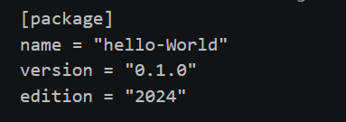
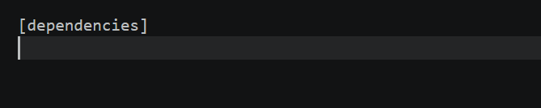
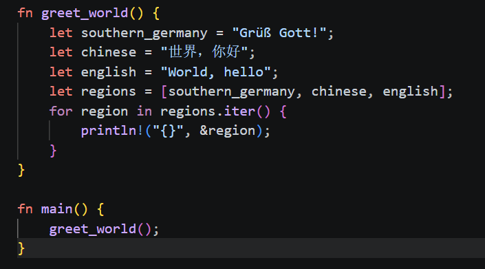
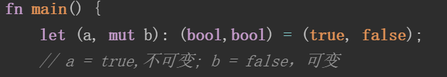
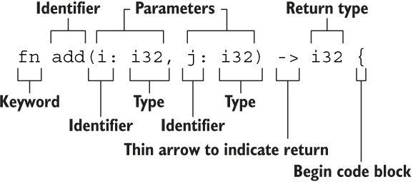
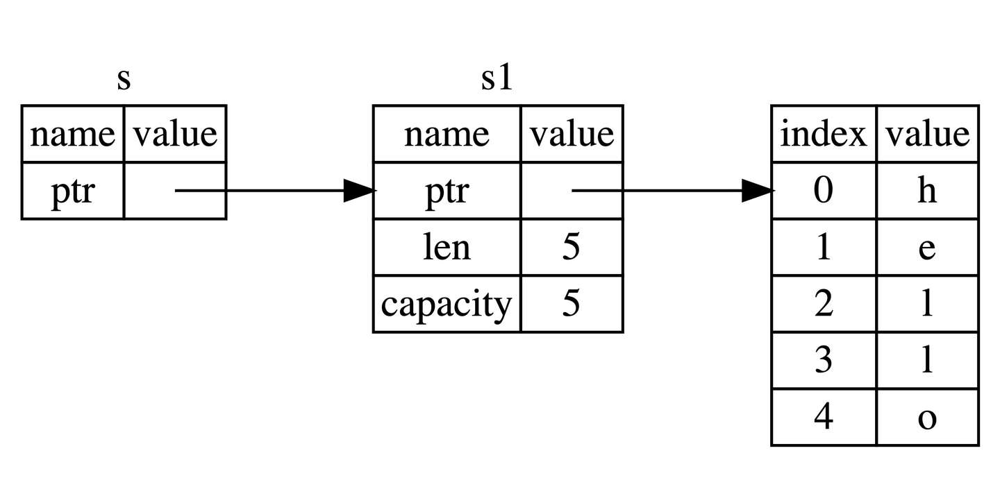
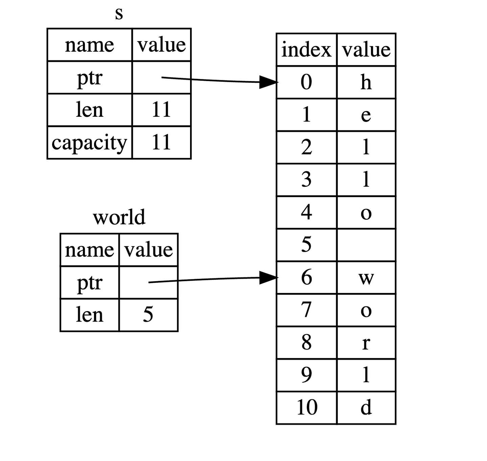
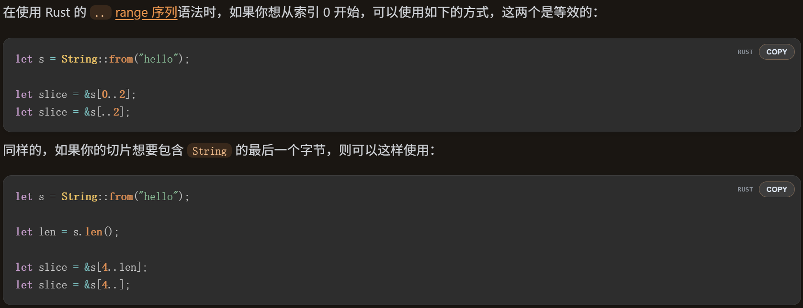
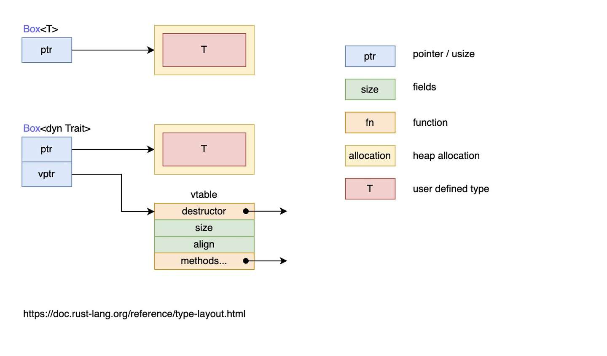

# rust指令学习
**建立项目：** cargo new \<project> ：创建一个rust项目名为project
**编译项目：** cargo build
**编译+执行当前所在项目：** cargo run
**检查代码能否编译通过：** cargo check

----
-------

# rust文件构成
## cargo.toml和cargo.lock
Cargo.toml 和 Cargo.lock 是 cargo 的核心文件，它的所有活动均基于此二者。

**Cargo.toml** 是 cargo 特有的项目数据描述文件。它存储了项目的所有元配置信息，如果 Rust 开发者希望 Rust 项目能够按照期望的方式进行构建、测试和运行，那么，必须按照合理的方式构建 Cargo.toml。

**Cargo.lock** 文件是 cargo 工具根据同一项目的 toml 文件生成的项目依赖详细清单，因此我们一般不用修改它，只需要对着 Cargo.toml 文件撸就行了。
>什么情况下该把 Cargo.lock 上传到 git 仓库里？很简单，当你的项目是一个可运行的程序时，就上传 Cargo.lock，如果是一个依赖库项目，那么请把它添加到 .gitignore 中。

## 详细解析cargo.toml
* ### package段落
  
    总体描述了项目相关信息
    * name定义项目名称
    * version定义当前版本
    * edition定义所用的rust大版本
* ### 定义项目依赖库（该项目需要的库文件）
  
  ==由于我们新创建的项目还没导入依赖库，所以这区域为空==

---
---

# rust语言语法学习
==编写所在区域：.rs文件==

## hello，World的示例

* println!()中的!表示宏操作符
* println!()内部的占位符是{}，会自动识别数据类型
* rust不支持直接循环，需要通过iter()方法变成迭代器进行循环
==但在最新的rust版本中可直接for region in regions{}，因为for隐式地将regions变为了迭代器==
* 控制流：for 和 continue 连在一起使用，实现循环控制。
* 方法语法：由于 Rust 没有继承，因此 Rust 不是传统意义上的面向对象语言，但是它却从 OO 语言那里偷师了方法的使用 record.trim()，record.split(',') 等。
* 高阶函数编程：函数可以作为参数也能作为返回值，例如 .map(|field| field.trim())，这里 map 方法中使用闭包函数作为参数，也可以称呼为 匿名函数、lambda 函数。
* 类型标注：if let Ok(length) = fields[1].parse::<f32>()，通过 ::<f32> 的使用，告诉编译器 length 是一个 f32 类型的浮点数。这种类型标注不是很常用，但是在编译器无法推断出你的数据类型时，就很有用了。
* 隐式返回：Rust 提供了 return 关键字用于函数返回，但是在很多时候，我们可以省略它。因为 Rust 是 基于表达式的语言。
---
## 变量
### 变量可分为可变变量和不可变变量
* **变量绑定（类似赋值）**：
    * let a = "hhhhh";
    ==这种变量绑定默认了该变量是不可变变量==
    * let mut a = "hhhhhh";
    ==变量a就声明为了可变变量==
    * let _a = "hhhhhh";
    ==告诉编译器我声明的这个变量a没被使用，但这有用，你不用警告==
* **变量解构**
    * 可用let指令进行变量解构 
    ==":"代表类型标注符号，说明左边的变量是右边的类型，当绑定的类型非常典型明确时可以不用==
* **常量和变量**
    * 常量代表从始至终都不可变
    * 常量必须用const声明，且必须标注类型
    >例如一个常量声明：const NUM:u32 = 100_000 
    >//声明常量NUM为u32类型，且值为100,000
* **变量遮蔽**
    * 同一个变量能够重复声明，但后面声明的变量会遮蔽前面的变量
    ```rust
    fn main() {
    let x = 5;
    // 在main函数的作用域内对之前的x进行遮蔽
    let x = x + 1;
    
    {
        // 在当前的花括号作用域内，对之前的x进行遮蔽
        let x = x * 2;
        println!("The value of x in the inner scope is: {}", x);
    }
    
    println!("The value of x is: {}", x);
    }
    ```
    所得到的输出：
    >    $ cargo run
    Compiling variables v0.1.0 (file:///projects/variables)
    ...
    The value of x in the inner scope is: 12
    The value of x is: 6

---
## 基本类型
### 类型推导与标注
  * rust能根据上下文进行推测该绑定的变量的类型，因此很多情况下不需要去声明所用变量的类型
  * 但有时无法推测时，就必须加入“:”来显式标注该变量的类型
### 数值类型
#### 整数类型

  ==rust整型默认使用i32，同时该类型也是性能最好的==
>* 整型溢出
    >假设有一个 u8 ，它可以存放从 0 到 255 的值。那么当你将其修改为范围之外的值，比如 256，则会发生整型溢出。关于这一行为 Rust 有一些有趣的规则：当在 debug 模式编译时，Rust 会检查整型溢出，若存在这些问题，则使程序在编译时 panic(崩溃,Rust 使用这个术语来表明程序因错误而退出)。
        >
        >在当使用 --release 参数进行 release 模式构建时，Rust 不检测溢出。相反，当检测到整型溢出时，Rust 会按照补码循环溢出（two’s complement wrapping）的规则处理。简而言之，大于该类型最大值的数值会被补码转换成该类型能够支持的对应数字的最小值。比如在 u8 的情况下，256 变成 0，257 变成 1，依此类推。程序不会 panic，但是该变量的值可能不是你期望的值。依赖这种默认行为的代码都应该被认为是错误的代码。

进制表达：默认十进制，八进制（前缀：0o），二进制（前缀：0b），十六进制（前缀：0x）
#### 浮点数类型
     
浮点类型数字 是带有小数点的数字，在 Rust 中浮点类型数字也有两种基本类型： f32 和 f64，分别为 32 位和 64 位大小。默认浮点类型是 f64，在现代的 CPU 中它的速度与 f32 几乎相同，但精度更高。

>* 浮点数陷阱
        >浮点数由于底层格式的特殊性，导致了如果在使用浮点数时不够谨慎，就可能造成危险，有两个原因：
        >浮点数往往是你想要数字的近似表达 浮点数类型是基于二进制实现的，但是我们想要计算的数字往往是基于十进制，例如 0.1 在二进制上并不存在精确的表达形式，但是在十进制上就存在。这种不匹配性导致一定的歧义性，更多的，虽然浮点数能代表真实的数值，但是由于底层格式问题，它往往受限于定长的浮点数精度，如果你想要表达完全精准的真实数字，只有使用无限精度的浮点数才行
        >浮点数在某些特性上是反直觉的 例如大家都会觉得浮点数可以进行比较，对吧？是的，它们确实可以使用 >，>= 等进行比较，但是在某些场景下，这种直觉上的比较特性反而会害了你。因为 f32 ， f64 上的比较运算实现的是 std::cmp::PartialEq 特征(类似其他语言的接口)，但是并没有实现 std::cmp::Eq 特征，但是后者在其它数值类型上都有定义

        
==为了避免上面说的两个陷阱，你需要遵守以下准则：1.避免在浮点数上测试相等性；2.当结果在数学上可能存在未定义时，需要格外的小心==


#### NaN
特殊的浮点数类型，表示不合法的数学处理（除以0，负数取平方根等）
* 任何与NaN的操作都会返回NaN，且无法用来比较，否则会崩溃（panic！）
* 可使用is_nan()方法来检测是否是NaN

#### 运算符
 * 支持所有的基本数字运算
 * 支持所有的位运算（和其他语言一样）==rust会检测所有移位运算后的数值是否超出类型确定的范围，如果是则报错“overflow”==

#### 序列
**一个简洁的表达式生成连续的数字**
* 例如1..5：生成1到4的连续数字 **（左开右闭区间）**
* 1..=5 ：生成1到5的连续数字 **（闭区间）**
==序列只能用于数字或字符类型==
这个表达经常用于循环中：
```rust
for i in 1..=5 {
    println!("{}",i);
}
```

#### 有理数和复数
有专门的库：num 提供

#### 类型转换
采用as关键词，用法示例：
```rust
fn main() {
    let v: u16 = 38_u8 as u16;
}
```

### 字符、布尔、单元类型
#### 字符（char）
一个字符固定占用4字节（utf-32）
#### 布尔（bool）
一个bool（false，true）占用1字节
#### 单元（（））
**==单元类型称为unit，表示就是一个()==**
()类型有且只有一个值(),比如f==main()函数的返回类型就是单元类型()==，所以main函数是有返回值的函数，而没有返回值的函数被称为发散函数。比如常见的==println()就是一个返回()的宏==
它可以代表是无所谓，无意义。比如在map中我们可以用()作为map的值，代表我们只关注key，而不关注值
占用字节0字节，不占内存，单纯占位

### 语句和表达式
==二者的概念需要明确分清，因为语句不会返回值，但表达式总是会==
#### 语句
```rust
let a = 8;
let b: Vec<f64> = Vec::new();
let (a, c) = ("hi", false);
```
以上是一些语句。因为他们==完成了具体的操作==，但是==没有返回值==
#### 表达式

完成求值，然后必定要返回值，那么就是表达式。表达式能成为语句的一部分。调用函数是表达式，调用有返回值的宏也是表达式，甚至一个花括号包起来的程序块也可以是一个表达式，例如这有段程序：
```rust
fn main() {
    let y = {
        let x = 3;
        x + 1
    };

    println!("The value of y is: {}", y);
}
```
当中的：
```rust
{
    let x = 3;
    x + 1
}
```
同样是一个表达式，因为x+1是一个表达式，它会返回一个值，所以最终y=4。
==但注意！表达式没有“;”来结尾，否则表达式将变成语句，也不会返回值。所以上述{}中的表达式就没有;以此来返回值==
**如果表达式不返回任何一个值，那么表达式将会返回一个单元类型()**

### 函数
函数声明构成：


#### 函数要点
* 函数名和变量名使用蛇形命名法(snake case)，例如 fn add_two() {}
* 函数的位置可以随便放，Rust 不关心我们在哪里定义了函数，只要有定义即可
* 每个函数参数都需要标注类型

#### 函数返回
##### 两种方式：
1. 最后一条表达式
2. return指令提前返回
示例：
```rust
fn plus_or_minus(x:i32) -> i32 {
    if x > 5 {
        return x - 5
    }

    x + 5
}
```
==注意：return作为表达式同样不加“;”同时return expr本身是表达式，可返回!（与返回！的表达式连用），但return作为语句（末尾加;）时由于return后不可达，编译器依旧会认为return后语句不可达，返回!==(如果直接return ; 则认为返回() )
##### 特殊返回类型
* 单元类型返回
    函数没有返回值则返回一个()
    以“;”结尾的语句返回一个()
#### 发散函数
永远不会有返回值的函数，以 ==！==作为声明函数时的返回值
```rust
//特别的，这种语法往往用做会导致程序崩溃的函数：
fn dead_end() -> ! {
  panic!("你已经到了穷途末路，崩溃吧！");
}

//该函数创建了一个无限循环，所以调用后永远不会有返回值
fn forever() -> ! {
  loop {
    //...
  };
}
```

---
## <u> *所有权和借用* （及其重要） </u>
用于完全避免程序不安全问题的rust特有特性

### 所有权

#### 所有权和堆栈
当你的代码调用一个函数时，传递给函数的参数（包括可能指向堆上数据的指针和函数的局部变量）依次被压入栈中，当函数调用结束时，这些值将被从栈中按照相反的顺序依次移除。

因为堆上的数据缺乏组织，因此跟踪这些数据何时分配和释放是非常重要的，否则堆上的数据将产生内存泄漏 —— 这些数据将永远无法被回收。这就是 Rust 所有权系统为我们提供的强大保障。

#### 所有权原则
> 1. rust中每一个值被一个变量拥有，该变量称为这个值的所有者
> 2. 一个值同时只能被一个变量所拥有，或者说一个值只能拥有一个所有者
> 3. 当所有者（变量）离开作用域范围时，这个值将被丢弃(drop)
==作用域的划定是依靠{}决定的，与c++的作用域类似==

#### 转移所有权（移动move）
1. 基本类型的绑定和赋值一般不会转移所有权，而是拷贝数据来赋值，操作和数据都在**栈**上完成和存储。由于是拷贝的方式完成，所以不会转移所有权（基本类型的拷贝非常快，对性能影响很小）
```rust
let x = 5;
let y = x;
```

2. 复杂类型的绑定和赋值由于存储复杂且较大，所以会在**堆**上存储和操作，因此rust不会自动采取拷贝的方式进行，而是转移所有权(移动)来保证性能。
==转移所有权是指拷贝string**本身(代表自身的指针的转移)** 给s2，而不是复制一个一模一样的另一个实例出来（克隆）。对于rust而言，再认为原来的s1失效了。于是表面上就像是<u>转移所有权</u>。（拷贝本身比克隆性能要快很多，因为只需要把对应的指针，和其他信息给新的变量，而不需要去复制一份新的一模一样的数据）==
本质实现上来说，移动就是先浅拷贝，然后删掉原变量。
```rust
let s1 = String::from("hello");
let s2 = s1;
```

3. 当所有权转移的时候同时可以转移可变性（mut）
```rust
fn main() {
    let s = String::from("hello, ");
    
    // 只修改下面这行代码 !
    let mut s1 = s;

    s1.push_str("world")
}
```

4. 部分 move
当解构一个变量时，可以同时使用 move 和引用模式绑定的方式。当这么做时，部分 move 就会发生：变量中一部分的所有权被转移给其它变量，而另一部分我们获取了它的引用。

在这种情况下，原变量将无法再被使用，但是它没有转移所有权的那一部分依然可以使用，也就是之前被引用的那部分。
```rust

fn main() {
    #[derive(Debug)]
    struct Person {
        name: String,
        age: Box<u8>,
    }

    let person = Person {
        name: String::from("Alice"),
        age: Box::new(20),
    };

    // 通过这种解构式模式匹配，person.name 的所有权被转移给新的变量 `name`
    // 但是，这里 `age` 变量却是对 person.age 的引用, 这里 ref 的使用相当于: let age = &person.age 
    let Person { name, ref age } = person;

    println!("The person's age is {}", age);

    println!("The person's name is {}", name);

    // Error! 原因是 person 的一部分已经被转移了所有权，因此我们无法再使用它
    //println!("The person struct is {:?}", person);

    // 虽然 `person` 作为一个整体无法再被使用，但是 `person.age` 依然可以使用
    println!("The person's age from person struct is {}", person.age);
}
```

#### 克隆（深拷贝）
克隆是指会同时复制指针等栈上的数据，也会复制指针等指到堆分配内存区域的数据
rust不会自动进行任何的克隆操作。如果要对复杂类型等本应该被移动的数据进行拷贝赋值，就必须使用**clone()** 方法
```rust
let s1 = String::from("hello");
let s2 = s1.clone();
```
==如果只在初始化等时候少量使用，那么能简化程序，但如果频繁使用将会导致代码性能下降==

#### 拷贝（浅拷贝）
拷贝只会复制栈上（也可能不止栈上）的指针等数据信息，而不会复制指针指向的堆上数据，性能很高（类比为基本类型的赋值时的复制而不移动）。因为这些拷贝的数据长度固定，内容固定，拷贝是很划算的。

>Rust 有一个叫做 Copy 的特征，可以用在类似整型这样在栈中存储的类型。如果一个类型拥有 Copy 特征，一个旧的变量在被赋值给其他变量后仍然可用，也就是赋值的过程即是拷贝的过程。

==对于有copy特征的类型的数据，使用clone()方法依旧表示的是浅拷贝。==（换句话说，这里没有深浅拷贝的区别，因此这里调用 clone 并不会与通常的浅拷贝有什么不同，我们可以不用管它（可以理解成在栈上做了深拷贝）。）

##### 有copy特征的类型
**基本上地**， 任何基本类型的组合可以 Copy ，不需要分配内存或某种形式资源的类型是可以 Copy 的。

>* 所有整数类型，比如 u32
>* 布尔类型，bool，它的值是 true 和 false
>* 所有浮点数类型，比如 f64
>* 字符类型，char
>* 元组，当且仅当其包含的类型也都是 Copy 的时候。比如，(i32, i32) 是 Copy 的，但 (i32, String) 就不是
>* 不可变引用 &T ，例如转移所有权中的最后一个例子，但是注意：可变引用 &mut T 是不可以 Copy的

#### 函数传参和返回值
将值传给函数同样会默认出现移动，将所有权转移给函数的变量。
```rust
fn main() {
    let s = String::from("hello");  // s 进入作用域

    takes_ownership(s);             // s 的值移动到函数里 ...
                                    // ... 所以到这里不再有效

    let x = 5;                      // x 进入作用域

    makes_copy(x);                  // x 应该移动函数里，
                                    // 但 i32 是 Copy 的，所以在后面可继续使用 x

} // 这里, x 先移出了作用域，然后是 s。但因为 s 的值已被移走，
  // 所以不会有特殊操作

fn takes_ownership(some_string: String) { // some_string 进入作用域
    println!("{}", some_string);
} // 这里，some_string 移出作用域并调用 `drop` 方法。占用的内存被释放

fn makes_copy(some_integer: i32) { // some_integer 进入作用域
    println!("{}", some_integer);
} // 这里，some_integer 移出作用域。不会有特殊操作
```

同样函数返回值也存在所有权和作用域

```rust
fn main() {
    let s1 = gives_ownership();         // gives_ownership 将返回值
                                        // 移给 s1

    let s2 = String::from("hello");     // s2 进入作用域

    let s3 = takes_and_gives_back(s2);  // s2 被移动到
                                        // takes_and_gives_back 中,
                                        // 它也将返回值移给 s3
} // 这里, s3 移出作用域并被丢弃。s2 也移出作用域，但已被移走，
  // 所以什么也不会发生。s1 移出作用域并被丢弃

fn gives_ownership() -> String {             // gives_ownership 将返回值移动给
                                             // 调用它的函数

    let some_string = String::from("hello"); // some_string 进入作用域.

    some_string                              // 返回 some_string 并移出给调用的函数
}

// takes_and_gives_back 将传入字符串并返回该值
fn takes_and_gives_back(a_string: String) -> String { // a_string 进入作用域

    a_string  // 返回 a_string 并移出给调用的函数
}
```

### 借用和引用
**获取变量的引用称为借用（borrowing）**
**借用**规则总览：
* 同一时刻，你只能拥有要么一个可变引用，要么任意多个不可变引用
* 引用必须总是有效的

在描述时，**引用**是描述类型，是名词（类型系统角度）；**借用**是描述行为，所有权暂时转移的行为，是动词（所有权系统角度）。
#### 引用和解引用
常规引用是一个指针类型
```rust
    let x = 5;
    let y = &x;

    assert_eq!(5, x);
    assert_eq!(5, *y);
```
所以要使用y引用的x，那么就要使用**解引用*y**来获取x的**值**（cpp的指针）。（在rust编译器中，有很多其他时候无需采用解引用，它会自动帮你隐式解引用）

#### 不可变引用
```rust
fn main() {
    let s1 = String::from("hello");

    let len = calculate_length(&s1);//引用类型依旧是指针，传进的依旧是地址

    println!("The length of '{}' is {}.", s1, len);
}

fn calculate_length(s: &String) -> usize {
    s.len()
}
```
其中 **&即为引用符号**，声明该变量（s）是引用类型变量，将s1的引用传给形式参数（s），而不是s1的所有权。
>引用原理：
>
==由于引用类型仅仅是一个指针指向了原本变量的指针，因此当走出作用域后，是这个引用类型（指针）变量失效并回收了，但原本的变量却不会受影响==

**但这种引用声明默认是不可变的，所以无法通过引用对值进行修改，只能访问。**

#### 可变引用
在声明**引用类型变量**和**原变量**前加一个**mut**（毕竟是要对原变量修改，所以要对原变量保证是mut）
```rust
fn main() {
    let mut s = String::from("hello");

    change(&mut s);//在此处依旧要注明变量是可变的。
}

fn change(some_string: &mut String) {
    some_string.push_str(", world");
}
```

##### 可变引用同时只能存在一个
**同一作用域，特定数据只能有一个可变引用**但能有多个不可变引用（这能避免数据竞争---一份数据被多个进程修改造成未定义行为，危险或崩溃）

==但通过手动设置{}作用域可能解决这个声明问题。==
```rust
let mut s = String::from("hello");

{
    let r1 = &mut s;

} // r1 在这里离开了作用域，所以我们完全可以创建一个新的引用

let r2 = &mut s;
```
##### 可变引用和不可变引用不能同时存在
毕竟当用户去借用变量不可变引用时，他肯定不想出现原变量数据污染或变化了。所以在**同一作用域下**，不可变引用和可变引用不能同时出现。
> ==注意，在**新版本**rust编译器中引用 r1,r2,r3 的作用域从创建开始，一直持续到它最后一次使用的地方 println!(....)，这个跟变量的作用域有所不同，变量的作用域从创建持续到某一个花括号}==
> ```rust
>fn main() {
>   let mut s = String::from("hello");
>
>    let r1 = &s;
>    let r2 = &s;
>    println!("{} and {}", r1, r2);
>    // 新编译器中，r1,r2作用域在这里结束
>
>    let r3 = &mut s;
>    println!("{}", r3);
>} // 老编译器中，r1、r2、r3作用域在这里结束
>  // 新编译器中，r3作用域在这里结束
> ```

##### 悬垂引用(Dangling References)
悬垂引用也叫做悬垂指针，意思为指针指向某个值后，这个值被释放掉了，而指针仍然存在，其指向的内存可能不存在任何值或已被其它变量重新使用。在 Rust 中编译器可以确保引用永远也不会变成悬垂状态：当你获取数据的引用后，编译器可以确保数据不会在引用结束前被释放，要想释放数据，必须先停止其引用的使用。（强制创建悬垂引用将报错）
>这是一个悬垂指针的出现：
```rust
fn main() {
    let reference_to_nothing = dangle();
}

fn dangle() -> &String {
    let s = String::from("hello");

    &s//返回一个地址想让main中的引用形成常规引用（指针）
}//但是过了这个作用域，返回的引用中指向的变量s已经销毁了
```

##### ref模式
与mut关键词是一类的，属于变量模式。ref代表声明该变量属于引用模式，所以变量绑定应当按照引用方式进行。
```rust
    let c = '中';
    let r1 = &c; //r1采用&符号来绑定c的内存
    let ref r2 = c;//r2通过ref模式来绑定c的内存
    assert_eq!(*r1, *r2);//两种表达等价，最后都会声明出一个指针或者rust里叫引用
```

---
## 复合类型
### 字符串（String）和切片（slice）
字符串类型：String
字符串切片类型：str，但这我们通常要当作&str来绑定给变量，因为str不能直接被绑定（牵扯到str和String以及&str的区别与联系）
#### 切片（slice）
它代表了是某个集合整体的一部分。而这种类型允许程序员去引用某个集合的某部分，而不是整个集合
```rust
let s = String::from("hello world");

let hello = &s[0..5];//这样的类似语法就是在绑定切片类型变量，
let world = &s[6..11];//[]内部填入的是半开半闭区间（..序列，而不是..=序列）
```

在切片内部存储了数据开始的指针和长度（与引用类似，所以&str中有&（确信））


**string切片的小技巧**


==注意！在对字符串使用切片语法时需要格外小心，切片的索引必须落在字符之间的边界位置，也就是 UTF-8 字符的边界，例如中文在 UTF-8 中占用三个字节，下面的代码就会崩溃：==
```rust
 let s = "中国人";
 let a = &s[0..2];
 println!("{}",a);
```
==因为我们只取 s 字符串的前两个字节，但是本例中每个汉字占用三个字节，因此没有落在边界处，也就是连 中 字都取不完整，此时程序会直接崩溃退出，如果改成 &s[0..3]，则可以正常通过编译。 因此，当你需要对字符串做切片索引操作时，需要格外小心这一点==

当然我们可以去做其他的切片，比如数组的切片等

当我们直接声明一个字符串（就是字符字面量，硬编码，不可更改的数据）时，实际上是声明了字符切片类型
```rust
let s="this is a &str";//等价：let s:&str=.....
let s:String = "this is the String!";
```

#### 字符串（String）
字符串是字符组成的连续集合
在rust中字符字面值一般默认为utf-32.**但字符串类型一般默认其数据按照utf-8存储**。这使得字符串类型当中每个字符所占的字节数是不固定的。(这样能降低String类型的内存空间)
在rust语言本身中，只有一种字符串类型：**str**（本质是一段utf-8的二进制数据，再被字面值用指针指向（&str类型）并被引用，这里对于数据和类型的区分很难详细阐述，总而言之可以暂时不理解str和&str和字面值之间的关系和区别），通常以&str引用类型出现。它是被硬编码的，无法修改的。而能被修改的是标准库提供的符合类型：**String**。

#### String和&str之间的互化
&str--->String:
* String::from("hello,world")
* "hello,world".to_string()

String--->&str:直接对String类型取引用（deref会隐式强制转换，之后了解）
```rust
fn main() {
    let s = String::from("hello,world!");
    say_hello(&s);
    say_hello(&s[..]);
    say_hello(s.as_str());
}

fn say_hello(s: &str) {
    println!("{}",s);
}
```

#### String类型不能访问索引！
因为底层是一个[u8]类型，采用的utf-8编码表示，这使得不同的字符使用的字节数是不一样的，那么索引去访问是不确定的（一个索引访问了一个字节，但编码时有可能时多个字节表示一个字符）

#### 操作字符串
##### 追加push()
字符串尾部可以使用 **push()** 方法追加**字符** char，也可以使用 **push_str()** 方法追加字符串字面量。这两个方法都是在原有的字符串上追加，并**不会返回**新的字符串。由于字符串追加操作要修改原来的字符串，则**该字符串必须是可变的**，即要修改字符串类型的字符串变量必须由 mut 关键字修饰。

##### 插入insert()
可以使用 insert() 方法插入单个字符 char，也可以使用 insert_str() 方法插入字符串字面量，与 push() 方法不同，这俩方法需要传入两个参数，第一个参数是字符（串）插入位置的索引，第二个参数是要插入的字符（串），索引从 0 开始计数，如果越界则会发生错误。由于字符串插入操作要修改原来的字符串，则该字符串必须是可变的，即字符串变量必须由 mut 关键字修饰。
```rust
fn main() {
    let mut s = String::from("Hello rust!");
    s.insert(5, ',');
    println!("插入字符 insert() -> {}", s);
    s.insert_str(6, " I like");
    println!("插入字符串 insert_str() -> {}", s);
}
```
==由于涉及到索引操作，所以依旧要注意这里索引是字节索引而不是字符索引！所以应当传入插入位置上一个字符的最后一个字节所在的索引==

##### 替换replace()
有三个方法：
###### replace(要被替换的字符串，用于替换的字符串)
适用于String类型和&str类型，这会替换所有匹配的字符串，并**返回一个新的字符串，而不是在原字符串上修改**

###### replacen(要被替换的字符串，用于替换的字符串，替换的个数)
适用于String类型和&str类型，与replace类似，但只会替换指定个数的字符串，并且同样**返回新的字符串**

###### replace_range(要替换的字符串范围，新的字符串)
**仅适用String类型**，且**在原字符串上进行操作，不会返回值！** ==需要原字符串变量为mut==
```rust
fn main() {
    let mut string_replace_range = String::from("I like rust!");
    string_replace_range.replace_range(7..8, "R");//替换第七个字节，半开半闭区间这一块
    dbg!(string_replace_range);
}
```

##### 删除delete()
###### pop()
**删除并返回字符串最后一个字符**，
该方法是直接操作原来的字符串。但是存在返回值，其返回值是一个 Option 类型，如果字符串为空，则返回 None

###### remove()
**删除指定位置并返回这个字符(char)**
该方法是直接操作原来的字符串。但是存在返回值，其返回值是删除位置的字符串，只接收一个参数，表示该字符起始索引位置。==remove() 方法是按照字节来处理字符串的，如果参数所给的位置不是合法的字符边界，则会发生错误。==
```rust
fn main() {
    let mut string_remove = String::from("测试remove方法");
    println!(
        "string_remove 占 {} 个字节",
        std::mem::size_of_val(string_remove.as_str())
    );
    // 删除第一个汉字
    string_remove.remove(0);
    // 下面代码会发生错误
    // string_remove.remove(1);
    // 直接删除第二个汉字
    // string_remove.remove(3);
    dbg!(string_remove);
}
```

###### truncate(要删除的启示字节索引)
**删除字符串中从指定位置开始到结尾的全部字符删除字符串中从指定位置开始到结尾的全部字符**
该方法是直接操作原来的字符串。无返回值。该方法 truncate() 方法是按照字节来处理字符串的，如果参数所给的位置不是合法的字符边界，则会发生错误。

###### clear()
**直接清除字符串，相当于truncate(0)**
直接操作原来字符串

##### 连接字符串
1. 使用 + 或者 += 连接字符串

使用 + 或者 += 连接字符串，要求**右边的参数必须为字符串的切片引用（Slice）类型**。其实当调用 + 的操作符时，相当于调用了 std::string 标准库中的 add() 方法，这里 add() 方法的第二个参数是一个引用的类型。因此我们在使用 + 时， 必须传递切片引用类型。不能直接传递 String 类型。==+== 是**返回一个新的字符串，所以变量声明可以不需要 mut 关键字修饰。**而 ==+=== 不是，+=是直接修改原字符串，所以需要mut模式

==所以我们可以连+==
```rust
let s1 = String::from("tic");
let s2 = String::from("tac");
let s3 = String::from("toe");

// String = String + &str + &str + &str + &str
let s = s1 + "-" + &s2 + "-" + &s3;
//由于采用了add（），所以s1所有权被转移了，然后又随着add结束被释放掉，
//因此这个语句后就没有s1变量了。这时调用s1会报错
```
2. format！()

format! 这种方式适用于 String 和 &str 。format! 的用法与 print! 的用法类似，调用宏后会返回一个String类型
```rust
fn main() {
    let s1 = "hello";
    let s2 = String::from("rust");
    let s = format!("{} {}!", s1, s2);
    println!("{}", s);
}
//输出：hello rust!
```

##### 操作utf-8字符串
1. 遍历字符串可用**chars()** 方法
```rust
for c in "中国人".chars() {                     
    println!("{}", c);                  
}                                       

/*输出：
中
国
人
*/
```
2. 字节**bytes()** 方法
返回字符串的底层字符字节数组
.png)

#### 字符串深度剖析
为啥 String 可变，而字符串字面值 str 却不可以？

就字符串字面值来说，我们在编译时就知道其内容，最终字面值文本被直接硬编码进可执行文件中，这使得字符串字面值快速且高效，这主要得益于字符串字面值的不可变性。不幸的是，我们不能为了获得这种性能，而把每一个在编译时大小未知的文本都放进内存中（你也做不到！），因为有的字符串是在程序运行的过程中动态生成的。

对于 String 类型，为了支持一个可变、可增长的文本片段，需要在堆上分配一块在编译时未知大小的内存来存放内容，这些都是在程序运行时完成的：

1. 首先向操作系统请求内存来存放 String 对象
2. 在使用完成后，将内存释放，归还给操作系统

重点来了，到了第二部分，就是百家齐放的环节，在有垃圾回收 GC 的语言中，GC 来负责标记并清除这些不再使用的内存对象，这个过程都是自动完成，无需开发者关心，非常简单好用；但是在无 GC 的语言中，需要开发者手动去释放这些内存对象，就像创建对象需要通过编写代码来完成一样，未能正确释放对象造成的后果简直不可估量。

对于 Rust 而言，安全和性能是写到骨子里的核心特性，如果使用 GC，那么会牺牲性能；如果使用手动管理内存，那么会牺牲安全，这该怎么办？为此，Rust 的开发者想出了一个无比惊艳的办法：变量在离开作用域后，就自动释放其占用的内存
与其它系统编程语言的 free 函数相同，Rust 也提供了一个释放内存的函数： drop，但是不同的是，其它语言要手动调用 free 来释放每一个变量占用的内存，而 Rust 则在变量离开作用域时，自动调用 drop 函数

### 元组
--声明：
```rust
fn main() {
    let tup: (i32, f64, u8) = (500, 6.4, 1); //该元组类型是（i32,f64,u8）
}
```

--访问元素：
```rust
fn main(){
    let (a,b,c)=tup; //使用let进行模式匹配来解构访问元组
    let (a,_,c)=tup; //_表示该位置不关心，仅占位，将a绑定500，c绑定1
    let (..,c)=tup; //表示忽略多余部分，将元组最后一个值1绑定给c
    tup.0;
    tup.1;
    tup.2;//使用.操作符进行访问
}
```

### 结构体
结构体跟之前讲过的元组有些相像：都是由多种类型组合而成。但是与元组不同的是，**结构体可以为内部的每个字段起一个富有含义的名称。**因此结构体更加灵活更加强大，你无需依赖这些字段的顺序来访问和解析它们。

* struct定义：
```rust
struct User {
    active: bool,
    username: String,
    email: String,
    sign_in_count: u64,
}
```

* 创建struct实例（好像类+构造函数！）：
```rust
    let user1 = User {
        email: String::from("someone@example.com"),
        username: String::from("someusername123"),
        active: true,
        sign_in_count: 1,
    };//有;是一个语句
```

**注意：**
1. 初始化实例时，每个字段都需要进行初始化
2. 初始化时的字段顺序不需要和结构体定义时的顺序一致

* 调用实例元素
和c++一致，用' .'调用元素
 ==注意，如果要修改实例元素，必须声明实例为mut==

* 结构体简化创建
```rust
fn build_user(email: String, username: String) -> User {
    User {
        email: email, //或者email，因为传入形式参数名称和原结构体元素名称一致
        username: username,//或者username
        active: true,
        sign_in_count: 1,
    }//没有;是表达式
}
``` 
它接收两个字符串参数： email 和 username，然后使用它们来创建一个 User 结构体，并且返回。
==注意这里分行末尾是,而不是;==
并且结构体表达式会返回一个结构体实例
**我们发现结构体内元素变量绑定所用符号是:而不是=，因为: 在 Rust 里表示“名字 → 值”的映射/绑定关系，而 = 表示“赋值给一个已存在的变量”。**

* 根据已有结构体创建新结构体
```rust
//常见方法，一一赋值字段
  let user2 = User {
        active: user1.active,
        username: user1.username,
        email: String::from("another@example.com"),
        sign_in_count: user1.sign_in_count,
    };

//省略写法：由于user2和user1只有email不一样，其他的都一样，可以用..省略符号
  let user2 = User {
        email: String::from("another@example.com"),
        ..user1 //必须在结构体尾部使用，才能将剩余未绑定的字段用user1的值来赋值
    };
```

==注意，根据已有实例创建新实例本质上还是变量绑定赋值，所以对于没有copy特征的变量，将会发生**所有权转移**==，所以user1内关于String类型的字段无法使用了，但其他的基本类型可以

#### 特殊结构体
* 元组结构体：结构体有名称，但是结构体内部的字段没有名称，长得像元组
```rust
    struct Color(i32, i32, i32);
    struct Point(i32, i32, i32);

    let black = Color(0, 0, 0);
    let origin = Point(0, 0, 0);
```
* 单元结构体：无字段属性，仅用来占位
```rust
struct AlwaysEqual;

let subject = AlwaysEqual;//赋值简单

// 我们不关心 AlwaysEqual 的字段数据，只关心它的行为，因此将它声明为单元结构体，然后再为它实现某个特征
impl SomeTrait for AlwaysEqual {

}
```
#### debug打印结构体信息
1. **采用#[derive(Debug)]提前在需要打印的对应结构体的上一行使用来标记代码为debug状态，然后可使用{:?}或{:#?}替代{}来打印结构体**
```rust
#[derive(Debug)]
struct Rectangle {
    width: u32,
    height: u32,
}

fn main() {
    let rect1 = Rectangle {
        width: 30,
        height: 50,
    };

    println!("rect1 is {:?}", rect1); //{:?}可换成{:#?}
}

/*输出信息
$ cargo run
rect1 is Rectangle { width: 30, height: 50 }

换成{:#?}的打印信息：
rect1 is Rectangle {
    width: 30,
    height: 50,
}
*/
```

2. dbg!宏
它会拿走表达式的所有权，然后打印出相应的文件名、行号等 debug 信息，当然还有我们需要的表达式的求值结果。除此之外，它最终还会把表达式值的所有权返回！

```rust
#[derive(Debug)]
struct Rectangle {
    width: u32,
    height: u32,
}

fn main() {
    let scale = 2;
    let rect1 = Rectangle {
        width: dbg!(30 * scale), //将值30*scale表达式返回的值传给了width
        height: 50,
    };

    dbg!(&rect1);
}

/*
输出信息：
$ cargo run
[src/main.rs:10] 30 * scale = 60
[src/main.rs:14] &rect1 = Rectangle {
    width: 60,
    height: 50,
}
*/
```

### 枚举（enum）（枚举类型，枚举值）
**枚举类型**是一个类型，它会包含所有可能的枚举成员，而**枚举值**是该类型中的具体某个成员的实例。
一个变量（或实例）只可能是枚举类型中的==一个==，但这些枚举值可能在某些方面或本质上是一样的，所以可以归纳进一个枚举类型里面：比如扑克牌四种花色就是一类枚举，各个花色是枚举值，而都属于扑克牌，所以可归纳进“扑克牌”这个枚举类型里面

#### 创建枚举类型与实例
```rust
enum PokerSuit {
  Clubs,
  Spades,
  Diamonds,
  Hearts,
}

let heart = PokerSuit::Hearts;
let diamond = PokerSuit::Diamonds; //通过::访问枚举类型的具体成员，创建实例
```

#### 定义函数使用枚举
```rust
fn main() {
    let heart = PokerSuit::Hearts;
    let diamond = PokerSuit::Diamonds;

    print_suit(heart); //虽然heart，diamond都属于枚举下的Hearts，Diamonds的实例，但是都属于PokerSuit枚举类型
    print_suit(diamond);
}

fn print_suit(card: PokerSuit) {
    // 需要在定义 enum PokerSuit 的上面添加上 #[derive(Debug)]，否则会报 card 没有实现 Debug
    println!("{:?}",card);
}
```

#### 为枚举值赋值
**结构体方式**（值和枚举值分开不做绑定，通过struct连接）
```rust
enum PokerSuit {
    Clubs,
    Spades,
    Diamonds,
    Hearts,
}

struct PokerCard {
    suit: PokerSuit,
    value: u8
}

fn main() {
   let c1 = PokerCard {
       suit: PokerSuit::Clubs,
       value: 1,
   };
   let c2 = PokerCard {
       suit: PokerSuit::Diamonds,
       value: 12,
   };
}
```

**枚举成员关联值**
```rust
enum PokerCard {
    Clubs(u8),
    Spades(u8),
    Diamonds(u8),
    Hearts(u8),
}

fn main() {
   let c1 = PokerCard::Spades(5);
   let c2 = PokerCard::Diamonds(13);
}//直接将值与枚举成员关联
```
**任何类型的数据都可以放入枚举成员中**
包括字符串，结构体,元组，甚至另一个枚举等复合类型
```rust
struct temp{
    //一堆东西
};

enum test{
    A(u8),
    B(i32,i32,i32),
    C(char),
    D(temp),

    StructTemp{x:i32,y:i32}, //结构体也可以进入枚举成为枚举成员，但是这种结构体属于枚举的变体即匿名结构体（必须用test::StructTemp调用），所以不需要struct关键词声明
}
```
这些东西我们本来可以分开分别定义或声明（通过结构体）。但那样我们就不能当作一样类型传入函数中，而必须进行函数重载。这种使代码简便的能力正是枚举的意义之一==（同一化类型，聚化代码）==

#### 枚举类型Option处理空值
Option 枚举包含两个成员，一个成员表示含有值：Some(T), 另一个表示没有值：None
```rust
enum Option<T> {
    Some(T), //T是泛型参数（类比stl库中的类型传入）
    None,
}
```
**=====================================================================**
Option\<T> 枚举是如此有用以至于它被包含在了 prelude（prelude 属于 Rust 标准库，Rust 会将最常用的类型、函数等提前引入其中，省得我们再手动引入）之中，==你不需要将其显式引入作用域。另外，它的成员 Some 和 None 也是如此，无需使用 Option:: 前缀就可直接使用 Some 和 None。==

```rust
//采用some可不用提前声明Option的类型，可直接通过关联的值判断
let some_number = Some(5);
let some_string = Some("a string");
//但None在使用前则必须声明该变量是哪个类型
let absent_number: Option<i32> = None;
```
##### 采用option的none替代NULL的优越性
因为Option<T> 和T并不是同一个类型，所以以下代码不能编译：
```rust
let x: i8 = 5;
let y: Option<i8> = Some(5);

let sum = x + y;//不能相加，Option<i8>和i8类型并不相同
```
所以要去使用这个option\<i8>，你必须去做一道显式转换才能得到i8类型，而这一步就会让编译器去检查这个值是否为空（因为当你使用option的时候，就是告诉编译器这些变量可能会有空的风险，你在担心这些变量是否为空），从而解决你期望某值不为空但却是空的问题。
==那么如何从Option::some类型中调取需要的值呢？去查文档，应对不同情况==

#### match结构控制

如果要处理none类型，我们一种简单应用是采用**match**模式匹配结构处理枚举（c++的switch）
```rust
fn plus_one(x: Option<i32>) -> Option<i32> {
    match x {
        None => None,
        Some(i) => Some(i + 1),
    }
}

let five = Some(5);
let six = plus_one(five);
let none = plus_one(None);
```

match结构主要作用就是用来匹配enum类型的成员来执行指令的（依旧参考switch）**表达式**（这是和switch最大的不同，也就是说match能返回值并绑定给变量）
```rust
    //作为表达式的例子（没声明x的enum）
    let result = match x {
    1 => "one",
    2 => "two",
    _ => "other",
    };
```
==============================================================================================
##### match的原则
```rust
enum Direction {
    East,
    West,
    North,
    South,
}

fn main() {
    let dire = Direction::South;
    match dire {
        Direction::East => println!("East"),
        Direction::North | Direction::South => {
            println!("South or North");
        },
        _ => println!("West"),
    };//此处是作为语句的用法

}
```
想去匹配 dire 对应的枚举类型，因此在 match 中用三个匹配分支来完全覆盖枚举变量 Direction 的所有成员类型，有以下几点==值得注意==：
* match的匹配尽可能枚举所有可能，==“_”==代表未列出的情况
* match 的每一个分支都必须是一个表达式，且所有分支的表达式最终返回值的类型必须相同
* 可以使用逻辑运算符连接表达式

##### match通用写法：

```rust
match target {
    模式1 => 表达式1,
    模式2 => {
        语句1;
        语句2;
        表达式2
    },
    _ => 表达式3
}
```

##### match做模式绑定
```rust
enum Action {
    Say(String),
    MoveTo(i32, i32),
    ChangeColorRGB(u16, u16, u16),
    Structs{a:i32,b:i32}
}

fn main() {
    let actions = [
        Action::Say("Hello Rust".to_string()),
        Action::MoveTo(1,2),
        Action::ChangeColorRGB(255,255,0),
        Action::Structs{a:12,b:21},
    ];
    for action in actions {
        match action {
            Action::Say(s) => {
                println!("{}", s);
            },
            Action::MoveTo(x, y) => {
                println!("point from (0, 0) move to ({}, {})", x, y);
            },
            Action::ChangeColorRGB(r, g, _) => {
                println!("change color into '(r:{}, g:{}, b:0)', 'b' has been ignored",
                    r, g,
                );
            }
            Action::Structs{..} => println!("Structs，ignored\n"),
            //Action::Structs{x:a,y:b} => println!("{} {}",x,y),
            //Action::Structs{a,b} => println!("{} {}",a,b), 
            //当结构体内部字段名称和解构的变量名一致可不写:来指明哪个字段赋给哪个变量
        }
    }
}
```
我们发现，当枚举成员已经被声明实例化，我们就必须在match分支中用()内部填充变量来取出枚举成员关联的数据绑定给（）内的变量（变量可用_或者..替代，表示不做取出，但是格式必须和关联枚举成员时的变体格式一样）

**如果我们不希望match后发生所有权的转移，可以采用&的方式进入match来获取值，但不会所有权转移**

### 数组（主要固定数组）
#### 创建数组
```rust
fn main() {
    let a = [1, 2, 3, 4, 5];//存储在栈上
    //而对于vec动态数组存储在堆上

    //当然也可以显式声明
    let a: [i32; 5] = [1, 2, 3, 4, 5];
    //特殊声明：
    let a = [3; 5]; //a[5]={3,3,3,3,3}
}
```

#### 访问数组
```rust
let a = [9, 8, 7, 6, 5];

let first = a[0]; // 获取a数组第一个元素
let second = a[1]; // 获取第二个元素
let fault = a[5]; //直接报错崩溃退出，无法越界访问（好贴心！）
```
==rust只要检测到越界索引就会直接在该行中断然后报错（也就是这种panic（）发生在运行期间而不是编译期间）==

#### 如果数组内部元素是复合类型：
```rust
let array = [String::from("rust is good!"); 8];

println!("{:#?}", array);
//报错！String是复合类型，不能这么声明变量，
//因为String没有copy特征，无法
//一份一份的复制字面值赋值，而只能一个一个声明：

//正确声明：
let array = [String::from("rust is good!"),String::from("rust is good!"),String::from("rust is good!")];
//或者：let array: [String; 8] = std::array::from_fn(|_i| String::from("rust is good!"));

println!("{:#?}", array);
```
=======================
**访问数组索引本质是引用和解引用**如果数组内存的是有copy特征的值，那么绑定变量会复制出来给变量，如果是无copy特征的值，就不能这么绑定变量，因为数组不支持部分取值：
```rust
let arr = [String::from("a"), String::from("b")];

let x = arr[0]; // ❌ 编译错误：cannot move out of index of `[String; 2]`
```
>原因如下：
>Rust 不允许从数组/Vec 中直接部分移动元素，本质上是为了贯彻所有权法则和安全原则。因为绑定非 Copy 类型默认是移动，而 Rust 拒绝隐式 clone，如果允许直接移动数组元素，数组就会变成“部分可用、部分不可用”的非法状态。Rust 的解法是：要么编译报错，要么强制你用 Option<T>、remove 等显式手段，让“空位”成为类型系统里合法的、可追踪的状态。对于编译器能精确追踪字段的结构体，则允许部分移动。

如果想正确使用：
```rust
//只想可读访问其数据
let arr = [String::from("a"), String::from("b")];

let x = &arr[0]; // ✅ x: &String，借用
println!("{}", x); // a
println!("{:?}", arr); // ✅ 原数组完好

//-------------------------------------------------
//如果一定要所有权移出来：
//方法1，模式解构
let arr = [String::from("a"), String::from("b")];

let [a, b] = arr; // ✅ 把两个 String 移出来
// arr 之后不能再整体使用（被移动了）
println!("{} {}", a, b);

//方法2：消费整个数组
let arr = [String::from("a"), String::from("b")];
let x = arr; // ✅ 整个数组移动给 x
// arr 之后不能用

//方法3：分别克隆出来
let arr = [String::from("a"), String::from("b")];
let x = arr[0].clone(); // ✅ 克隆一份，原数组不受影响
println!("{:?}", arr); // ✅ 还能用

//方法4：必须要部分取出，那就要声明移走后原数组位置是Option::none（take方法）
// 如果你真的需要“移走一个留个空位”，用 Option
let mut arr: [Option<String>; 2] = [
    Some(String::from("a")),
    Some(String::from("b")),
];

let x = arr[0].take(); // ✅ 移走内容，留下 None
// arr[0] = None, arr[1] = Some("b")
```

#### 数组切片
```rust
let a: [i32; 5] = [1, 2, 3, 4, 5];

let slice: &[i32] = &a[1..3];

assert_eq!(slice, &[2, 3]);
```

-------
## 流程控制解构

### 分支结构（if，else）

```rust
fn main() {
    let condition = true;
    let number = if condition { //if，else可返回值，说明其属于表达式
        5 //if，else返回的值必须得类型相同
    } else {
        6
    };

    println!("The value of number is: {}", number);
}
```

可用else if一起组成复杂分支解构
```rust
fn main() {
    let n = 6;

    if n % 4 == 0 {
        println!("number is divisible by 4");
    } else if n % 3 == 0 {
        println!("number is divisible by 3");
    } else if n % 2 == 0 {
        println!("number is divisible by 2");
    } else {
        println!("number is not divisible by 4, 3, or 2");
    }
}
```

### 循环结构（for，while，loop）
#### for
for可以和in联用获取集合内部的元素:
```rust
fn main() { //让i从1到5
    for i in 1..=5 {
        println!("{}", i);
    }
}

//如果要访问的是其中元素的值那么就要对集合采取引用，
//不然所有权可能转移
//导致原集合失效
for item in &container {
  // ...
}

//如果要在循环内修改集合，则采用mut引用类型
for item in &mut container {
  // 此时item的类型是元素类型的引用，所以要修改就必须解引用
  //*item+=2 //比如对当前的元素+=2，这时就是对item进行*解引用
}

```

但是，对于实现了==实现了copy特征的数组==而言， for item in arr 并不会把 arr 的所有权转移，而是直接对其进行了拷贝，因此循环之后仍然可以使用 arr 。

**一些for的特殊用法**
```rust
fn main() {
    let a = [4, 3, 2, 1];
    // `.iter()` 方法把 `a` 数组变成一个迭代器
    for (i, v) in a.iter().enumerate() { //在循环中获取元素的索引和元素两部分，i是索引，v是元素
        println!("第{}个元素是{}", i + 1, v);
    }
}

for _ in 0..10 { //用_代替变量i占位，从而表示循环10次，不需要额外声明变量
  // ...
}
```

**用i迭代数组元素和i迭代元素索引(迭代器)的各自优劣**
* i迭代索引：
适合特殊规则下进行循环（只找数组的偶数项，反向遍历，访问相邻元素等）
但是有数组越界风险，且运行过程中边界检测会持续进行造成略微性能下降
* i迭代元素：
不会数组越界，非常安全，并且对边界检测有所优化
但是对于特殊循环有局限

==当然rust也有**continue**和**break**==

#### while
条件循环，可以模拟for循环
也可以被loop循环（无条件循环）模拟
```rust
fn main() {
    let mut n = 0;

    loop {
        if n > 5 {
            break
        }
        println!("{}", n);
        n+=1;
    }

    println!("我出来了！");
}
```

#### loop
简单的表示无限循环，break退出。泛用性最高，能用来做任何循环（当然并不会简洁和方便，所以并不如while和for好用）

如果想要正常使用loop，就必须做好退出条件，否则就会一直循环，直到ctrl+c退出终端

特殊性：break，loop都是表达式，可返回值

## 模式匹配
在前文所讲的**match，let**正是模式匹配语句之一，现在我们再讲其他方式
### if let
如果你只对枚举成员中的一个进行处理，那么就可以采用if let变量进行模式匹配，而不需要用match写一大堆
```rust
if let Some(v) = Some(3) { //将Option::Some内部的3绑定给v
    println!("three");
}

//如果你要检测v是否是3：
let v=Some(3u8);
if let Some(3) = v { //将Option::Some内部的3绑定给v
    println!("three");
}
//如果你用match，就得这么写
    let v = Some(3u8);
    match v {
        Some(3) => println!("three"),
        _ => (),
    }
```

### matches!
判断一个值是否属于某种模式（枚举成员，序列，ref，mut等）
```rust
enum MyEnum {
    Foo,
    Bar
}

fn main() {
    let v = vec![MyEnum::Foo,MyEnum::Bar,MyEnum::Foo];

    //过滤数组，只保留Foo元素：
    v.iter().filter(|x| matches!(x, MyEnum::Foo));//MyEnum::Foo是一种模式
    //v.iter().filter(|x| x == MyEnum::Foo); 不能这么写，x无法和模式比较

    //以下为其他的样例
    let foo = 'f';
    assert!(matches!(foo, 'A'..='Z' | 'a'..='z'));

    let bar = Some(4);
    assert!(matches!(bar, Some(x) if x > 2));
}
```

### 变量遮蔽
无论是 match 还是 if let，这里都是一个新的代码块，而且这里的绑定相当于新变量，如果你使用同名变量，会发生变量遮蔽：

```rust
fn main() {
   let age = Some(30);
   println!("在匹配前，age是{:?}",age);
   if let Some(age) = age {
       println!("匹配出来的age是{}",age);
   }

   println!("在匹配后，age是{:?}",age);
}

/*输出
在匹配前，age是Some(30)
匹配出来的age是30
在匹配后，age是Some(30)
*/
```
发现第二次输出和第三次输出的类型差别，说明**变量遮蔽范围是从if let处age被声明到if let{}作用域结束**

### 模式适用场景
#### 模式
模式是 Rust 中的特殊语法，它用来匹配类型中的结构和数据，它往往和 match 表达式联用，以实现强大的模式匹配能力。模式一般由以下内容组合而成：
1. 字面值
2. 解构的数组、枚举、结构体或者元组
3. 变量
4. 通配符
5. 占位符
模式是 Rust 描述“数据形状”的语法，它把“判断结构 + 解构数据 + 绑定变量”三件事合并成一个动作，从而简化了各种操作和逻辑。它出现在 let、match、if let、while let、函数参数、for 循环等所有“值和变量对应”的地方。**模式匹配本质就是判断结构 + 解构数据 + 绑定变量**,这也解释了为什么rust解构变量用let，本质就是做了模式匹配
而枚举在模式匹配下，就相当于定义了模式的结构和类型，从而让枚举变得简洁好用。换句话说**rust的模式语法是让枚举好用轻松的基础**

#### 可能用到模式的地方
##### match
```rust
match VALUE {
    PATTERN => EXPRESSION,
    PATTERN => EXPRESSION,
    _ => EXPRESSION,
}
```
match 的每个分支就是一个模式，因为 match 匹配是穷尽式的，因此我们往往需要一个特殊的模式 _，来匹配剩余的所有情况
##### if let
if let就是对一个模式进行模式匹配，

##### while let
一个与 if let 类似的结构是 while let 条件循环，**它允许只要模式匹配就一直进行 while 循环**。

```rust
// Vec是动态数组
let mut stack = Vec::new();

// 向数组尾部插入元素
stack.push(1);
stack.push(2);
stack.push(3);

// stack.pop从数组尾部弹出元素
while let Some(top) = stack.pop() {
    println!("{}", top);
}
```

##### for
```rust
let v = vec!['a', 'b', 'c'];

for (index, value) in v.iter().enumerate() {
    println!("{} is at index {}", value, index);
}
```
这里使用 enumerate 方法产生一个迭代器，该迭代器每次迭代会返回一个 (索引，值) 形式的元组，然后用 (index,value) 来匹配

##### let
let语法就是在做模式匹配：let 模式=表达式
代表的就是对于左边的模式进行标识，并按照标识的模式进行绑定。
```rust
let x=5;//x就是一种模式，代表将右边的5按照只绑定一个变量的方式绑定给x
let (x,y)=(1,2)//识别模式为分解元组，将元组按照顺序拆分，分别绑定给x，y
```

##### 函数参数
```rust
fn print_coordinates(&(x, y): &(i32, i32)) {
    println!("Current location: ({}, {})", x, y);
}

fn main() {
    let point = (3, 5);
    print_coordinates(&point);
}
```
&(3, 5) 会匹配模式 &(x, y)，因此 x 得到了 3，y 得到了 5。

##### let和if let的区别
```rust
let Some(x) = some_option_value;
```
这行代码会报错，因为option==可能==是None，这时就无法进行模式匹配了
但是：
```rust
if let Some(x) = some_option_value {
    println!("{}", x);
}
```
这行代码不会，因为if let代表的是“可能是这种模式，如果是，那么匹配”。换句话说，是识别匹配其中一个分支，而不管其他模式，（相当于_在match）

##### let else
使用 let-else 匹配，即可使 let 变为可驳模式。它可以使用 else 分支来处理模式不匹配的情况，但是 else 分支中必须用发散的代码块处理（例如：break、return、panic）


```rust
use std::str::FromStr;

fn get_count_item(s: &str) -> (u64, &str) {
    let mut it = s.split(' ');
    let (Some(count_str), Some(item)) = (it.next(), it.next()) else {
        panic!("Can't segment count item pair: '{s}'");
    };
    let Ok(count) = u64::from_str(count_str) else {
        panic!("Can't parse integer: '{count_str}'");
    };
    // error: `else` clause of `let...else` does not diverge
    // let Ok(count) = u64::from_str(count_str) else { 0 };
    (count, item)
}

fn main() {
    assert_eq!(get_count_item("3 chairs"), (3, "chairs"));
}
```

与 match 和 if let 相比，let-else 的一个显著特点在于其解包成功时所创建的变量具有更广的作用域。在 let-else 语句中，成功匹配后的变量不再仅限于特定分支内使用，而是上一层分支

## 方法
在rust中，方法并不是用class将数据和操作绑定一起，而是与结构体，枚举，特征一起使用，通过impl把方法（操作）绑定给结构体，枚举，特征等

### 定义方法
==impl==定义方法
```rust
struct Circle {
    x: f64,
    y: f64,
    radius: f64,
}

impl Circle {
    // new是Circle的关联函数，因为它的第一个参数不是self，且new并不是关键字
    // 这种方法往往用于初始化当前结构体的实例
    fn new(x: f64, y: f64, radius: f64) -> Circle {
        Circle {
            x: x,
            y: y,
            radius: radius,
        }
    }

    // Circle的方法，&self表示借用当前的Circle结构体
    fn area(&self) -> f64 {
        std::f64::consts::PI * (self.radius * self.radius)
    }
}
```
补充概念：rust中的关联函数和其他语言中的静态方法是差不多的东西。
==调用关联函数：Circle::new(_._);==

### self，&self和&mut self
```rust
#[derive(Debug)]
struct Rectangle {
    width: u32,
    height: u32,
}

impl Rectangle {
    fn area(&self) -> u32 {
        self.width * self.height
    }
}

fn main() {
    let rect1 = Rectangle { width: 30, height: 50 };

    println!(
        "The area of the rectangle is {} square pixels.",
        rect1.area()
    );
}
```


在 area 的签名中，我们使用 &self 替代 rectangle: &Rectangle，**&self 其实是 self: &Self 的简写（注意大小写）**。在一个 impl 块内，**Self** 指代被实现方法的结构体**类型**，**self** 指代此类型的**实例**，换句话说，self 指代的是 Rectangle 结构体实例，这样的写法会让我们的代码简洁很多，而且非常便于理解：我们为哪个结构体实现方法，那么 self 就是指代哪个结构体的实例。
==当我们用self.method()时，本质是用了一个语法糖method(&self)==
**注意，self依旧存在所有权:**
* self占位，表示rectangle
* &self占位表示该方法对Rectangle实例的不可变借用（const方法成员）
* &mut self占位表示可变借用（一般的方法成员）

### 方法名和结构体字段名可相同
当你object.method()时，根据()编译器就知道调用的是方法，而不是字段
**这种特性一般用于实现访问器**(比如get()方法，在类外调用该方法获取当前实例某个字段的数据)
```rust
mod my {//把mod理解冲class+namespace的结合就行，负责封装Rectangle及其方法
    pub struct Rectangle {
        width: u32,
        pub height: u32,
    }

    impl Rectangle {
        pub fn new(width: u32, height: u32) -> Self {
            Rectangle { width, height }
        }
        pub fn width(&self) -> u32 {
            return self.width;
        }
        pub fn height(&self) -> u32 {
            return self.height;
        }
    }
}

fn main() {
    let rect1 = my::Rectangle::new(30, 50);

    println!("{}", rect1.width()); // OK
    println!("{}", rect1.height()); // OK
    // println!("{}", rect1.width); // Error - the visibility of field defaults to private
    println!("{}", rect1.height); // OK
}
```
代码中由于struct属于private，于是通过width等与字段同名的**公开（pub）**方法获取数据

### 关联函数
在impl{}中不在形式参数声明中包含self即可。由于没有self，不能通过实例的方法的方式调用，所以属于函数。但在impl中和结构体等类型联系紧密，所以叫做关联函数
调用方法：type::function()
==总而言之，'::'符号用于访问impl或者mod模块命名空间等一类有独立性的作用域中的成员==

### impl其他功能与特性
impl可以为枚举，特征（trait）实现方法
```rust
#![allow(unused)]
enum Message {
    Quit,
    Move { x: i32, y: i32 },
    Write(String),
    ChangeColor(i32, i32, i32),
}

impl Message {
    fn call(&self) {
        // 在这里定义方法体
    }
}

fn main() {
    let m = Message::Write(String::from("hello"));
    m.call();
}
```
impl可以使用多次来分开声明同一个类型的多个方法：
```rust
# #[derive(Debug)]
# struct Rectangle {
#     width: u32,
#     height: u32,
# }
#
impl Rectangle {
    fn area(&self) -> u32 {
        self.width * self.height
    }
}

impl Rectangle {
    fn can_hold(&self, other: &Rectangle) -> bool {
        self.width > other.width && self.height > other.height
    }
}
```
当然这种功能在很多时候很没必要

## 泛型
通过规定一个字符来表示多种相同或类似的关键词（比如类型i8，i32，i64，u8之类）
### 声明规定泛型参数
```rust
fn largest<T>(list: &[T]) -> T {
```
我们可以这样理解这个函数定义：函数 largest 有泛型类型 T，它有个参数 list，其元素是类型为 T 的数组切片，最后，该函数返回值的类型也是 T

**但是一般来说我们还需要对规定的泛型再规定泛型中哪些符合特征的类型才能调用该函数**

以下代码是==错误==的
```rust
fn largest<T>(list: &[T]) -> T {
    let mut largest = list[0];

    for &item in list.iter() {
        if item > largest {
            largest = item;
        }
    }

    largest
}

fn main() {
    let number_list = vec![34, 50, 25, 100, 65];

    let result = largest(&number_list);
    println!("The largest number is {}", result);

    let char_list = vec!['y', 'm', 'a', 'q'];

    let result = largest(&char_list);
    println!("The largest char is {}", result);
}
```
会在“ if item > largest ”这行出错，原因是不是所有的类型都能比大小。
所以需要给类型做一个类型限制：使用==std::cmp::PartialOrd== 特征（Trait）来限定泛型中符合该特征（能进行比较）的类型才可调用该函数
```rust
fn largest<T:std::cmp::PartialOrd>(list: &[T]) -> T 
```

### 显式指定泛型的类型参数
```rust
use std::fmt::Display;

fn create_and_print<T>() where T: From<i32> + Display {
    let a: T = 100.into(); // 创建了类型为 T 的变量 a，它的初始值由 100 转换而来
    println!("a is: {}", a);
}

fn main() {
    create_and_print();
}
```
在这段main函数中调用方法时，并未指定T的类型，于是编译器无法得知声明的变量应当是哪个类型，从而无法转换
所以调用该方法时需要显式表明T的类型
```rust
fn main() {
    create_and_print::<i64>();
}
```

### 结构体中使用泛型
```rust
struct Point<T> {
    x: T,
    y: T,
}

fn main() {
    let integer = Point { x: 5, y: 10 };
    let float = Point { x: 1.0, y: 4.0 };
}
```
创建了一个Point结构体，能够定义任何类型的坐标值的坐标点
注意：
* 提前声明：和函数类似，需要提前声明该结构体的泛型字符
* 声明结构体实例时必须保证结构体内字段绑定的类型是一致的
如果不符合第二点，会报错，比如：
```rust
fn main() {
    let error= Point{x:5,y:1.0};
}
```
这很好理解，因为x，y声明的类型都是T，但是我实际绑定时二者的类型却不一致
所以希望能绑定不同类型时，我们需要声明两个泛型参数
```rust
struct Point<T,U> {
    x: T,
    y: U,
}
fn main() {
    let p = Point{x: 1, y :1.1};
}
```

### 枚举中使用泛型
比如Option枚举
```rust
enum Option<T> {
    Some(T),
    None,
}
```
以及Result枚举
```rust
enum Result<T, E> {
    Ok(T),
    Err(E),
}
```
二者同样用于对于函数返回值的处理，但是有所不同
Result枚举关注值是否正确。
如果函数正常运行，则可以加入Ok模式，表明值正确返回，而如果函数异常，则返回Err模式，表明函数的错误返回值

### 方法中使用泛型
```rust
struct Point<T> {
    x: T,
    y: T,
}

impl<T> Point<T> {
    fn x(&self) -> &T {
        &self.x
    }
}

fn main() {
    let p = Point { x: 5, y: 10 };

    println!("p.x = {}", p.x());
}
```
使用泛型参数前，依然需要提前声明：impl\<T>，只有提前声明了，我们才能在Point\<T>中使用它，这样 Rust 就知道 Point 的尖括号中的类型是泛型而不是具体类型。需要注意的是，这里的 Point\<T> 不再是泛型声明，而是一个完整的结构体类型，因为我们定义的结构体就是 Point\<T> 而不再是 Point。==(类的重载多态类似，可能Point和Point\<T>属于两种结构体)==

我们同样可以在方法中定义额外的泛型参数，和函数一样。（因为方法是某种特殊的函数而已）

#### 为泛型中的某些类型实现特定的方法
```rust
impl Point<f32> {
    fn distance_from_origin(&self) -> f32 {
        (self.x.powi(2) + self.y.powi(2)).sqrt()
    }
}
```
这串代码就是为Point\<f32>实现了特定的方法。只有Point\<f32>实例才可调用

### const泛型
我们不仅能用泛型表示类型，还能表示值
比如以下的报错代码：
```rust
fn display_array(arr: [i32; 3]) {
    println!("{:?}", arr);
}
fn main() {
    let arr: [i32; 3] = [1, 2, 3];
    display_array(arr);

    let arr: [i32; 2] = [1, 2];
    display_array(arr);
}
```
报错的原因是display_array()方法是针对[i32;3]类型的数组，而不是[i32;2]类型
所以我们使用数组切片类型当作形式参数声明，然后传入不可变引用数组即可
```rust
fn display_array(arr: &[i32]) {
    println!("{:?}", arr);
}
fn main() {
    let arr: [i32; 3] = [1, 2, 3];
    display_array(&arr);

    let arr: [i32; 2] = [1, 2];
    display_array(&arr);
}
```
我们也可以用泛型参数将i32改为其他任何类型的数组
```rust
fn display_array<T: std::fmt::Debug>(arr: &[T]) {
    println!("{:?}", arr);
}
fn main() {
    let arr: [i32; 3] = [1, 2, 3];
    display_array(&arr);

    let arr: [i32; 2] = [1, 2];
    display_array(&arr);
}
```
std::fmt::Debug特征是指可以用{:?}格式化输出打印的特征
==但是对于某些不适宜或不能用引用的场景，我们就必须运用一个新的概念解决==
**也就是const泛型**，代表各种数值
比如处理数组长度的问题时：
```rust
fn display_array<T: std::fmt::Debug, const N: usize>(arr: [T; N]) {
    println!("{:?}", arr);
}
fn main() {
    let arr: [i32; 3] = [1, 2, 3];
    display_array(arr);

    let arr: [i32; 2] = [1, 2];
    display_array(arr);
}
```
T就是一个类型泛型参数，而N就是值的泛型参数，用来替代数组长度。
```rust
const N:usize
```
这里面N是const泛型，而它基于的值的类型是usize

### const泛型表达式
暂时略
### const fn
在编译期执行的函数，并求出结果，使运行期代码运行更流畅，更简洁，高效，灵活。比如定义数组的长度，计算常量值等

**基本用法：**在声明函数前加一个const
```rust
const fn add(a: usize, b: usize) -> usize
```

**const fn的限制**
无论在编译时还是运行时调用 const fn，它们的结果总是相同，即使多次调用也是如此。唯一的例外是，如果你在极端情况下进行复杂的浮点操作，你可能会得到（非常轻微的）不同结果。因此，不建议使 数组长度 (arr.len()) 和 Enum判别式 依赖于浮点计算。

### 泛型的性能
运行和性能上零开销，但由于泛型是在编译期为编译时确定的不同的类型自动创建对应的代码（单态化），所以损失了编译速度和最终生成文件大小。

## 特征（trait）
可以类比为“接口”
特征定义了一组可以被共享的行为，只要实现了该特征，你就能使用这组行为

### 定义特征
如果不同的类型具有相同的行为，那么我们就可以定义一个特征，然后为这些类型实现该特征。定义特征是把一些**方法**组合在一起，目的是定义一个实现某些目标所必需的行为的集合。
```rust
pub trait Name{
    fn Function(&self)->String;
}
```
注意，这里末尾是;,说明和接口类似，特征只负责接口的函数签名，但是不负责具体的实现方法。具体的实现是放在特定需要被绑定的类型中去声明实现的。

### 为类型声明特征的实现
```rust
pub trait Summary {
    fn summarize(&self) -> String;
}
pub struct Post {
    pub title: String, // 标题
    pub author: String, // 作者
    pub content: String, // 内容
}

impl Summary for Post {
    fn summarize(&self) -> String {
        format!("文章{}, 作者是{}", self.title, self.author)
    }
}

pub struct Weibo {
    pub username: String,
    pub content: String
}

impl Summary for Weibo {
    fn summarize(&self) -> String {
        format!("{}发表了微博{}", self.username, self.content)
    }
}
```
我们同样通过impl指令来为类型绑定特征。
```rust
impl trait for Type{fn Function}
```

### 调用特征带的方法
```rust
fn main() {
    let post = Post{title: "Rust语言简介".to_string(),author: "Sunface".to_string(), content: "Rust棒极了!".to_string()};
    let weibo = Weibo{username: "sunface".to_string(),content: "好像微博没Tweet好用".to_string()};

    println!("{}",post.summarize());
    println!("{}",weibo.summarize());
}
```
调用特征的方法就和直接调用方法没区别

当然，trait中==也能放关联函数和常量。也和一般的相关调用方法一样==

### 孤儿规则（特征定义与实现的位置）
**如果你想要为类型 A 实现特征 T，那么 A 或者 T 至少有一个是在当前作用域中定义的**
例如我们可以为上面的 Post 类型实现标准库中的 Display 特征，这是因为 Post 类型定义在当前的作用域中。同时，我们也可以在当前包中为 String 类型实现 Summary 特征，因为 Summary 定义在当前作用域中。

但是你无法在当前作用域中，为 String 类型实现 Display 特征，因为它们俩都定义在标准库中，其定义所在的位置都不在当前作用域

这么做的目的是为了防止人们互相破坏对方的代码。

### 默认实现
我们可以在trait的函数标签内部直接声明一个函数。这样在别人绑定标签后可以直接使用这个函数，或者重写。
```rust
pub trait Summary {
    fn summarize(&self) -> String {
        String::from("(Read more...)")
    }
}
```
直接调用或者重写：
```rust
impl Summary for Post {}

impl Summary for Weibo {
    fn summarize(&self) -> String {
        format!("{}发表了微博{}", self.username, self.content)
    }
}

println!("{}",post.summarize());
println!("{}",weibo.summarize());
```
输出结果：
```
(Read more...)
sunface发表了微博好像微博没Tweet好用
```

**默认实现允许调用相同特征中的其他方法，哪怕这些方法没有默认实现。如此，特征可以提供很多有用的功能而只需要实现指定的一小部分内容。** 例如，我们可以定义 Summary 特征，使其具有一个需要实现的 summarize_author 方法，然后定义一个 summarize 方法，此方法的默认实现调用 summarize_author 方法
把他类比成一个相对独立的板块好了。可以调用内部自己有的函数
```rust
pub trait Summary {
    fn summarize_author(&self) -> String;

    fn summarize(&self) -> String {
        format!("(Read more from {}...)", self.summarize_author())
    }
}
```
为了使用 Summary，只需要实现 summarize_author 方法即可：
```rust
impl Summary for Weibo {
    fn summarize_author(&self) -> String {
        format!("@{}", self.username)
    }
}
println!("1 new weibo: {}", weibo.summarize());
```
这样，在weibo引用summarize()方法时会先调用Summarize方法默认实现，进而调用在Weibo中实现的summarize_author方法

### 特征当作函数参数
```rust
pub fn notify(item: &impl Summary) {
    println!("Breaking news! {}", item.summarize());
}
```
在这里，item的类型指定，是impl Summary的引用类型，impl Summary代表的就是绑定了Summary特征的类型
所以item在这里就能使Post，Weibo类型，而不是i32等其他未实现该特征的类型。同时在函数内部能直接调用实现的方法。

### 特征约束（trait bound）
实际上impl Trait是一种语法糖，原本是这样表达：
```rust
pub fn notify<T: Summary>(item: &T) {
    println!("Breaking news! {}", item.summarize());
}
```
也就是之前提到泛型声明时规定的实现了Summary特征的泛型的引用
**这种形如T:Summary被称为特征约束**
采用特征约束的声明方式的优势是带来了更大灵活性和语法表现能力。比如我要传入两个实现了Summary特征的参数
```rust
pub fn notify(item1: &impl Summary, item2: &impl Summary) {} //按之前的方法是这样。
```
但如果我们希望这两个参数是同一类型呢？
```rust
pub fn notify<T: Summary>(item1: &T, item2: &T) {}
```
这样保证了item1和item2必须是同一个类型，且类型必须实现Summary特征

### 多重约束
除了单个约束条件，我们还可以指定多个约束条件，例如除了让参数实现 Summary 特征外，还可以让参数实现 Display 特征以控制它的格式化输出：
```rust
pub fn notify(item: &(impl Summary + Display)) {}
```
也可以用标准特征约束的形式声明
```rust
pub fn notify<T: Summary + Display>(item: &T) {}
```

#### Where 约束
当特征约束变得多时签名会变得很复杂，所以我们课以采用where来约束泛型
```rust
fn some_function<T, U>(t: &T, u: &U) -> i32
    where T: Display + Clone,
          U: Clone + Debug
{}
```

### 使用特征约束有条件地实现方法或特征
采用特征约束，我们可以指定某些实现了特定特征的类型绑定新方法：
```rust
use std::fmt::Display;

struct Pair<T> {
    x: T,
    y: T,
}

impl<T> Pair<T> {
    fn new(x: T, y: T) -> Self {
        Self {
            x,
            y,
        }
    }
}

impl<T: Display + PartialOrd> Pair<T> {
    fn cmp_display(&self) {
        if self.x >= self.y {
            println!("The largest member is x = {}", self.x);
        } else {
            println!("The largest member is y = {}", self.y);
        }
    }
}
```
这样，对于实现了Display+Partial的特征的pair\<T>类型才能使用cmp_display()方法。

**也可以有条件的实现特征**
比如为任何实现了Display特征的类型实现ToString特征
```rust
impl<T: Display> ToString for T {
    // --snip--
}
```
这段代码，先限定泛型参数T要首先实现了Display，然后再将ToString特征绑定给符合这样条件的T参数

### 函数返回中的impl Trait
可以通过 impl Trait 来说明一个函数返回了**一个类型**，该类型实现了某个特征（就和作为参数声明的类型的含义时一致的）
```rust
fn returns_summarizable() -> impl Summary {
    Weibo {
        username: String::from("sunface"),
        content: String::from(
            "m1 max太厉害了，电脑再也不会卡",
        )
    }
}
```
这样，我们在面对某些真实类型非常复杂的的情况下，不知道该怎么声明时，就能用impl Trait的方式简单返回。
但是这种返回值方式有一个巨大局限，那就是这个函数只能返回一种具体的类型。
==以下的代码是错的，无法通过编译==
```rust
fn returns_summarizable(switch: bool) -> impl Summary {
    if switch {
        Post {
            title: String::from(
                "Penguins win the Stanley Cup Championship!",
            ),
            author: String::from("Iceburgh"),
            content: String::from(
                "The Pittsburgh Penguins once again are the best \
                 hockey team in the NHL.",
            ),
        }
    } else {
        Weibo {
            username: String::from("horse_ebooks"),
            content: String::from(
                "of course, as you probably already know, people",
            ),
        }
    }
}
```
==因为它返回两种具体的类型了==
如果要实现返回不同类型，要用到下一节的特征对象概念

### 通过derive派生特征
在本书中，形如 #[derive(Debug)] 的代码已经出现了很多次，这种是一种特征派生语法，被 derive 标记的对象会自动实现对应的默认特征代码，继承相应的功能。
例如 Debug 特征，它有一套自动实现的默认代码，当你给一个结构体标记后，就可以使用 println!("{:?}", s) 的形式打印该结构体的对象。
再如 Copy 特征，它也有一套自动实现的默认代码，当标记到一个类型上时，可以让这个类型自动实现 Copy 特征，进而可以调用 copy 方法，进行自我复制。
总之，derive 派生出来的是 Rust 默认给我们提供的特征，在开发过程中极大的简化了自己手动实现相应特征的需求，当然，如果你有特殊的需求，还可以自己手动重写该实现。
详细的 derive 列表参见附录-派生特征。

### 调用方法需要引入特征
在一些场景中，使用 as 关键字做类型转换会有比较大的限制，因为你想要在类型转换上拥有完全的控制，例如处理转换错误，那么你将需要 TryInto：
```rust
use std::convert::TryInto;//将TryInto特征引入到当前作用域

fn main() {
  let a: i32 = 10;
  let b: u16 = 100;

  let b_ = b.try_into()
            .unwrap();

  if a < b_ {
    println!("Ten is less than one hundred.");
  }
}
```
上面代码中引入了 std::convert::TryInto 特征，但是却没有使用它，可能有些同学会为此困惑，主要原因在于**如果你要使用一个特征的方法，那么你需要将该特征引入当前的作用域中** ，我们在上面用到了 try_into 方法，因此需要引入对应的特征。

但是 Rust 又提供了一个非常便利的办法，即把最常用的标准库中的特征通过 std::prelude 模块提前引入到当前作用域中，其中包括了 std::convert::TryInto，你可以尝试删除第一行的代码 use ...的那行，也不会报错。

## 特征对象
由于我们如果需要制作一个函数能够处理不同的类型，并且每个类型在该函数中处理不同（但流程类似），调用相同的方法，且我们无法在编译时就确定类型的种类多少，或新增类型。那么就需要用到特征对象（在c++中会选择使用类和继承。使用基类并创建这个方法，然后其他类型都由该基类派生。但是rust没有继承）

### 定义特征对象
先定义一个特征
```rust
pub trait Draw {
    fn draw(&self);
}
```
只要组件实现了 Draw 特征，就可以调用 draw 方法来进行渲染。假设有一个 Button 和 SelectBox 组件实现了 Draw 特征：
```rust
pub struct Button {
    pub width: u32,
    pub height: u32,
    pub label: String,
}

impl Draw for Button {
    fn draw(&self) {
        // 绘制按钮的代码
    }
}

struct SelectBox {
    width: u32,
    height: u32,
    options: Vec<String>,
}

impl Draw for SelectBox {
    fn draw(&self) {
        // 绘制SelectBox的代码
    }
}

```
此时，还需要一个动态数组来存储这些 UI 对象，方便调用来执行对应的draw：
```rust
pub struct Screen {
    pub components: Vec<?>,
}
```
这里的？代表的是我们目前的代码是无法判断采用什么类型。但是由于SelectBox和Button都实现了Draw特征，所以我们能考虑将实现了Draw特征的实例当作类型加入components数组中

===========
**特征对象指向实现了 Draw 特征的类型的实例，也就是指向了 Button 或者 SelectBox 的实例，这种映射关系是存储在一张表中，可以在运行时通过特征对象找到具体调用的类型方法。**
可以通过 & 引用或者 Box\<T> 智能指针的方式来创建特征对象。
>Box\<T>是声明了一种智能指针，当作一种引用，但是它包裹（指向）的值是在堆上生成的
```rust
trait Draw {
    fn draw(&self) -> String;
}

impl Draw for u8 {
    fn draw(&self) -> String {
        format!("u8: {}", *self)
    }
}

impl Draw for f64 {
    fn draw(&self) -> String {
        format!("f64: {}", *self)
    }
}

// 若 T 实现了 Draw 特征， 则调用该函数时传入的 Box<T> 可以被隐式转换成函数参数签名中的 Box<dyn Draw>
fn draw1(x: Box<dyn Draw>) {
    // 由于实现了 Deref 特征，Box 智能指针会自动解引用为它所包裹的值，然后调用该值对应的类型上定义的 `draw` 方法
    x.draw();
}

fn draw2(x: &dyn Draw) {
    x.draw();
}

fn main() {
    let x = 1.1f64;
    // do_something(&x);
    let y = 8u8;

    // x 和 y 的类型 T 都实现了 `Draw` 特征，因为 Box<T> 可以在函数调用时隐式地被转换为特征对象 Box<dyn Draw> 
    // 基于 x 的值创建一个 Box<f64> 类型的智能指针，指针指向的数据被放置在了堆上
    draw1(Box::new(x));
    // 基于 y 的值创建一个 Box<u8> 类型的智能指针
    draw1(Box::new(y));
    draw2(&x);
    draw2(&y);
}
```
这段代码，我们发现，dyn Trait正是代表的是==实现了指定特征的实例==的类型

* ==draw1== 函数的参数是 ==Box\<dyn Draw>== 形式的特征对象，该特征对象是通过 Box::new(x) 的方式创建的
* draw2 函数的参数是 &dyn Draw 形式的特征对象，该特征对象是通过 &x 的方式创建的
* dyn 关键字只用在特征对象的类型声明上，在创建时无需使用 dyn
因此，可以使用特征对象来代表泛型或具体的类型。
接下来我们创建一个特征Draw对象类型的数组来加入那些组件对象
```rust
pub struct Screen {
    pub components: Vec<Box<dyn Draw> >,
}
```
>**特征对象类型Box\<dyn Draw>和T:Draw的区别**
>如果我们的components是Vec\<T:Draw>,那么如果这个数组一旦存入了一个组件类型（比如button），那么这个数组就只能存同一个组件类型（也就是只能存button）。==当我们需要的泛型只需要单一类型时，我们就可以用特征约束，而如果要求需要多种实现了相同特征的类型，那么我们就用特征对象类型==

使用特征对象和 Rust 类型系统来进行类似鸭子类型操作的优势是，无需在运行时检查一个值是否实现了特定方法或者担心在调用时因为值没有实现方法而产生错误。如果值没有实现特征对象所需的特征， 那么 Rust 根本就不会编译这些代码

==注意 dyn 不能单独作为特征对象的定义，例如下面的代码编译器会报错，原因是特征对象可以是任意实现了某个特征的类型，编译器在编译期不知道该类型的大小，不同的类型大小是不同的。==
```rust
fn draw2(x: dyn Draw) {
    x.draw();
}
```
正是这种无法类型大小会变化导致的原因导致我们得用指针（引用或者box）来指明分配一种地址存放这个类型（编译期分配了内存，运行期再填入，和&str是同一个原因）

### 特征对象的动态发放
与泛型的工作原理做对比。泛型是在编译期时自动为泛型参数对应的具体的类型生成一份同样功能的代码。这种方式被称为静态发放
动态分发(dynamic dispatch)，在这种情况下，直到运行时，才能确定需要调用什么方法。之前代码中的关键字 dyn 正是在强调这一“动态”的特点。
>当使用特征对象时，Rust 必须使用动态分发。编译器无法知晓所有可能用于特征对象代码的类型，所以它也不知道应该调用哪个类型的哪个方法实现。为此，Rust 在运行时使用特征对象中的指针来知晓需要调用哪个方法。动态分发也阻止编译器有选择的内联方法代码，这会相应的禁用一些优化。
#### 具体解析特征对象的底层

这张图就解释了Box\<T>和Box\<dyn T>的区别，即静态分发和动态分发区别
根据这张图我们能知道特征对象的特点
* 特征对象大小不固定
* 几乎总是使用特征对象的引用方式，如 &dyn Draw、Box\<dyn Draw>
    *  虽然特征对象没有固定大小，但它的引用类型的大小是固定的，它由两个指针组成（ptr 和 vptr），因此占用两个指针大小
    *  一个指针 ptr 指向实现了特征 Draw 的具体类型的实例，也就是当作特征 Draw 来用的类型的实例，比如类型 Button 的实例、类型 SelectBox 的实例
    *  另一个指针 vptr 指向一个虚表 vtable，vtable 中保存了类型 Button 或类型 SelectBox 的实例对于可以调用的实现于特征 Draw 的方法。当调用方法时，直接从 vtable 中找到方法并调用。之所以要使用一个 vtable 来保存各实例的方法，是因为实现了特征 Draw 的类型有多种，这些类型拥有的方法各不相同，当将这些类型的实例都当作特征 Draw 来使用时(此时，它们全都看作是特征 Draw 类型的实例)，有必要区分这些实例各自有哪些方法可调用

==简而言之，当类型 Button 实现了特征 Draw 时，类型 Button 的实例对象 btn 可以当作特征 Draw 的特征对象类型来使用，btn 中保存了作为特征对象的数据指针（指向类型 Button 的实例数据）和行为指针（指向 vtable）。==
一定要注意，此时的 btn 是 **Draw 的特征对象的实例**，而不再是具体类型**Button 的实例**，而且 btn 的 ==vtable 只包含了实现自特征 Draw 的那些方法（比如 draw），因此 btn 只能调用实现于特征 Draw 的 draw 方法，而不能调用类型 Button 本身实现的方法和类型 Button 实现于其他特征的方法==。也就是说，btn 是哪个特征对象的实例，它的 vtable 中就包含了该特征的方法。

### self和Self
self指**实例**，Self指实例的**类型**

### 特征对象的限制
特征必须满足对象安全原则，才会能够拥有特征对象
当特征的所有方法都符合以下原则时，该特征才符合对象安全：
* 方法的返回类型不能是 Self
* 方法没有任何泛型参数
>原因：对象安全对于特征对象是必须的，因为一旦有了特征对象，就不再需要知道实现该特征的具体类型是什么了。如果特征方法返回了具体的 Self 类型，但是特征对象忘记了其真正的类型，那这个 Self 就非常尴尬，因为没人知道它是谁了。而对于泛型类型参数来说，当使用特征时其会放入具体的类型参数：此具体类型变成了实现该特征的类型的一部分。而当使用特征对象时其具体类型被抹去了，故而无从得知放入泛型参数类型到底是什么。

## 集合类型
### Vector数组
#### 创建动态数组
**Vec::new()**
```rust
let v: Vec<i32> = Vec::new();
```
上述代码显式声明了Vec的类型
但是如果你加了一个元素进去，就能推断Vec的类型从而不需要声明类型
```rust
let mut v = Vec::new();
v.push(1);
```

**vec![]**
采用vec![]的方式声明vector数组，能直接初始化数组中的元素
```rust
let v = vec![1, 2, 3];
```
#### 更新动态数组
采用push()方法可往后追加元素
```rust
let mut v = Vec::new();
v.push(1);
```
==注意，这里我们必须声明数组是mut模式==

#### 访问元素
**索引直接访问**
**采用get()方法访问**

```rust
let v = vec![1, 2, 3, 4, 5];

let third: &i32 = &v[2];
println!("第三个元素是 {}", third);

match v.get(2) {
    Some(third) => println!("第三个元素是 {third}"),
    None => println!("去你的第三个元素，根本没有！"),
}
```
我们可以直观得知，采用get和直接访问的不同之处在于，get返回的是一个option枚举类型包裹的值，需要做模式匹配取出
>二者的各自优势很明显，采用直接索引引用可以直观，快速，简洁，但是可能索引出界，不安全；而采用get()方法，就可以安全的进行，但是性能轻微损耗，而且使用不方便。

#### 同时借用多个元素
以下代码会编译出错
```rust
let mut v = vec![1, 2, 3, 4, 5];

let first = &v[0];

v.push(6);

println!("The first element is: {first}");
```
原因在于，我们的first是不可变借用，v是可变借用，且first在push操作后又进行了使用操作，这会出现同一作用域下既有可变引用，又有不可变引用。==而单独针对这段代码的情况，报错是因为，做了push操作后，数组可能因为原有内存不够而重新分配到新的连续内存块，这样，first的引用，**可能**会变为一个悬空指针。所以编译不过。==

#### 迭代遍历元素
```rust
//直接迭代，比用索引更快更方便
let v = vec![1, 2, 3];
for i in &v {
    println!("{i}");
}
//也能修改元素
let mut v = vec![1, 2, 3];
for i in &mut v {
    *i += 10
}
```

#### vector常用方法
更多更灵活的初始化方式：
```rust
fn main() {
    let v = vec![0; 3];   // 默认值为 0，初始长度为 3
    let v_from = Vec::from([0, 0, 0]);
    assert_eq!(v, v_from);
}
```

动态数组意味着我们增加元素时，如果容量不足就会导致 vector 扩容（目前的策略是重新申请一块 2 倍大小的内存，再将所有元素拷贝到新的内存位置，同时更新指针数据），显然，当频繁扩容或者当元素数量较多且需要扩容时，大量的内存拷贝会降低程序的性能。
可以考虑在初始化时就指定一个实际的预估容量，尽量减少可能的内存拷贝：
```rust
fn main() {
    let mut v = Vec::with_capacity(10);
    v.extend([1, 2, 3]);    // 附加数据到 v
    println!("Vector 长度是: {}, 容量是: {}", v.len(), v.capacity());

    v.reserve(100);        // 调整 v 的容量，至少要有 100 的容量
    println!("Vector（reserve） 长度是: {}, 容量是: {}", v.len(), v.capacity());

    v.shrink_to_fit();     // 释放剩余的容量，一般情况下，不会主动去释放容量
    println!("Vector（shrink_to_fit） 长度是: {}, 容量是: {}", v.len(), v.capacity());
}
```

一些常用方法：
```rust
let mut v =  vec![1, 2];
assert!(!v.is_empty());         // 检查 v 是否为空

v.insert(2, 3);                 // 在指定索引插入数据，索引值不能大于 v 的长度， v: [1, 2, 3] 
assert_eq!(v.remove(1), 2);     // 移除指定位置的元素并返回, v: [1, 3]
assert_eq!(v.pop(), Some(3));   // 删除并返回 v 尾部的元素，v: [1]
assert_eq!(v.pop(), Some(1));   // v: []
assert_eq!(v.pop(), None);      // 记得 pop 方法返回的是 Option 枚举值
v.clear();                      // 清空 v, v: []

let mut v1 = [11, 22].to_vec(); // append 操作会导致 v1 清空数据，增加可变声明
v.append(&mut v1);              // 将 v1 中的所有元素附加到 v 中, v1: []
v.truncate(1);                  // 截断到指定长度，多余的元素被删除, v: [11]
v.retain(|x| *x > 10);          // 保留满足条件的元素，即删除不满足条件的元素

let mut v = vec![11, 22, 33, 44, 55];
// 删除指定范围的元素，同时获取被删除元素的迭代器, v: [11, 55], m: [22, 33, 44]
let mut m: Vec<_> = v.drain(1..=3).collect();    

let v2 = m.split_off(1);        // 指定索引处切分成两个 vec, m: [22], v2: [33, 44]
```

可以像数组切片的方式获取部分元素
```rust
fn main() {
    let v = vec![11, 22, 33, 44, 55];
    let slice = &v[1..=3];
    assert_eq!(slice, &[22, 33, 44]);
}
```

#### vector的排序
实现了两种排序算法，分别为**稳定的排序 sort 和 sort_by**，以及**非稳定排序 sort_unstable 和 sort_unstable_by**
==一般来说，整型数组可以直接用这些方法，但浮点型不行，因为浮点型有部分元素没有实现可比较（Ord）的特征==

**结构体比较排序**
通过重载cmp函数进行
```rust
#[derive(Debug)]
struct Person {
    name: String,
    age: u32,
}

impl Person {
    fn new(name: String, age: u32) -> Person {
        Person { name, age }
    }
}

fn main() {
    let mut people = vec![
        Person::new("Zoe".to_string(), 25),
        Person::new("Al".to_string(), 60),
        Person::new("John".to_string(), 1),
    ];
    // 定义一个按照年龄倒序排序的对比函数
    people.sort_unstable_by(|a, b| b.age.cmp(&a.age));

    println!("{:?}", people);
}
```
排序需要我们实现 Ord 特性，那么如果我们把我们的结构体实现了该特性，是否就不需要我们自定义对比函数了呢？
是，但不完全是，实现 Ord 需要我们实现 Ord、Eq、PartialEq、PartialOrd 这些属性。好消息是，你可以 derive 这些属性
```rust
#[derive(Debug, Ord, Eq, PartialEq, PartialOrd)]
struct Person {
    name: String,
    age: u32,
}

impl Person {
    fn new(name: String, age: u32) -> Person {
        Person { name, age }
    }
}

fn main() {
    let mut people = vec![
        Person::new("Zoe".to_string(), 25),
        Person::new("Al".to_string(), 60),
        Person::new("Al".to_string(), 30),
        Person::new("John".to_string(), 1),
        Person::new("John".to_string(), 25),
    ];

    people.sort_unstable();

    println!("{:?}", people);
}
```
需要 derive Ord 相关特性，需要确保你的结构体中所有的属性均实现了 Ord 相关特性，否则会发生编译错误。derive 的默认实现会依据属性的顺序依次进行比较，如上述例子中，当 Person 的 name 值相同，则会使用 age 进行比较。

### HashMap
键值映射集合
#### 创建HashMap
**用new创建**
跟创建动态数组 Vec 的方法类似，可以使用 new 方法来创建 HashMap，然后通过 insert 方法插入键值对。
```rust
use std::collections::HashMap;

// 创建一个HashMap，用于存储宝石种类和对应的数量
let mut my_gems = HashMap::new();

// 将宝石类型和对应的数量写入表中
my_gems.insert("红宝石", 1);
my_gems.insert("蓝宝石", 2);
my_gems.insert("河边捡的误以为是宝石的破石头", 18);
```
这里使用了use来导入HashMap，很容易知道，因为HashMap没在Prelude库中。
所有的集合类型都是动态的，意味着它们没有固定的内存大小，因此它们底层的数据都存储在内存堆上，然后通过一个存储在栈中的引用类型来访问。同时，跟其它集合类型一致，HashMap 也是内聚性的，即所有的 K 必须拥有同样的类型，V 也是如此。
所以同样会出现内存可能不够于是重新分配带来的性能损耗，
>跟 Vec 一样，如果预先知道要存储的 KV 对个数，可以使用 HashMap::with_capacity(capacity) 创建指定大小的 HashMap，避免频繁的内存分配和拷贝，提升性能。

**用迭代器和collect方法**
在实际使用中，不是所有的场景都能 new 一个哈希表后，然后悠哉悠哉的依次插入对应的键值对，而是可能会从另外一个数据结构中，获取到对应的数据，最终生成 HashMap。
在这种情形下，Rust 为我们提供了一个非常精妙的解决办法：先将 Vec 转为迭代器，接着通过 collect 方法，将迭代器中的元素收集后，转成 HashMap
```rust
fn main() {
    use std::collections::HashMap;

    let teams_list = vec![
        ("中国队".to_string(), 100),
        ("美国队".to_string(), 10),
        ("日本队".to_string(), 50),
    ];

    let teams_map: HashMap<_,_> = teams_list.into_iter().collect();
    
    println!("{:?}",teams_map)
}
```
代码很简单，into_iter 方法将列表转为迭代器，接着通过 collect 进行收集，不过需要注意的是，collect 方法在内部实际上支持生成多种类型的目标集合，因此我们需要通过类型标注 HashMap<_,_> 来告诉编译器：请帮我们收集为 HashMap 集合类型，具体的 KV 类型，编译器自行推导

#### 所有权转移
有copy特征的类型，数值是通过复制进行；没有copy特征，则所有权转移给HashMap。
如果你**使用引用类型放入 HashMap 中，请确保该引用的生命周期至少跟 HashMap 活得一样久**

#### 查询HashMap
可通过get()获取
```rust
use std::collections::HashMap;

let mut scores = HashMap::new();

scores.insert(String::from("Blue"), 10);
scores.insert(String::from("Yellow"), 50);

let team_name = String::from("Blue");
let score: Option<&i32> = scores.get(&team_name);
```
根据以上代码注意几点：
* get 方法返回一个 Option<&i32> 类型：当查询不到时，会返回一个 None，查询到时返回 Some(&i32)
* &i32 是对 HashMap 中值的借用，如果不使用借用，可能会发生所有权的转移
* get 方法的 key 参数必须是一个引用，如这里的 scores.get(&team_name)，这是因为 HashMap<K, V> 的 get 方法的签名本身声明为就是一个引用类型，且K被做了特征约束，要求类型必须有Borrow<>特征

如果想直接获取其中的值，而不是借用，也不被包装，则可以采用以下的代码：
```rust
let score: i32 = scores.get(&team_name).copied().unwrap_or(0);
```
#### 迭代HashMap
可用循环依次遍历KV对
```rust
use std::collections::HashMap;

let mut scores = HashMap::new();

scores.insert(String::from("Blue"), 10);
scores.insert(String::from("Yellow"), 50);

for (key, value) in &scores {
    println!("{}: {}", key, value);
}
```

#### 更新HashMap的值
```rust
fn main() {
    use std::collections::HashMap;

    let mut scores = HashMap::new();

    scores.insert("Blue", 10);

    // 覆盖已有的值
    let old = scores.insert("Blue", 20);
    assert_eq!(old, Some(10));

    // 查询新插入的值
    let new = scores.get("Blue");
    assert_eq!(new, Some(&20));

    // 查询Yellow对应的值，若不存在则插入新值
    let v = scores.entry("Yellow").or_insert(5);
    assert_eq!(*v, 5); // 不存在，插入5

    // 查询Yellow对应的值，若不存在则插入新值
    let v = scores.entry("Yellow").or_insert(50);
    assert_eq!(*v, 5); // 已经存在，因此50没有插入
}
```

#### 在已有值的基础上更新
假设一个场景：查询某个 key 对应的值，若不存在则插入新值，若存在则对已有的值进行更新，例如在文本中统计词语出现的次数：
```rust
use std::collections::HashMap;

let text = "hello world wonderful world";

let mut map = HashMap::new();
// 根据空格来切分字符串(英文单词都是通过空格切分)
for word in text.split_whitespace() {
    let count = map.entry(word).or_insert(0);
    *count += 1;
}

println!("{:?}", map);
```
在上述代码中，新建一个 map 用于保存词语出现的次数，插入一个词语时会进行判断：若之前没有插入过，则使用该词语作 Key，插入次数 0 作为 Value，若之前插入过则取出之前统计的该词语出现的次数，对其加一。
这说明两点：
* or_insert 返回了 &mut v 引用，因此可以通过该可变引用直接修改 map 中对应的值
* 使用 count 引用时，需要先进行解引用 *count，否则会出现类型不匹配

## 生命周期
简单来说，生命周期就是引用有效的作用域
这个概念最重要的在于，解决悬垂指针和不安全内存引用的问题
```rust
{
    let r;

    {
        let x = 5;
        r = &x;
    }

    println!("r: {}", r);
}
```
这段代码是错的：因为r生成后，被赋予了x的引用地址。但是，x死的比r快（作用域范围），那么在x死后，r的内部存入的原来的x的地址就是一串未定义的内存。使用r就变为了悬垂指针。这时调用r就会让内存不安全，并且程序结果就会出现怪异问题。在复杂代码中，调试和发觉
### 借用检查
于是为了检查rust语法中引用和所有权的合法性，于是rust引用了一个借用检查器（borrow checker）来检查借用的合法性
```rust
{
    let r;                // ---------+-- 'a
                          //          |
    {                     //          |
        let x = 5;        // -+-- 'b  |
        r = &x;           //  |       |
    }                     // -+       |
                          //          |
    println!("r: {}", r); //          |
}                         // ---------+
```
这段代码和之前的一模一样，唯一的区别在于增加了对变量生命周期的注释。这里，r 变量被赋予了生命周期 'a，x 被赋予了生命周期 'b，从图示上可以明显看出生命周期 'b 比 'a 小很多。
在编译期，Rust 会比较两个变量的生命周期，结果发现 r 明明拥有生命周期 'a，但是却引用了一个小得多的生命周期 'b，在这种情况下，编译器会认为我们的程序存在风险，因此拒绝运行。
如果想要编译通过，也很简单，只要 'b 比 'a 大就好。总之，x 变量只要比 r 活得久，那么 r 就能随意引用 x 且不会存在危险：
```rust
{
    let x = 5;            // ----------+-- 'b
                          //           |
    let r = &x;           // --+-- 'a  |
                          //   |       |
    println!("r: {}", r); //   |       |
                          // --+       |
}                         // ----------+
```
### 函数中的生命周期
在函数参数中存在多个引用时，编译器有时会无法自动推导生命周期，因为可能传入的多个参数的原数据各自的生命周期是不一样的，因此编译器无法判断会返回哪一个引用类型，因此函数就可能报错
此时就需要我们手动去标注，通过为参数标注合适的生命周期来帮助编译器进行借用检查的分析。
#### 生命周期标注语法
==重要前提：生命周期标注并不会改变任何引用的实际作用域==
生命周期的语法也颇为与众不同，以=='== 开头，==名称往往是一个单独的小写字母，大多数人都用 'a 来作为生命周期的名称==。 如果是==引用类型==的参数，那么==生命周期会位于引用符号 &== 之后，并用一个空格来将生命周期和引用参数分隔开:
```rust
&i32        // 一个引用
&'a i32     // 具有显式生命周期的引用
&'a mut i32 // 具有显式生命周期的可变引用
```
生命周期的标注语法，本身没有任何实际操作意义。它的作用是告诉编译器，哪些多个引用归属于哪个同一生命周期中，
>例如，有一个函数，它的第一个参数 first 是一个指向 i32 类型的引用，具有生命周期 'a，该函数还有另一个参数 second，它也是指向 i32 类型的引用，并且同样具有生命周期 'a。此处生命周期标注仅仅说明，这两个参数 first 和 second 至少活得和'a 一样久，至于到底活多久或者哪个活得更久，抱歉我们都无法得知：
```rust
fn useless<'a>(first: &'a i32, second: &'a i32) -> &'a i32 {}
```
该函数签名表明对于某些生命周期 'a，函数的两个参数都至少跟 'a 活得一样久，同时函数的返回引用也至少跟 'a 活得一样久
注意：
* 和泛型一样，使用生命周期参数，需要先声明 <'a>
* first、second 和返回值至少活得和 'a 一样久（因为返回值要么是 first，要么是 second）
* 生命周期 'a 不代表生命周期等于 'a，而是大于等于 'a,两个参数的实际生命周期可能是不一致的
* 由于生命周期标注并不会改变实际周期，生命周期标签不是实际改变了周期，而仅仅是做保证这多个引用的周期一定大于等于'a。如果不满足这点编译器报错
* 在这段代码里面，'a的生命周期的作用域范围，就是再传给参数first，second后这二者引用类型变量（实参）的生命周期的重合部分；而返回值因为纳入'a标签，同样也是那二者的重合部分作为生命周期

#### 函数返回的是引用类型的返回值的生命周期从何而来？
* 函数参数的生命周期
* 函数体中某个新建引用的生命周期。
对于后者而言，如果不妥善处理，就会出现悬垂引用
>因为对于大部分语言来说返回出来的引用对应的原变量在函数结束后就已经被销毁了，那么返回出来的就是悬垂指针

而rust就会通过编译器标注和编写员标注的生命周期自动判断是否合理，而对于后者的问题是没办法手动标注生命周期标签解决的，从而在**可能**出现悬垂指针的情况下直接报错，从而规避安全问题

那么正确的方法是直接将生成的所有权转交出去，比如以下的函数
```rust
fn longest(_x: &str, _y: &str) -> String {
    String::from("really long string")
}

fn main() {
   let s = longest("not", "important");
}//所有权直接移交给s
```
**总结：** ==生命周期语法用来将函数的多个引用参数和返回值的作用域关联到一起，一旦关联到一起后，Rust 就拥有充分的信息来确保我们的操作是内存安全的。==
### 结构体中的生命周期
之前结构体中涉及字符串都用的是String类型，因为他们只用考虑所有权转移的问题，但学了目前的生命周期标签后，我们可以把String换为使用&str
```rust
struct ImportantExcerpt<'a> {
    part: &'a str, 
}

fn main() {
    let novel = String::from("Call me Ishmael. Some years ago...");
    let first_sentence = novel.split('.').next().expect("Could not find a '.'");
    let i = ImportantExcerpt {
        part: first_sentence,
    };
}
```
ImportantExcerpt 结构体中有一个引用类型的字段 part，因此需要为它标注上生命周期。结构体的生命周期标注语法跟泛型参数语法很像，需要对生命周期参数进行声明 <'a>。该生命周期标注说明，结构体 ImportantExcerpt 所引用的字符串 str 生命周期需要大于等于该结构体的生命周期。
==注意：结构体中只要声明了引用类型，就必须做生命周期标签显式说明，来告诉编译器，part的引用类型的生命周期必须比结构体的实例还要长或相等==
>生命周期标签的本质：它在同时约束和向编译器约定两个方面：1.向编译器说明引用类型变量的生命周期是'a；2.向编译器保证，传入的数据的本身的声明周期是长于'a的。在这段代码中，也就是part的生命周期要短于first_sentence
>而生命周期标签的'a的发生点，一般来说是调用点处开始！

### 生命周期消除
首先，我们发现对于需要表明生命周期标签的时候基本上出现在结构体，或者**函数存在多个引用参数，并返回值是引用类型。**结构体必须规定引用的生命周期标签，但是函数却存在很多时候不需要标注
原因在于：对于编译器来说，每个引用类型变量都应该会有一个生命周期，但是为了简化代码，于是编译器能消除大部分生命周期，只用指明最难以清晰的部分
**注意两点：**
* 消除规则不是万能的，若编译器不能确定某件事是正确时，会直接判为不正确，那么你还是需要手动标注生命周期
* 函数或者方法中，参数的生命周期被称为 输入生命周期，返回值的生命周期被称为 输出生命周期
#### 三条消除规则：
这其中，第一条是关于输入生命周期；其余两条关于输出生命周期
1. 每一个引用参数都会获得独自的生命周期
2. 若只有一个输入生命周期（函数参数中只有一个引用类型），那么该生命周期会被赋给所有的输出生命周期，也就是所有返回值的生命周期都等于该输入生命周期
3. 若存在多个输入生命周期，且其中一个是 &self 或 &mut self，则 &self 的生命周期被赋给所有的输出生命周期
**针对3，我们会额外展开：**
这是一道例子：
```rust
struct ImportantExcerpt<'a> {
    part: &'a str,
}

impl<'a> ImportantExcerpt<'a> {
    fn announce_and_return_part<'b>(&'a self, announcement: &'b str) -> &'a str {
        println!("Attention please: {}", announcement);
        self.part
    }
}
```
>在这里，显式标注的正是编译器默认标注的。
>那么我们把输出生命周期改为'b会报错。原因是self.part或者说整个绑定的方法都应该在self实例存在的生命周期之内（也就是输出生命周期周期得是'a,因为这样才能保证我们调用方法和调用part字段时实例依旧存在）。但当我们改为'b后，self.part在结构体中声明的生命周期本应是'a的生命周期，现在却说它属于'b。编译器就无法保证这样生命周期是合法的（因为我们不知道'b和'a的关系，也就不能知道调用self.part时实例是否还存在）

==注意，因为part是ImportantExcerpt结构体的字段，所以二者的生命周期是一致的。在声明结构体实例的同时'a就已经开始了==
所以我们可以像特征约束那样表明'b和'a之间的关系：
```rust
impl<'a: 'b, 'b> ImportantExcerpt<'a> {
    fn announce_and_return_part(&'a self, announcement: &'b str) -> &'b str {}
}
```
注意'a:'b这表明了向编译器保证'a大于'b，从而编译器能够检查确认并放行。

### 静态生命周期
在 Rust 中有一个非常特殊的生命周期，那就是 'static，拥有该生命周期的引用可以和整个程序活得一样久。
当生命周期不知道怎么标时，对类型施加一个静态生命周期的约束 T: 'static 是不是很爽？这样我和编译器再也不用操心它到底活多久了。

嗯，只能说，这个想法是对的，在不少情况下，'static 约束确实可以解决生命周期编译不通过的问题，但是问题来了：本来该引用没有活那么久，但是你非要说它活那么久，万一引入了潜在的 BUG 怎么办？

因此，遇到因为生命周期导致的编译不通过问题，首先想的应该是：是否是我们试图创建一个悬垂引用，或者是试图匹配不一致的生命周期，而不是简单粗暴的用 'static 来解决问题。

**总之**
* 生命周期 'static 意味着能和程序活得一样久，例如字符串字面量和特征对象
* 实在遇到解决不了的生命周期标注问题，可以尝试 T: 'static，有时候它会给你奇迹

## 返回值和错误处理
两类错误：
1. 可恢复的错误：通常用于从系统全局角度来看可以接受的错误，例如处理用户的访问、操作等错误，这些错误只会影响某个用户自身的操作进程，而不会对系统的全局稳定性产生影响
2. 不可恢复的错误：刚好相反，该错误通常是全局性或者系统性的错误，例如数组越界访问，系统启动时发生了影响启动流程的错误等等，这些错误的影响往往对于系统来说是致命的

### panic!()深度剖析，处理不可恢复错误
假设一个场景：假设我们想要从文件读取数据，如果失败，你有没有好的办法通知调用者为何失败？如果成功，你有没有好的办法把读取的结果返还给调用者？
#### 被动触发
编译器的一般不合法时出现的报错，不是编写者自己手动编写出来的
#### 主动触发
在某些特殊场景中，开发者想要主动抛出一个异常，例如开头提到的在系统启动阶段读取文件失败。
对此，Rust 为我们提供了 panic! 宏，当调用执行该宏时，程序会打印出一个错误信息，展开报错点往前的函数调用堆栈，最后退出程序。
==切记，一定是不可恢复的错误，才调用 panic! 处理，你总不想系统仅仅因为用户随便传入一个非法参数就崩溃吧？所以，只有当你不知道该如何处理时，再去调用 panic!.==
```rust
fn main() {
    panic!("crash and burn");
}
```
```rust
输出结果：
thread 'main' panicked at 'crash and burn', src/main.rs:2:5
note: run with `RUST_BACKTRACE=1` environment variable to display a backtrace
```
这上面包含了两种重要信息：
* main 函数所在的线程崩溃了，发生的代码位置是 src/main.rs 中的第 2 行第 5 个字符（包含该行前面的空字符）
* 在使用时加上一个环境变量可以获取更详细的栈展开信息：
  * Linux/macOS 等 UNIX 系统： RUST_BACKTRACE=1 cargo run
  * Windows 系统（PowerShell）： $env:RUST_BACKTRACE=1 ; cargo run

#### backtrace栈展开
在真实场景中，错误往往涉及到很长的调用链甚至会深入第三方库，如果没有栈展开技术，错误将难以跟踪处理，一个真实的崩溃例子：
```rust
fn main() {
    let v = vec![1, 2, 3];

    v[99];
}
```
崩溃是因为数组越界。报错会得到具体的行与原因，于是我们开始去看这行代码调用了什么？
所以按照提示：RUST_BACKTRACE=1 cargo run 或 $env:RUST_BACKTRACE=1 ; cargo run 来再一次运行程序：
```rust
thread 'main' panicked at 'index out of bounds: the len is 3 but the index is 99', src/main.rs:4:5
stack backtrace:
   0: rust_begin_unwind
             at /rustc/59eed8a2aac0230a8b53e89d4e99d55912ba6b35/library/std/src/panicking.rs:517:5
   1: core::panicking::panic_fmt
             at /rustc/59eed8a2aac0230a8b53e89d4e99d55912ba6b35/library/core/src/panicking.rs:101:14
   2: core::panicking::panic_bounds_check
             at /rustc/59eed8a2aac0230a8b53e89d4e99d55912ba6b35/library/core/src/panicking.rs:77:5
   3: >::index
             at /rustc/59eed8a2aac0230a8b53e89d4e99d55912ba6b35/library/core/src/slice/index.rs:184:10
   4: core::slice::index:: for [T]>::index
             at /rustc/59eed8a2aac0230a8b53e89d4e99d55912ba6b35/library/core/src/slice/index.rs:15:9
   5:  as core::ops::index::Index>::index
             at /rustc/59eed8a2aac0230a8b53e89d4e99d55912ba6b35/library/alloc/src/vec/mod.rs:2465:9
   6: world_hello::main
             at ./src/main.rs:4:5
   7: core::ops::function::FnOnce::call_once
             at /rustc/59eed8a2aac0230a8b53e89d4e99d55912ba6b35/library/core/src/ops/function.rs:227:5
note: Some details are omitted, run with `RUST_BACKTRACE=full` for a verbose backtrace.
```
上面的代码就是一次栈展开（也称栈回溯），它包含了函数调用的顺序，当然按照逆序排列：最近调用的函数排在列表的最上方。因为咱们的 main 函数基本是最先调用的函数了，所以排在了倒数第二位，还有一个关注点，排在最顶部最后一个调用的函数是 rust_begin_unwind，该函数的目的就是进行栈展开，呈现这些列表信息给我们。

要获取到栈回溯信息，你还需要开启 debug 标志，该标志在使用 cargo run 或者 cargo build 时自动开启（这两个操作默认是 Debug 运行方式）。同时，栈展开信息在不同操作系统或者 Rust 版本上也有所不同。

#### panic时两种终止方式
当出现 panic! 时，程序提供了两种方式来处理终止流程：栈展开和直接终止。

其中，默认的方式就是 栈展开，这意味着 Rust 会回溯栈上数据和函数调用，因此也意味着更多的善后工作，好处是可以给出充分的报错信息和栈调用信息，便于事后的问题复盘。直接终止，顾名思义，不清理数据就直接退出程序，善后工作交与操作系统来负责。

对于绝大多数用户，使用默认选择是最好的，但是当你关心最终编译出的二进制可执行文件大小时，那么可以尝试去使用直接终止的方式，例如下面的配置修改 Cargo.toml 文件，实现在 release 模式下遇到 panic 直接终止：
```rust
[profile.release]
panic = 'abort'
```

**panic后程序是否会终止？**
如果在main，则会直接终止程序，如果在其他函数块，则是只终止其他函数块

#### 使用panic的常见场景
##### 背景补充，更深地探索result枚举
```rust
enum Result<T, E> {
    Ok(T),
    Err(E),
}
```
当没有错误发生时，函数返回一个用 Result 类型包裹的值 Ok(T)，当错误时，返回一个 Err(E)。对于 Result 返回我们有很多处理方法，最简单粗暴的就是 unwrap 和 expect，这两个函数非常类似，我们以 unwrap 举例：
```rust
use std::net::IpAddr;
let home: IpAddr = "127.0.0.1".parse().unwrap();
```
上面的 parse 方法试图将字符串 "127.0.0.1" 解析为一个 IP 地址类型 IpAddr，它返回一个 Result<IpAddr, E> 类型，如果解析成功，则把 Ok(IpAddr) 中的值赋给 home，如果失败，则不处理 Err(E)，而是直接 panic。

因此 unwrap 简而言之：成功则返回值，失败则 panic，总之不进行任何错误处理。

##### 实例，原型，测试
这几个场景下，需要快速地搭建代码，错误处理会拖慢编码的速度，也不是特别有必要，因此通过 unwrap、expect 等方法来处理是最快的。
同时，当我们回头准备做错误处理时，可以全局搜索这些方法，不遗漏地进行替换。

**你确切的知道你的程序是正确时，可以使用 panic**
例如上面的例子，"127.0.0.1" 就是 ip 地址，因此我们知道 parse 方法一定会成功，那么就可以直接用 unwrap 方法进行处理。
当然，如果该字符串是来自于用户输入，那在实际项目中，就必须用错误处理的方式，而不是 unwrap，否则你的程序一天要崩溃几十万次！

**可能导致全局有害状态时**
有害状态大概分为几类：
* 非预期的错误
* 后续代码的运行会受到显著影响
* 内存安全的问题
当错误预期会出现时，返回一个错误较为合适，例如解析器接收到格式错误的数据，HTTP 请求接收到错误的参数甚至该请求内的任何错误（不会导致整个程序有问题，只影响该次请求）。因为错误是可预期的，因此也是可以处理的。
当启动时某个流程发生了错误，对后续代码的运行造成了影响，那么就应该使用 panic，而不是处理错误后继续运行，当然你可以通过重试的方式来继续。
上面提到过，数组访问越界，就要 panic 的原因，这个就是属于内存安全的范畴，一旦内存访问不安全，那么我们就无法保证自己的程序会怎么运行下去，也无法保证逻辑和数据的正确性。

### result和?处理可恢复的错误
继续思考文件读取开启的那个例子：当时我们解决了读取文件时遇到不可恢复错误该怎么处理的问题，现在来看看，读取过程中，正常返回和遇到可以恢复的错误时该如何处理。
假设，我们有一台消息服务器，每个用户都通过 websocket 连接到该服务器来接收和发送消息，该过程就涉及到 socket 文件的读写，那么此时，如果一个用户的读写发生了错误，显然不能直接 panic，否则服务器会直接崩溃，所有用户都会断开连接，因此我们需要一种更温和的错误处理方式：Result\<T, E>。

举一个打开文件的例子：
```rust
use std::fs::File;

fn main() {
    let f = File::open("hello.txt");
}
```
File::open()函数会返回一个result类型
>如何获知变量类型或者函数的返回类型
>有几种常用的方式，此处更推荐第二种方法：
>第一种是查询标准库或者三方库文档，搜索 File，然后找到它的 open 方法
>在 Rust IDE 章节，我们推荐了 VSCode IDE 和 rust-analyzer 插件，如果你成功安装的话，那么就可以在 VSCode 中很方便的通过代码跳转的方式查看代码，同时 rust-analyzer 插件还会对代码中的类型进行标注，非常方便好用！
>你还可以尝试故意标记一个错误的类型，然后让编译器告诉你，比如
```rust
let f: u32 = File::open("hello.txt");

输出：
error[E0308]: mismatched types
 --> src/main.rs:4:18
  |
4 |     let f: u32 = File::open("hello.txt");
  |                  ^^^^^^^^^^^^^^^^^^^^^^^ expected u32, found enum
`std::result::Result`
  |
  = note: expected type `u32`
             found type `std::result::Result`
```
这里我们故意标为u32，而编译器说明返回的类型时Result类型
而这个Result中绑定的字段是哪些类型呢？
对于File来说，返回的字段类型是：Result\<std::fs::File,std::io::Error>
File是一个文件句柄类型，Error是一个io错误类型

#### 对返回的错误进行处理
由于返回的是一个Result枚举类型，那么我们可以考虑用模式匹配来分开处理：
```rust
use std::fs::File;
use std::io::ErrorKind;

fn main() {
    let f = File::open("hello.txt");

    let f = match f {
        Ok(file) => file,
        Err(error) => match error.kind() {
            ErrorKind::NotFound => match File::create("hello.txt") {
                Ok(fc) => fc,
                Err(e) => panic!("Problem creating the file: {:?}", e),
            },
            other_error => panic!("Problem opening the file: {:?}", other_error),
        },
    };
}
```
在上述代码我们可以看到如何处理：当正常返回时，那么就返回file句柄，而如果发现返回错误类型那么对错误类型进行分类，分开不可恢复错误和可恢复错误，前者panic，后者进行处理
上面代码在匹配出 error 后，又对 error 进行了详细的匹配解析，最终结果：
* 如果是文件不存在错误 ErrorKind::NotFound，就创建文件，这里创建文件File::create 也是返回 Result，因此继续用 match 对其结果进行处理：创建成功，将新的文件句柄赋值给 f，如果失败，则 panic
* 剩下的错误，一律 panic

#### 失败就 panic: unwrap 和 expect
在不需要处理错误的场景，例如写原型、示例时，我们不想使用 match 去匹配 Result\<T, E> 以获取其中的 T 值，因为 match 的穷尽匹配特性，你总要去处理下 Err 分支。那么有没有办法简化这个过程？有，答案就是 unwrap 和 expect。

它们的作用就是，如果返回成功，就将 Ok(T) 中的值取出来，如果失败，就直接 panic，真的勇士绝不多 BB，直接崩溃。
expect 跟 unwrap 很像，也是遇到错误直接 panic, 但是会带上自定义的错误提示信息，相当于重载了错误打印的函数
```rust
use std::fs::File;

fn main() {
    let f = File::open("hello.txt").expect("Failed to open hello.txt");
}
```
```rust
输出：
thread 'main' panicked at 'Failed to open hello.txt: Os { code: 2, kind: NotFound, message: "No such file or directory" }', src/main.rs:4:37
note: run with `RUST_BACKTRACE=1` environment variable to display a backtrace
```

#### 传播错误
，一个功能涉及十几层的函数调用都有可能。而**错误处理也往往不是哪里调用出错，就在哪里处理**，实际应用中，大概率会把**错误层层上传然后交给调用链的上游函数进行处理**，==错误传播==将极为常见。
例如以下函数从文件中读取用户名，然后将结果进行返回：
```rust
use std::fs::File;
use std::io::{self, Read};

fn read_username_from_file() -> Result<String, io::Error> {
    // 打开文件，f是`Result<文件句柄,io::Error>`
    let f = File::open("hello.txt");

    let mut f = match f {
        // 打开文件成功，将file句柄赋值给f
        Ok(file) => file,
        // 打开文件失败，将错误返回(向上传播)
        Err(e) => return Err(e),
    };
    // 创建动态字符串s
    let mut s = String::new();
    // 从f文件句柄读取数据并写入s中
    match f.read_to_string(&mut s) {
        // 读取成功，返回Ok封装的字符串
        Ok(_) => Ok(s),
        // 将错误向上传播
        Err(e) => Err(e),
    }
}
```
这段代码会发现，Err枚举出现后并没有直接panic，而是一层层传递给返回值Result类型，然后再对Result返回值处理，这就是传播错误。
那么我们该怎么简化这些代码？
###### ?宏符号
采用 ==?== 符号来简化：
```rust
use std::fs::File;
use std::io;
use std::io::Read;

fn read_username_from_file() -> Result<String, io::Error> {
    let mut f = File::open("hello.txt")?;
    let mut s = String::new();
    f.read_to_string(&mut s)?;
    Ok(s)
}
```
?就是一个宏符号，和上文中的match含义是几乎一致的：
```rust
let mut f = match f {
    // 打开文件成功，将file句柄赋值给f
    Ok(file) => file,
    // 打开文件失败，将错误返回(向上传播)
    Err(e) => return Err(e),
};
```
如果结果是 Ok(T)，则把 T 赋值给 f，如果结果是 Err(E)，则返回该错误，所以 ? 特别适合用来传播错误。
>且关于？返回的Err(E)的错误类型，是能够进行错误转换的。比如明明语句中的表达式返回的错误是io::Error类型，但函数要求返回std::error::Error。?就会自动转换，因为io::Error实现了from特征，？能够自动调用特征实现转换
>错误类型是有分级的，error::Error类似于表示所有类型错误，其下分为了多种错误，其中包含io::Error
>这种转换非常好用，意味着你可以用一个大而全的 ReturnError 来覆盖所有错误类型，只需要为各种子错误类型实现这种转换即可

**?也可以返回Option类型**
类比Result。如果表达式返回Some(T)，那么?返回None

==值得一提的是，?前的语句，如果返回的不是None或者Err，那么就会解构Some()和Ok()，返回包裹里的值，而不是返回Some()和Ok()==

## 管理项目
Rust提供了相应概念用于代码的组织管理：

* 项目(Packages)：一个 Cargo 提供的 feature，可以用来构建、测试和分享包
* 包(Crate)：一个由多个模块组成的树形结构，可以作为三方库进行分发，也可以生成可执行文件进行运行
* 模块(Module)：可以一个文件多个模块，也可以一个文件一个模块，模块可以被认为是真实项目中的代码组织单元
### 包crate
由于真实项目的编写和管理远比之前所学的会更复杂，其文件结构也比Rust的Cargo new复杂的多。
但Rust 为我们提供了强大的包管理工具：

* 项目(Package)：可以用来构建、测试和分享包
* 工作空间(WorkSpace)：对于大型项目，可以进一步将多个包联合在一起，组织成工作空间
* 包(Crate)：一个由多个模块组成的树形结构，可以作为三方库进行分发，也可以生成可执行文件进行运行
* 模块(Module)：可以一个文件多个模块，也可以一个文件一个模块，模块可以被认为是真实项目中的代码组织单元
#### 定义
Crate和Package时常出现混乱，但二者实际是不同的。
**Crate（包）**
对于 Rust 而言，包是一个独立的可编译单元，它编译后会生成一个可执行文件或者一个库。（可以理解成一个头文件）

一个包会将相关联的功能打包在一起，使得该功能可以很方便的在多个项目中分享。例如标准库中没有提供但是在三方库中提供的 rand 包，它提供了随机数生成的功能，我们只需要将该包通过 use rand; 引入到当前项目的作用域中，就可以在项目中使用 rand 的功能：rand::XXX。

同一个包中不能有同名的类型，但是在不同包中就可以。例如，虽然 rand 包中，有一个 Rng 特征，可是我们依然可以在自己的项目中定义一个 Rng，前者通过 rand::Rng 访问，后者通过 Rng 访问，对于编译器而言，这两者的边界非常清晰，不会存在引用歧义。

**Package（项目）**
Package 就是一个项目，因此它包含有独立的 Cargo.toml 文件，以及因为功能性被组织在一起的一个或多个包。一个 Package 只能包含一个库(library)类型的Package，但是可以包含多个二进制可执行类型的Package。

##### 二进制Crate
我们创建一个Package
```
$ cargo new my-project
     Created binary (application) `my-project` package
$ ls my-project
Cargo.toml
src
$ ls my-project/src
main.rs
```
我们ls浏览文件，发现并没有有关“crate”的身影
我们打开其中的.toml文件，其中更是没有，只有[package]相关属性。

==原因在于，在默认生成package的时候，生成的bin crate的名称默认和package一致。所以在别的包内调用（use关键词）实际上调用的是包的名称，但名字和package很像。==
**而src/main.rs 是二进制包的根文件，该二进制包的包名跟所属 Package 相同，在这里都是 my-project，所有的代码执行都从该文件中的 fn main() 函数开始。**
##### library（库） Crate
创建一个库crate
```
$ cargo new my-lib --lib
     Created library `my-lib` package
$ ls my-lib
Cargo.toml
src
$ ls my-lib/src
lib.rs
```
**库类型的 Package** 只能作为三方库被其它项目引用，而==不能独立运行==，只有二进制 Package 才可以独立运行。
与 src/main.rs 一样，Cargo 知道，如果一个 Package 包含有 src/lib.rs，意味它包含有一个库类型的同名包 my-lib，该包的根文件是 src/lib.rs。

##### 总结crate和Package：
* crate是一个编译单元，他是以一个src文件夹形式存在
* Package是一个“项目”，在编译和运行上并不存在，这是个虚拟概念。

##### Package典型结构
```rust
.
├── Cargo.toml
├── Cargo.lock
├── src
│   ├── main.rs
│   ├── lib.rs
│   └── bin
│       └── main1.rs
│       └── main2.rs
├── tests
│   └── some_integration_tests.rs
├── benches
│   └── simple_bench.rs
└── examples
    └── simple_example.rs

```
* 唯一库包：src/lib.rs
* 默认二进制包：src/main.rs，编译后生成的可执行文件与 Package 同名
* 其余二进制包：src/bin/main1.rs 和 src/bin/main2.rs，它们会分别生成一个文件同名的二进制可执行文件
* 集成测试文件：tests 目录下
* 基准性能测试 benchmark 文件：benches 目录下
* 项目示例：examples 目录下

### 模块（module）
假设一个场景，一个小餐馆，我们创建一个package，库crate，来模拟这个餐馆

然后建立一个嵌套模块
```rust
// 餐厅前厅，用于吃饭
mod front_of_house {
    mod hosting {
        fn add_to_waitlist() {}

        fn seat_at_table() {}
    }

    mod serving {
        fn take_order() {}

        fn serve_order() {}

        fn take_payment() {}
    }
}
```
以上的代码创建了三个模块，有几点需要注意的：
* 使用 mod 关键字来创建新模块，后面紧跟着模块名称
* 模块可以嵌套，这里嵌套的原因是招待客人和服务都发生在前厅，因此我们的代码模拟了真实场景
* 模块中可以定义各种 Rust 类型，例如函数、结构体、枚举、特征等
* 所有模块均定义在同一个文件中

类似上述代码中所做的，使用模块，我们就能将功能相关的代码组织到一起，然后通过一个模块名称来说明这些代码为何被组织在一起。这样其它程序员在使用你的模块时，就可以更快地理解和上手。（namespace）

#### 模块树
模块树描述了这个crate包的整体代码结构，即由哪些模块和模块下的子模块组成。
值得注意的是，crate树上的模块==不一定只是==代表是src下的文件，它也能是代码内生成的模块。

包（crate）根：src/main.rs 和 src/lib.rs。因为他们是crate的根文件，作为一个模块，处于整个crate的树结构中的根部
```
crate
 └── front_of_house
     ├── hosting
     │   ├── add_to_waitlist
     │   └── seat_at_table
     └── serving
         ├── take_order
         ├── serve_order
         └── take_payment

```

#### 用路径引用模块
根据整个包的模块树，我们就能很容易知道某个模块的具体路径
和文件路径一致，路径分为两类：
* 绝对路径：从包根开始，路径名以包名或crate开头
* 相对路径：从当前的模块所在的模块开始（self，可省略），然后从同级的其他模块开始，以 self，super 或当前模块的标识符作为开头
```rust
mod front_of_house {
    mod hosting {
        fn add_to_waitlist() {}
    }
}

pub fn eat_at_restaurant() {
    // 绝对路径
    crate::front_of_house::hosting::add_to_waitlist();

    // 相对路径
    front_of_house::hosting::add_to_waitlist();
}
```
#### 代码可见性
类比class中public，private等
我们运行上文的代码，会无情报错。原因在于，hosting是私有的。也就是别的模块并不能调用这个函数
而编译器并没有报错说front_of_house是私有的，==说明同一作用域（模块，在这里是包根模块）下的两个模块互相之间是能随意访问的。==
Rust 出于安全的考虑，默认情况下，所有的类型都是私有化的，包括函数、方法、结构体、枚举、常量，模块本身也是私有化的。在 Rust 中，父模块完全无法访问子模块中的私有项，但是子模块却可以访问父模块、父父..模块的私有项。
**pub关键字**
通过这个关键字就能改变rust的默认private可见性，从而能被其他模块引用，调用
```rust
mod front_of_house {
    pub mod hosting {
        pub fn add_to_waitlist() {}
    }
}
```

#### 用super引用模块
super 代表的是父模块为开始的引用方式，非常类似于文件系统中的 .. 语法：../a/b 
```rust
fn serve_order() {}

// 厨房模块
mod back_of_house {
    fn fix_incorrect_order() {
        cook_order();
        super::serve_order();
    }

    fn cook_order() {}
}
```
##### 用self引用模块
self 其实就是引用自身模块中的项，在很多时候是多此一举的，因为你可以直接在当前模块中引用旗下的子模块或调用同在当前模块下的函数，而不加self
```rust
fn serve_order() {
    self::back_of_house::cook_order()
}

mod back_of_house {
    fn fix_incorrect_order() {
        cook_order();
        crate::serve_order();
    }

    pub fn cook_order() {}
}
```

#### 结构体和枚举的可见性
* 将结构体设置为 pub，但它的所有字段依然是私有的
* 将枚举设置为 pub，它的所有字段也将对外可见
>原因在于，枚举和结构体的使用方式不一样。如果枚举的成员对外不可见，那该枚举将一点用都没有，因此枚举成员的可见性自动跟枚举可见性保持一致，这样可以简化用户的使用。
>而结构体的应用场景比较复杂，其中的字段也往往部分在 A 处被使用，部分在 B 处被使用，因此无法确定成员的可见性，那索性就设置为全部不可见，将选择权交给程序员。

#### 模块与文件分离
之前的例子中，我们所有的模块都定义在 src/lib.rs 中，但是当模块变多或者变大时，需要将模块放入一个单独的文件中，让代码更好维护。
现在，把 front_of_house 前厅分离出来，放入一个单独的文件中 src/front_of_house.rs：
```rust
pub mod hosting {
    pub fn add_to_waitlist() {}
}
```
将以下代码留在 src/lib.rs 中：
```rust
mod front_of_house;

pub use crate::front_of_house::hosting;

pub fn eat_at_restaurant() {
    hosting::add_to_waitlist();
    hosting::add_to_waitlist();
    hosting::add_to_waitlist();
}
```
mod front_of_house; 告诉 Rust 从另一个和模块 front_of_house 同名的文件中加载该模块的内容
>我们可以理解成在lib.rs中我们声明了一个模块front_of_house，在同名文件中实现它的内容（和c++的头文件类似）
使用绝对路径的方式来引用 hosting 模块：crate::front_of_house::hosting;
>用use将hosting模块加载到当前的crate根模块（作用域）上。于是在eat_at_restaurant就能直接hosting::来调用其中的函数

**将模块文件->文件夹，具体各个子模块的实现也变为.rs文件来分别实现**
当一个模块有许多子模块时，我们也可以通过文件夹的方式来组织这些子模块。
在上述例子中，我们可以创建一个目录 front_of_house，然后在文件夹里创建一个 hosting.rs 文件，hosting.rs 文件现在就剩下：
```rust
pub fn add_to_waitlist() {}
```
如果将**文件夹作为一个模块**，我们需要进行==显式指定暴露哪些子模块==。按照上述的报错信息，我们有两种方法：
* 在 front_of_house 目录里创建一个 mod.rs，如果你使用的 rustc 版本 1.30 之前，这是唯一的方法
* 在 front_of_house **同级**目录里创建一个与模块（目录）同名的 rs 文件 front_of_house.rs，在新版本里，更建议使用这样的命名方式来避免项目中存在大量同名的 mod.rs 文件（ Python 点了个 踩）。
第二种方法形成的树状图：
```
src
├── front_of_house
│   └── hosting.rs
├── front_of_house.rs
└── lib.rs
```
然后，你需要在(mod.rs 或 front_of_house.rs)定义你的子模块（子模块名与子模块的内容的文件名相同）
```rust
//在mod.rs或front_of_house.rs文件中的内容
pub mod hosting;
```

### use引用
==重要辨析！use只是引用了模块的名字，并不是打开了这个模块从而可以直接使用内部的公开子模块和函数。它更类似于让这处作用域知道这个名字，然后根据这个名字去找模块，但不会打开模块==

**use+相对路径 or 绝对路径**
use也可以只**引用**某个模块下的**函数**，只需要路径精确到某个函数即可
如果需要引入多个函数，使用 **{}** 功能
```rust
use std::collections::{HashMap,BTreeMap,HashSet};
```
==use ... as ...== 可以将引入的模块/函数改为别名来在当前的模块下使用
==**pub** use ....== 由于use引用后，引用的模块和函数默认的可见性为private，因此如果你需要在引用到的模块之外的模块使用这些你重引入的模块或函数，你就需要pub来重新设置其可见性为public。
```rust
mod delicious_snacks {
    //以下的PEAR和CUCUMBER被引入到delicious_snacks模块作用域下，但我模块外的函数main不能直接用delicious_snacks::fruit等，因为重引用出来的PEAR，CUCUMBER是private。所以必须在use前加pub
    pub use self::fruits::PEAR as fruit;
    pub use self::veggies::CUCUMBER as veggie;

    pub mod fruits {
        pub const PEAR: &'static str = "Pear";
        pub const APPLE: &'static str = "Apple";
    }

    pub mod veggies {
        pub const CUCUMBER: &'static str = "Cucumber";
        pub const CARROT: &'static str = "Carrot";
    }
}

fn main() {
    println!(
        "favorite snacks: {} and {}",
        delicious_snacks::fruit,
        delicious_snacks::veggie
    );
}
```

## closure闭包
**闭包**是一种匿名函数，它可以赋值给变量也可以作为参数传递给其它函数，不同于函数的是，它允许捕获调用者作用域中的值
```rust
fn main() {
   let x = 1;
   let sum = |y| x + y;

    assert_eq!(3, sum(2));
}
```
上面的代码展示了非常简单的闭包 sum，它拥有一个入参 y，同时捕获了作用域中的 x 的值，因此调用 sum(2) 意味着将 2（参数 y）跟 1（x）进行相加，最终返回它们的和：3
对于闭包来说一个显著的作用就是简化代码，以及方便修改代码和调试。
### 一个样例
```rust
use std::thread;
use std::time::Duration;

// 开始健身，好累，我得发出声音：muuuu...
fn muuuuu(intensity: u32) -> u32 {
    println!("muuuu.....");
    thread::sleep(Duration::from_secs(2));
    intensity
}

fn workout(intensity: u32, random_number: u32) {
    let action = muuuuu;
    if intensity < 25 {
        println!(
            "今天活力满满, 先做 {} 个俯卧撑!",
            action(intensity)
        );
        println!(
            "旁边有妹子在看，俯卧撑太low, 再来 {} 组卧推!",
            action(intensity)
        );
    } else if random_number == 3 {
        println!("昨天练过度了，今天还是休息下吧！");
    } else {
        println!(
            "昨天练过度了，今天干干有氧, 跑步 {} 分钟!",
            action(intensity)
        );
    }
}

fn main() {
    // 强度
    let intensity = 10;
    // 随机值用来决定某个选择
    let random_number = 7;

    // 开始健身
    workout(intensity, random_number);
}
```
假设我们如果想修改这个action变量传入的intensity强度（将workout的action(intensity)改为action(intensity+1)，那么我们就需要修改很多行）

```rust
use std::thread;
use std::time::Duration;

fn workout(intensity: u32, random_number: u32) {
    let action = || {
        println!("muuuu.....");
        thread::sleep(Duration::from_secs(2));
        intensity
    };

    if intensity < 25 {
        println!(
            "今天活力满满，先做 {} 个俯卧撑!",
            action()
        );
        println!(
            "旁边有妹子在看，俯卧撑太low，再来 {} 组卧推!",
            action()
        );
    } else if random_number == 3 {
        println!("昨天练过度了，今天还是休息下吧！");
    } else {
        println!(
            "昨天练过度了，今天干干有氧，跑步 {} 分钟!",
            action()
        );
    }
}

fn main() {
    // 动作次数
    let intensity = 10;
    // 随机值用来决定某个选择
    let random_number = 7;

    // 开始健身
    workout(intensity, random_number);
}
```
在这里的action就是一个定义的闭包函数，因为匿名，所以不需要修改函数名；而由于这行代码可以直接获取workout函数作用域内的intensity，所以不像修改前的action那样，在有需要时每行修改传入的intensity问题，只需要修改这个闭包内部的intensity即可。

### 函数中闭包声明
```rust
|param1, param2,...| {
    语句1;
    语句2;
    返回表达式
}
```
如果闭包函数只有一个返回表达式，可以这么声明：
```rust
|param1| 返回表达式
```
* 闭包中最后一行表达式返回的值，就是闭包执行后的返回值，因此 action() 调用返回了 intensity 的值 10
* let action = ||... 只是把闭包赋值给变量 action，并不是把闭包执行后的结果赋值给 action，因此这里 action 就相当于闭包函数，可以跟函数一样进行调用：action()

### 结构体中的闭包
假设我们要实现一个简易缓存，功能是获取一个值，然后将其缓存起来，那么可以这样设计：
* 一个闭包用于获取值
* 一个变量，用于存储该值
```rust
struct Cacher<T>
where
    T: Fn(u32) -> u32,
{
    query: T,
    value: Option<u32>,
}
```
Fn(u32) -> u32 是一个特征，用来表示 T 是一个闭包类型
其实 Fn 特征不仅仅适用于闭包，还适用于函数，因此上面的 query 字段除了使用闭包作为值外，还能使用一个具名的函数来作为它的值
当然，这说明我们在创建Cacher结构体时同样需要将一个闭包传给query

### 闭包对内存的影响
当闭包从环境中捕获一个值（它能捕获作用域中的值）时，会分配内存去存储这些值。对于有些场景来说，这种额外的内存分配会成为一种负担。与之相比，函数就不会去捕获这些环境值，因此定义和使用函数不会拥有这种内存负担。

### 3种闭包特征
闭包捕获变量有三种途径，恰好对应函数参数的三种传入方式：转移所有权、可变借用、不可变借用，因此相应的 Fn 特征也有三种：
#### FnOnce
该类型的闭包会拿走被捕获变量的所有权
仅实现 FnOnce 特征的闭包在调用时会转移所有权，所以显然不能对已失去所有权的闭包变量进行二次调用：所以下面这段代码会报错
```rust
fn fn_once<F>(func: F)
where
    F: FnOnce(usize) -> bool,
{
    println!("{}", func(3));
    println!("{}", func(4));//func中的x变量所有权在上一行的func中，由于显式说明了func是FnOnce特征，编译器默认该闭包被传入了某些环境变量并且所有权转移，于是它自认为不允许调用第二次（虽然理论上可以调用第二次）
}

fn main() {
    let x = vec![1, 2, 3];
    fn_once(|z|{z == x.len()})
}
```

#### FnMut
它以可变借用的方式捕获了环境中的值，因此可以修改该值
想要在闭包内部捕获可变借用，需要把该闭包声明为可变类型，也就是 update_string 要修改为 mut update_string：
```rust
fn main() {
    let mut s = String::new();

    let mut update_string =  |str| s.push_str(str);
    update_string("hello");

    println!("{:?}",s);
}
```

#### Fn
以不可变借用的方式捕获环境中的值或变量。

#### move和闭包三大特征的联系与区别
==值得注意的是，一个闭包会绑定哪一种特征，是通过编译器检查闭包中的操作确定的，而不是看他们捕获变量的方式。==
比如：一个闭包做了追加环境变量中的字符串操作，那么就是FnMut特征。如果绑定字符串给闭包内的新变量，那么就是FnOnce特征。如果只是打印一个环境变量，那么就是Fn特征
而move则是声明后者。但这样并不会实际上影响它的特征是什么。
```rust
fn main() {
    let s = String::new();

    let update_string =  move || println!("{}",s);

    exec(update_string);
}

fn exec<F: Fn()>(f: F)  {
    f()
}
```
当我们用了move时，编译器最多是在原本给update_string的Fn特征基础上，额外绑定了FnOnce特征。但这不影响它有Fn特征。因此这段代码能运行。

### 闭包以返回值的形式返回
类比特征对象那节。由于闭包不同，他们的类型就不同，因此我们只能按照特征对象的方式来返回，也就是返回&Fn()或者Box\<dyn Fn()>
例外：你返回的闭包只有**一种**（类型一致），这时你可以用T泛型做特征约束的方式返回，或者，返回impl Fn等

## iterator迭代器
迭代器允许我们迭代一个连续的集合，例如数组、动态数组 Vec、HashMap 等，在此过程中，只需关心集合中的元素如何处理，而无需关心如何开始、如何结束、按照什么样的索引去访问等问题
### 传统for循环和迭代器的区别
这种区别最主要体现在是否采用索引的方式迭代。
```rust
let arr = [1, 2, 3];
for v in arr {
    println!("{}",v);
}
```
我们在rust的for就能发现，rust中这么使用本质上是将arr当作一个迭代器一次迭代集合中的元素。
所以本质上for循环更像是迭代器的语法糖（比如for i in 1..2等语句也是将1..2序列当作一个迭代器）
当然，数组等本身并不是迭代器，而是实现了IntoIterator特征。
IntoIterator 特征拥有一个 into_iter 方法，因此我们还可以显式的把数组转换成迭代器：
```rust
let arr = [1, 2, 3];
for v in arr.into_iter() {
    println!("{}", v);
}
```
迭代器是函数语言的核心特性，它赋予了 Rust 远超于循环的强大表达能力.
### 惰性初始化
在 Rust 中，迭代器是惰性的，==意味着如果你不使用它，那么它将不会发生任何事==
```rust
let v1 = vec![1, 2, 3];

let v1_iter = v1.iter();

for val in v1_iter {
    println!("{}", val);
}
```
比如这段代码，v1_iter是v1的迭代器，但是不会有任何迭代行为发生，直到在for循环中使用了这个迭代器，才会开始迭代

### next方法
对于 for 如何遍历迭代器，还有一个问题，它如何取出迭代器中的元素？
实际上是迭代器类型实现了Iterator特征
```rust
pub trait Iterator {
    type Item;

    fn next(&mut self) -> Option<Self::Item>;

    // 省略其余有默认实现的方法
}
```
这个特征内部存在next方法。因此我们同样也能借此依次调用获取迭代器中的集合
==next 方法对迭代器的遍历是消耗性的，每次消耗它一个元素，最终迭代器中将没有任何元素，只能返回 None。==
```rust
fn main() {
    let arr = [1, 2, 3];
    let mut arr_iter = arr.into_iter();

    assert_eq!(arr_iter.next(), Some(1));
    assert_eq!(arr_iter.next(), Some(2));
    assert_eq!(arr_iter.next(), Some(3));
    assert_eq!(arr_iter.next(), None);
}
```

### IntoIterator特征
其中存在着3中方法
**into_iter**方法会发生所有权的转移。
**iter**方法是借用
**iter_mut**方法是可变借用

>IntoIterator和Iterator二者的区别：前者是表示能够转换为迭代器，而后者实现后才代表这是一个迭代器，能够使用next方法

### 消费者与适配器
消费者是迭代器上的方法，它会消费掉迭代器中的元素，然后返回其类型的值，这些消费者都有一个共同的特点：在它们的定义中，都依赖 next 方法来消费元素，因此这也是为什么迭代器要实现 Iterator 特征，而该特征必须要实现 next 方法的原因。
#### 消费者适配器
只要迭代器上的某个方法 A 在其内部调用了 next 方法，那么 A 就被称为消费者适配器：因为 next 方法会消耗掉迭代器上的元素，所以方法 A 的调用也会消耗掉迭代器上的元素。
#### 迭代器适配器
既然消费者适配器是消费掉迭代器，然后返回一个值。那么迭代器适配器，顾名思义，会返回一个新的迭代器，这是实现链式方法调用的关键：v.iter().map().filter()...
与消费者适配器不同，迭代器适配器是**惰性**的，意味着你需要一个**消费者适配器来收尾**，最终将迭代器转换成一个具体的值：
```rust
let v1: Vec<i32> = vec![1, 2, 3];

let v2: Vec<_> = v1.iter().map(|x| x + 1).collect();

assert_eq!(v2, vec![2, 3, 4]);
```
#### collect
在上述代码的最后，我们采用的消费者适配器正是collect方法
使用它可以将一个迭代器中的元素收集到指定类型中，这里我们为 v2 标注了 Vec<_> 类型，就是为了告诉 collect：请把迭代器中的元素消费掉，然后把值收集成 Vec<_> 类型，至于为何使用 _，因为编译器会帮我们自动推导。

map 会对迭代器中的每一个值进行一系列操作，然后把该值转换成另外一个新值，该操作是通过闭包 |x| x + 1 来完成：最终迭代器中的每个值都增加了

#### 闭包作为适配器参数
如上述map的用法一样，闭包能够作为参数传入适配器中

### 实现Iterator特征
一个样例：
```rust
struct Counter {
    count: u32,
}  //创建一个Counter结构体

impl Counter {   //为Counter做一个初始化关联函数
    fn new() -> Counter {
        Counter { count: 0 }
    }
}

impl Iterator for Counter { //开始实现Iterator特征，以及下列的next方法
    type Item = u32; //将该特征的关联类型设为u32

    fn next(&mut self) -> Option<Self::Item> {
        if self.count < 5 {
            self.count += 1;
            Some(self.count)
        } else {
            None
        }
    }
}

```
而我们一般来说只需要实现next方法，因为其他方法**都有默认实现**

#### enumerate方法
```rust
let v = vec![1u64, 2, 3, 4, 5, 6];
for (i,v) in v.iter().enumerate() {
    println!("第{}个值是{}",i,v)
}
```
我们会发现，enumerate方法是一个迭代器适配器，它会生成一个迭代器，其中每个元素的结构为：（索引，元素）

#### product()方法
实现迭代器累乘，消费者适配器

#### filter方法
对迭代器进行迭代，并过滤掉不符合给定条件的元素，返回过滤后的迭代器，迭代器适配器。
```rust
 map.values().filter(|&&v| v == value).count()
```

### 迭代器的性能
使用迭代器进行迭代会比采用for循环+索引的方式迭代更为方便，并且更为快速，性能开销更小，所以我们尽可能采用迭代器进行。

## 类型转换

### as转换
```rust
fn main() {
  let a: i32 = 10;
  let b: u16 = 100;

  if a < (b as i32) {
    println!("Ten is less than one hundred.");
  }
}
```
为什么我们不考虑将i32转换为u16呢？因为i32能表示的范围更大，在转换时如果强制将这些范围外的数转换为更小字节的类型，就会出现转换后的数据出现变化造成bug。

============================
一些常见的转换
```rust
fn main() {
   let a = 3.1 as i8;
   let b = 100_i8 as i32;
   let c = 'a' as u8; // 将字符'a'转换为整数，97

   println!("{},{},{}",a,b,c)
}
```
内存地址转换为指针：
```rust
let mut values: [i32; 2] = [1, 2];
let p1: *mut i32 = values.as_mut_ptr();
let first_address = p1 as usize; // 将p1内存地址转换为一个整数
let second_address = first_address + 4; // 4 == std::mem::size_of::<i32>()，i32类型占用4个字节，因此将内存地址 + 4
let p2 = second_address as *mut i32; // 访问该地址指向的下一个整数p2
unsafe {
    *p2 += 1;
}
assert_eq!(values[1], 3);
```

================================
转换不具有传递性 就算 e as U1 as U2 是合法的，也不能说明 e as U2 是合法的（e 不能直接转换成 U2）

### TryInto转换
在一些场景中，使用 as 关键字会有比较大的限制。如果你想要在类型转换上拥有完全的控制而不依赖内置的转换，例如处理转换错误，那么可以使用 TryInto
```rust
use std::convert::TryInto;

fn main() {
   let a: u8 = 10;
   let b: u16 = 1500;

   let b_: u8 = b.try_into().unwrap();

   if a < b_ {
     println!("Ten is less than one hundred.");
   }
}
```
TryInto在prelude包中，因此这里的use引用包可以不使用
try_into 会尝试进行一次转换，并返回一个 Result，此时就可以对其进行相应的错误处理。由于我们的例子只是为了快速测试，因此使用了 unwrap 方法
try_into 转换会捕获大类型向小类型转换时导致的溢出错误：
```rust
fn main() {
    let b: i16 = 1500;

    let b_: u8 = match b.try_into() {
        Ok(b1) => b1,
        Err(e) => {
            println!("{:?}", e.to_string());
            0
        }
    };
}
```
### 通用类型转换
无论是as，还是TryInto，都会存在一个问题，那就是这种类型的转换不是通用的，比如结构体与结构体之间就无法用as和TryInto转换。但rust对于通用的任意类型间的转换存在一套独有的机制
#### 强制类型转换
在某些情况下，类型是可以进行隐式强制转换的
首先，==在匹配特征时，不会做任何强制转换(除了方法)。一个类型 T 可以强制转换为 U，不代表 impl T 可以强制转换为 impl U==，例如下面的代码就无法通过编译检查：
```rust
trait Trait {}

fn foo<X: Trait>(t: X) {}

impl<'a> Trait for &'a i32 {}

fn main() {
    let t: &mut i32 = &mut 0;
    foo(t);
}
```
```
报错结果：
error[E0277]: the trait bound `&mut i32: Trait` is not satisfied
--> src/main.rs:9:9
|
9 |     foo(t);
|         ^ the trait `Trait` is not implemented for `&mut i32`
|
= help: the following implementations were found:
        <&'a i32 as Trait>
= note: `Trait` is implemented for `&i32`, but not for `&mut i32`

```
&i32 实现了特征 Trait， &mut i32 可以转换为 &i32，但是 &mut i32 依然无法作为 Trait 来使用

#### 点操作符
todo!()

## 智能指针
>**补充堆栈知识**
>栈内存从高位地址向下增长，且栈内存是连续分配的，一般来说操作系统对栈内存的大小都有限制，因此 C 语言中无法创建任意长度的数组。在 Rust 中，main 线程的栈大小是 8MB，普通线程是 2MB，在函数调用时会在其中创建一个临时栈空间，调用结束后 Rust 会让这个栈空间里的对象自动进入 Drop 流程，最后栈顶指针自动移动到上一个调用栈顶，无需程序员手动干预，因而栈内存申请和释放是非常高效的。
>
>与栈相反，堆上内存则是从低位地址向上增长，堆内存通常只受物理内存限制，而且通常是不连续的，因此从性能的角度看，栈往往比堆更高。

### Box\<T>堆对象分配
>Box\<T> 允许你将一个值分配到堆上，然后在栈上保留一个智能指针指向堆上的数据。

相比其它语言，Rust 堆上对象还有一个特殊之处，它们都拥有一个所有者，因此受所有权规则的限制：当赋值时，发生的是所有权的转移（只需浅拷贝栈上的引用或智能指针即可）

**堆栈性能**
* 小型数据，在栈上的分配性能和读取性能都要比堆上高
* 中型数据，栈上分配性能高，但是读取性能和堆上并无区别，因为无法利用寄存器或 CPU 高速缓存，最终还是要经过一次内存寻址
* 大型数据，只建议在堆上分配和使用

#### Box使用场景
Box 相比其它智能指针，功能较为单一，可以在以下场景中使用它：
* 特意的将数据分配在堆上
* 数据较大时，又不想在转移所有权时进行数据拷贝
* 类型的大小在编译期无法确定，但是我们又需要固定大小的类型时
* 特征对象，用于说明对象实现了一个特征，而不是某个特定的类型

**数据存储在堆上**
```rust
fn main() {
    let a = Box::new(3);
    println!("a = {}", a); // a = 3

    // 下面一行代码将报错
    // let b = a + 1; // cannot add `{integer}` to `Box<{integer}>`
}
```
这串代码会返回一个指向这个存有3的堆内存地址的指针给a

**避免栈上的数据拷贝**
当**栈上**数据转移所有权时，实际上是把数据**拷贝**了一份，最终新旧变量各自拥有不同的数据，因此所有权并未转移。

而**堆上**则不然，底层数据并不会被拷贝，转移所有权仅仅是复制一份栈中的指针，再将新的指针赋予新的变量，然后让拥有旧指针的变量失效，最终完成了所有权的**转移**：
所以可以通过将数据用box声明在栈上解决栈上数据自动复制的问题。

**将DST -> Sized类型**
Rust 需要在编译时知道类型占用多少空间，如果一种类型在编译时无法知道具体的大小，那么被称为动态大小类型 DST。
其中一种无法在编译时知道大小的类型是递归类型：在类型定义中又使用到了自身，或者说该类型的值的一部分可以是相同类型的其它值，这种值的嵌套理论上可以无限进行下去，所以 Rust 不知道递归类型需要多少空间：
```rust
enum List {
    Cons(i32, List),
    Nil,
}
```
以上就是函数式语言中常见的 Cons List，它的每个节点包含一个 i32 值，还包含了一个新的 List，因此这种嵌套可以无限进行下去，Rust 认为该类型是一个 DST 类型，并给予报错
所以可以使用Box来包装
```rust
enum List {
    Cons(i32, Box<List>),
    Nil,
}
```
将 List 存储到堆上，然后使用一个智能指针指向它，即可完成从 DST 到 Sized 类型(固定大小类型)的华丽转变。

**特征对象**
详情可去看特征对象那节。本质上特征对象用Box包装也是因为要将DST转换为sized类型。

#### Box::leak()
Box 中还提供了一个非常有用的关联函数：Box::leak，它可以消费掉 Box 并且强制目标值从内存中泄漏
例如，你可以把一个 String 类型，变成一个 'static 生命周期的 &str 类型：
```rust
fn main() {
   let s = gen_static_str();
   println!("{}", s);
}

fn gen_static_str() -> &'static str{
    let mut s = String::new();
    s.push_str("hello, world");

    Box::leak(s.into_boxed_str())
}
```
在之前的代码中，如果 String 创建于函数中，那么返回它的唯一方法就是转移所有权给调用者 fn move_str() -> String，而通过 Box::leak 我们不仅返回了一个 &str 字符串切片，它还是 'static 生命周期的
在这里，只标注生命周期标签'static是无用的，因为生命周期标签并不能改变实际生命周期，但如果运行期间提前泄漏，那么就能真正转换为实际的'static生命周期,放入可执行文件中。

>一个简单的场景，**你需要一个在运行期初始化的值，但是可以全局有效，也就是和整个程序活得一样久**，那么就可以使用 Box::leak，例如有一个存储配置的结构体实例，它是在运行期动态插入内容，那么就可以将其转为全局有效，虽然 Rc/Arc 也可以实现此功能，但是 Box::leak 是性能最高的。

=========================
#### 总结
Box 背后是调用 jemalloc 来做内存管理，所以堆上的空间无需我们的手动管理。与此类似，带 GC 的语言中的对象也是借助于 Box 概念来实现的，一切皆对象 = 一切皆 Box， 只不过我们无需自己去 Box 罢了。

### Deref解引用
何为智能指针？能不让你写出 ****s 形式的解引用，我认为就是智能：）
智能指针的名称来源，主要就在于它实现了 Deref 和 Drop 特征，这两个特征可以智能地帮助我们节省使用上的负担：
* Deref 可以让智能指针像引用那样工作，这样你就可以写出同时支持智能指针和引用的代码，例如 *T
* Drop 允许你指定智能指针超出作用域后自动执行的代码，例如做一些数据清除等收尾工作

#### 函数和方法中的隐式调用Deref
对于函数和方法的传参，Rust 提供了一个极其有用的隐式转换：Deref 转换。若一个类型实现了 Deref 特征，那它的引用在传给函数或方法时，会根据参数签名来决定是否进行隐式的 Deref 转换
例如:
```rust
fn main() {
    let s = String::from("hello world");
    display(&s)
}

fn display(s: &str) {
    println!("{}",s);
}
```
* String 实现了 Deref 特征，可以在需要时自动被转换为 &str 类型
* &s 是一个 &String 类型，当它被传给 display 函数时，自动通过 Deref 转换成了 &str
* 必须使用 &s 的方式来触发 Deref(仅引用类型的实参才会触发自动解引用)

**连续隐式调用解引用**
Deref 可以支持连续的隐式转换，直到找到适合的形式为止，所以才能一个引用类型就能完成向多层嵌套的引用类型的转换
比如我有一个Box(String)类型的变量，但对其取引用可以直接传给&str参数或变量，因为编译器能自动连续解引用来获取正确的引用类型。

#### Deref规则总结
一个类型为 T 的对象 foo，如果 T: Deref\<Target=U>，那么，相关 foo 的引用 &foo 在应用的时候会自动转换为 &U
##### 引用归一化
译器实际上只能对 &v 形式的引用进行解引用操作
所以Rust 会在解引用时自动把智能指针和 &&&&v 做引用归一化操作，转换成 &v 形式，最终再对 &v 进行解引用：
* 把智能指针（比如在库中定义的，Box、Rc、Arc、Cow 等）从结构体脱壳为内部的引用类型，也就是转成结构体内部的 &v
* 把多重&，例如 &&&&&&&v，归一成 &v

#### 3种Deref特征
* 当 T: Deref\<Target=U>，可以将 &T 转换成 &U，也就是我们之前看到的例子
* 当 T: DerefMut\<Target=U>，可以将 &mut T 转换成 &mut U
* 当 T: Deref\<Target=U>，可以将 &mut T 转换成 &U

>注意：要实现 DerefMut 必须要先实现 Deref 特征：pub trait DerefMut: Deref

=====================

>T: DerefMut\<Target=U> 解读：将 &mut T 类型通过 DerefMut 特征的方法转换为 &mut U 类型，对应上例中，就是将 &mut MyBox\<String> 转换为 &mut String

=========================================
#### 总结
**Deref** 可以说是 Rust 中最常见的**隐式类型转换**，而且它可以连续的实现如 Box\<String> -> String -> &str 的隐式转换，只要链条上的类型实现了 Deref 特征。

我们也可以为自己的类型实现 Deref 特征，但是==原则上来说，只应该为自定义的智能指针实现 Deref==。例如，虽然你可以为自己的自定义数组类型实现 Deref 以避免 myArr.0[0] 的使用形式，但是 Rust 官方并不推荐这么做，特别是在你开发三方库时。

### Drop释放资源
本质delete，不过编译器会自动帮忙加drop，从而实现自动释放资源（所有权与作用域，超出作用域自动销毁），但有时也能手动加从而手动销毁

#### Drop特征
```rust
struct HasDrop1;
struct HasDrop2;
impl Drop for HasDrop1 {
    fn drop(&mut self) {
        println!("Dropping HasDrop1!");
    }
}
impl Drop for HasDrop2 {
    fn drop(&mut self) {
        println!("Dropping HasDrop2!");
    }
}
struct HasTwoDrops {
    one: HasDrop1,
    two: HasDrop2,
}
impl Drop for HasTwoDrops {
    fn drop(&mut self) {
        println!("Dropping HasTwoDrops!");
    }
}

struct Foo;

impl Drop for Foo {
    fn drop(&mut self) {
        println!("Dropping Foo!");
    }
}

fn main() {
    let _x = HasTwoDrops {
        two: HasDrop2,
        one: HasDrop1,
    };
    let _foo = Foo;
    println!("Running!");
}
```
在这里我们为多个类型重写了Drop特征下的drop函数，但是我们会发现其中的Drop特征的特点：
* Drop 特征中的 drop 方法借用了目标的可变引用，而不是拿走了所有权
* 结构体中每个字段都有自己的 Drop

#### 释放顺序
当一个线程存在多个变量时，超出作用域后drop的顺序按照“先进后出，后进先出”的顺序销毁。即变量级别，按照逆序的方式销毁变量。
但结构体内部的字段按照定义的顺序依次销毁。

#### 手动回收
当使用智能指针来管理锁的时候，你可能希望提前释放这个锁，然后让其它代码能及时获得锁，此时就需要提前去手动 drop
但是在之前我们提到一个悬念，==Drop::drop 只是借用了目标值的可变引用==，所以，就算你提前调用了 drop，后面的代码依然可以使用目标值，但是这就会访问一个并不存在的值，非常不安全，好在 Rust 会阻止你：
```rust
#[derive(Debug)]
struct Foo;

impl Drop for Foo {
    fn drop(&mut self) {
        println!("Dropping Foo!")
    }
}

fn main() {
    let foo = Foo;
    foo.drop();
    println!("Running!:{:?}", foo);
}
```
在drop后依然调用了foo，所以报错！
```
error[E0040]: explicit use of destructor method
  --> src/main.rs:37:9
   |
37 |     foo.drop();
   |     ----^^^^--
   |     |   |
   |     |   explicit destructor calls not allowed
   |     help: consider using `drop` function: `drop(foo)`
```
编译器直接阻止了我们调用 Drop 特征的 drop 方法，原因是对于 Rust 而言，不允许显式地调用析构函数（这是一个用来清理实例的通用编程概念）。好在在报错的同时，编译器还给出了一个提示：使用 drop 函数。

针对编译器提示的 drop （绝对路径是std::mem::drop()）函数：它能够拿走目标值的所有权，并真正销毁内存
>针对Drop::drop()和std::mem::drop()的区别在于：前者是在指定的self被销毁时调用的部分（析构函数），而std::mem::drop()才是真正擦除内存数据的函数（delete语句）。这也解释为什么Drop::drop()方法必须是可变借用，而不是self，因为如果是self，那么drop函数块执行完后self被销毁，又会继续调用drop()函数变为无限执行的语句。

所以我们可以将foo.drop()改为drop(foo)解决上述代码报错，提前擦除这部分内存，释放foo所有权。

#### Copy特征和Drop特征互斥
我们无法为一个类型同时实现 Copy 和 Drop 特征。因为实现了 Copy 特征的类型会被编译器隐式的复制，因此非常难以预测析构函数执行的时间和频率。因此这些实现了 Copy 的类型无法拥有析构函数。

### Rc与Arc
Rust 所有权机制要求一个值只能有一个所有者，在大多数情况下，都没有问题，但是考虑以下情况：
* 在图数据结构中，多个边可能会拥有同一个节点，该节点直到没有边指向它时，才应该被释放清理
* 在多线程中，多个线程可能会持有同一个数据，但是你受限于 Rust 的安全机制，无法同时获取该数据的可变引用
为了解决此类问题，Rust 在所有权机制之外又引入了额外的措施来简化相应的实现：通过引用计数的方式，允许一个数据资源在同一时刻拥有多个所有者-------Rc和Arc来实现这个功能

#### Rc\<T>
RC，翻译就是reference count，引用类型计数器
我们希望在**堆上分配一个对象供程序的多个部分使用且无法确定哪个部分最后一个结束时，就可以使用 Rc 成为数据值的所有者**
比如这里有一个所有权导致的报错：
```rust
fn main() {
    let s = String::from("hello, world");
    // s在这里被转移给a
    let a = Box::new(s);
    // 报错！此处继续尝试将 s 转移给 b
    let b = Box::new(s);
}
```
但用Rc可解决这个问题。
```rust
use std::rc::Rc;
fn main() {
    let a = Rc::new(String::from("hello, world"));
    let b = Rc::clone(&a);

    assert_eq!(2, Rc::strong_count(&a));
    assert_eq!(Rc::strong_count(&a), Rc::strong_count(&b))
}
```
以上代码我们使用 Rc::new 创建了一个新的 Rc\<String> 智能指针并赋给变量 a，该指针指向底层的字符串数据。
智能指针 Rc<T> 在创建时，还会将引用计数加 1，此时获取引用计数的关联函数 Rc::strong_count 返回的值将是 1。

##### Rc::clone()
接着，我们又使用 Rc::clone 克隆了一份智能指针 Rc\<String>，并将该智能指针的引用计数增加到 2。
由于 a 和 b 是同一个智能指针的两个副本，因此通过它们两个获取引用计数的结果都是 2。
这里的 clone **仅仅复制了智能指针并增加了引用计数，并没有克隆底层数据，因此 a 和 b 是共享了底层的字符串 s**，这种复制效率是非常高的。

##### 观察计数变化
使用关联函数 Rc::strong_count 可以获取当前引用计数的值，我们来观察下引用计数如何随着变量声明、释放而变化：
```rust
use std::rc::Rc;
fn main() {
        let a = Rc::new(String::from("test ref counting"));
        println!("count after creating a = {}", Rc::strong_count(&a)); //1
        let b =  Rc::clone(&a);
        println!("count after creating b = {}", Rc::strong_count(&a));//2
        {
            let c =  Rc::clone(&a);
            println!("count after creating c = {}", Rc::strong_count(&c));//3
        }
        println!("count after c goes out of scope = {}", Rc::strong_count(&a));//2
}
```
* 由于a，b，c三个指针共享一个Rc底层数据，所以调用谁的引用获取计数器都是一样的。
* 无法看到的是：当 a、b 超出作用域后，引用计数会变成 0，最终智能指针和它指向的底层字符串都会被清理释放

##### 不可变引用
Rc\<T>创建后所得的引用是不可变引用，因为rust中一个作用域内只允许存在多个不可变引用。
但是实际开发中我们往往需要对数据进行修改，这时单独使用 Rc\<T> 无法满足我们的需求，需要配合其它数据类型来一起使用，例如内部可变性的 RefCell\<T> 类型以及互斥锁 Mutex\<T>。事实上，在多线程编程中，Arc 跟 Mutex 锁的组合使用非常常见，它们既可以让我们在不同的线程中共享数据，又允许在各个线程中对其进行修改。

##### Rc总结
* Rc/Arc 是不可变引用，你无法修改它指向的值，只能进行读取，如果要修改，需要配合后面章节的内部可变性 RefCell 或互斥锁 Mutex
* 一旦最后一个拥有者消失，则资源会自动被回收，这个生命周期是在编译期就确定下来的
* Rc 只能用于同一线程内部，想要用于线程之间的对象共享，你需要使用 Arc
* Rc<T> 是一个智能指针，实现了 Deref 特征，因此你无需先解开 Rc 指针，再使用里面的 T，而是可以直接使用 T，例如上例中的 gadget1.owner.name

##### Arc
由于Rc\<T>并未实现Send特征，导致其无法在线程间安全传递。而Arc就能解决这个问题。
>当然，还有更深层的原因：由于 Rc<T> 需要管理引用计数，但是该计数器并没有使用任何并发原语，因此无法实现原子化的计数操作，最终会导致计数错误。

**Arc** 是 **Atomic Rc 的缩写**，顾名思义：原子化的 Rc\<T> 智能指针。原子化是一种并发原语，我们在后续章节会进行深入讲解，这里你只要知道它能保证我们的数据能够安全的在线程间共享即可。
Arc 和 Rc 并没有定义在同一个模块，**Arc**通过 use std::sync::Arc 来引入，**Rc**通过 use std::rc::Rc
但二者的api接口高度相似

### Cell与RefCell
